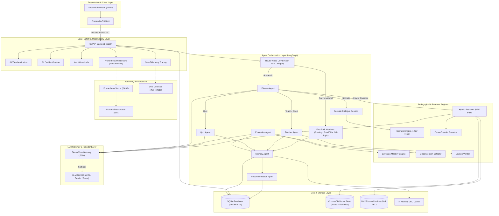
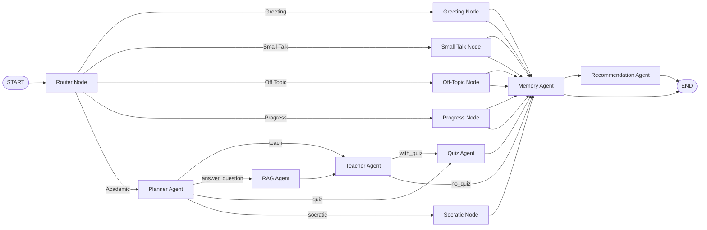
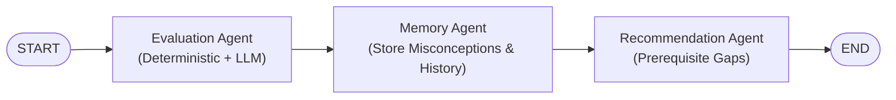

# 🎓 SocraticAI

> **An adaptive AI tutoring platform that turns conversations into personalized learning experiences.**

<p align="center">
  <a href="https://www.python.org/"></a>
  <a href="https://langchain-ai.github.io/langgraph/"></a>
  <a href="https://fastapi.tiangolo.com/"></a>
  <a href="https://streamlit.io/"></a>
  <a href="https://www.trychroma.com/"></a>
  <a href="https://www.sqlite.org/"></a>
  <a href="https://opentelemetry.io/"></a>
  <a href="https://prometheus.io/"></a>
  <a href="LICENSE"></a>
  <a href="docs/audit/GAP_ANALYSIS.md"></a>
</p>

---

## Table of Contents

- [Overview](#overview)
  - [The Problem](#the-problem)
  - [The SocraticAI Solution](#the-socraticai-solution)
  - [Target Audience & Use Cases](#target-audience--use-cases)
- [Key Features](#key-features)
- [System Architecture](#system-architecture)
  - [High-Level Architecture](#high-level-architecture)
  - [Request Lifecycle & LangGraph Workflows](#request-lifecycle--langgraph-workflows)
  - [Architectural Layers](#architectural-layers)
- [Technology Stack](#technology-stack)
- [Detailed Component Documentation](#detailed-component-documentation)
  - [1. Agent Orchestration & LangGraph](#1-agent-orchestration--langgraph)
  - [2. Multi-Tier Memory Architecture](#2-multi-tier-memory-architecture)
  - [3. Advanced RAG & Retrieval Pipeline](#3-advanced-rag--retrieval-pipeline)
  - [4. Intelligent Intent Routing](#4-intelligent-intent-routing)
  - [5. Adaptive Tutoring & Pedagogical Engines](#5-adaptive-tutoring--pedagogical-engines)
  - [6. Guardrails, PII Sanitization & Safety](#6-guardrails-pii-sanitization--safety)
  - [7. LLM Gateway & Fallback Architecture](#7-llm-gateway--fallback-architecture)
  - [8. Observability & Telemetry](#8-observability--telemetry)
  - [9. Evaluation & Benchmarking Infrastructure](#9-evaluation--benchmarking-infrastructure)
- [Project Structure](#project-structure)
- [Installation and Setup](#installation-and-setup)
  - [Prerequisites](#prerequisites)
  - [Local Development Setup](#local-development-setup)
  - [Database Initialization](#database-initialization)
- [Environment Variables](#environment-variables)
- [Running SocraticAI](#running-socraticai)
  - [Running Backend & Frontend Locally](#running-backend--frontend-locally)
  - [Running Full Stack via Docker Compose](#running-full-stack-via-docker-compose)
  - [Service Endpoints & Verification](#service-endpoints--verification)
- [Usage Guide](#usage-guide)
- [Evaluation & Benchmarks](#evaluation--benchmarks)
- [Deployment](#deployment)
- [Security, Privacy & Known Limitations](#security-privacy--known-limitations)
- [Project Roadmap](#project-roadmap)
- [Contributing](#contributing)
- [License & Acknowledgements](#license--acknowledgements)

---

## Overview

### The Problem

Generic Large Language Model (LLM) chatbots and basic "chat with your PDF" tools fail at educational tutoring because:

1. **They give away answers immediately** instead of fostering critical thinking through structured, progressive problem decomposition.
2. **They lack pedagogical state**, possessing no persistent mental model of the student's mastery level, learning velocity, or recurring misconceptions across sessions.
3. **They treat retrieval as a passive search**, frequently retrieving tangential passages without verifying factual grounding, ownership, or semantic relevance.
4. **They evaluate answers fuzzily**, relying on non-deterministic LLM grading for exact numerical calculations or structured multiple-choice problems.
5. **They ignore privacy and boundary safety**, sending raw student personally identifiable information (PII) to external LLM providers and allowing adversarial prompt injections via untrusted study materials.

### The SocraticAI Solution

**SocraticAI** is an AI-powered personalized tutoring platform engineered around specialized, decoupled agents orchestrated via **LangGraph**. It combines:

- **Socratic Dialogue & Guided Questioning:** Breaks complex problems down into step-by-step sub-questions with a 4-tier monotonic hint escalation hierarchy (Conceptual Direction → Key Principle → Partial Solution → Complete Walkthrough).
- **Persistent Student Modeling:** Tracks student concept mastery via a Bayesian-smoothed Exponential Moving Average (EMA) and detects recurring conceptual misunderstandings across turns.
- **Advanced Hybrid RAG:** Combines dense semantic vector retrieval (ChromaDB) with lexical keyword matching (BM25) using Reciprocal Rank Fusion (RRF), optional cross-encoder reranking, and regex-backed citation verification against student-uploaded documents.
- **Deterministic & Rubric Grading:** Evaluates objective questions (MCQ, True/False, numerical with absolute/relative tolerances) via zero-shot code execution while grading subjective explanations via structured multi-dimensional rubrics.
- **Defense-in-Depth Safety:** De-identifies PII using a bidirectional placeholder mapping context before external model calls and monitors input, retrieval, execution, and output boundaries.

### Target Audience & Use Cases

- **Self-Directed Learners:** Mastering STEM concepts (Calculus, Machine Learning, Thermodynamics) with interactive Socratic feedback rather than passive reading.
- **Students Grounded in Course Material:** Uploading lecture notes, syllabus guides, or textbook chapters (PDF, TXT, MD) and receiving explanations grounded in their specific class curriculum.
- **Educators & Researchers:** Deploying and benchmarking agentic tutoring behaviors, adaptive assessment algorithms, and retrieval strategies within a modular Python codebase.

---

## Key Features

Each capability is labeled with its current implementation status verified against the source code:
`[Implemented]`, `[Partially Implemented]`, or `[Planned]`.

| Category | Capability | Status | Description |
|---|---|:---:|---|
| **Adaptive Tutoring** | Socratic Dialogue Engine | `[Implemented]` | Multi-step problem decomposition state machine with step-level validation and response tracking. |
| | Progressive Hint Escalation | `[Implemented]` | 4-tier monotonic hint hierarchy providing scaffolding without prematurely revealing complete answers. |
| | Bayesian Mastery Tracking | `[Implemented]` | Asymptotically bounded EMA confidence modeling ($C(n) = 1.0 - e^{-0.45n}$) over concept knowledge. |
| | Evidence-Based Misconceptions | `[Implemented]` | Hybrid detection using pattern matching and LLM verification for subject-matter misunderstandings. |
| | Prerequisite Graph Recommendations | `[Implemented]` | 5-tier ranked recommendation engine grounded in a 15-edge relational prerequisite curriculum graph. |
| **Orchestration & Routing** | LangGraph Tutoring Workflow | `[Implemented]` | Dynamic state machine routing turns through router, fast paths, planner, RAG, teacher, quiz, memory, and recommendation. |
| | Fast-Path Intent Interception | `[Implemented]` | Low-latency handling for greetings, small talk, progress inquiries, and off-topic detours bypassing heavy LLM chains. |
| | Jev System One Intent Routing | `[Implemented]` | TypeSafe AI intent classification with deterministic regex fallback across a 10-intent taxonomy. |
| **Retrieval & Grounding** | Section-Aware Chunking | `[Implemented]` | Markdown heading and document page-aware chunking with token sliding windows (600 tokens, 100 overlap). |
| | Hybrid Search (Dense + BM25) | `[Implemented]` | Reciprocal Rank Fusion (RRF, $k=60$) combining ChromaDB dense vectors and per-student BM25 indices. |
| | Cross-Encoder Reranking | `[Implemented]` | Optional lazy-loaded cross-encoder (`ms-marco-MiniLM-L-6-v2`) reranking hybrid candidate pools. |
| | Citation Verification | `[Implemented]` | Regex-based source extraction verifying document ownership, page matching, and token-overlap support. |
| **Memory & Context** | Multi-Tier Context Assembly | `[Implemented]` | `ContextBuilder` budgeting tokens across system prompt, working history, episodic memory, student profile, and RAG chunks. |
| | Episodic Vector Memory | `[Implemented]` | ChromaDB-backed episodic recall of past learning milestones and interactions. |
| | In-Memory LRU Cache | `[Implemented]` | Multi-tier LRU cache for embeddings (24h TTL) and retrieval queries (30m TTL). |
| **Security & Safety** | PII De-Identification & Restoration | `[Implemented]` | Regex-based sanitization replacing names, emails, phones, IDs, and cards with placeholders, restored on output. |
| | Multi-Boundary Safety Rails | `[Implemented]` | Python regex guardrails checking user inputs, retrieved context, tool executions, and model outputs. |
| | NeMo Colang Flow Execution | `[Partially Implemented]` | Configuration stubs present (`rails.co`); validation currently executed by internal Python rails. |
| **Observability & Infra** | OpenTelemetry Distributed Tracing | `[Implemented]` | W3C traceparent context propagation, FastAPI middleware, HTTPX instrumentation, and span attribute redaction. |
| | Prometheus Metrics Exposition | `[Implemented]` | `/metrics` endpoint exposing HTTP request counts, durations, active requests, and custom RAG/tutoring counters. |
| | TensorZero LLM Gateway | `[Implemented]` | Optional gateway proxy client with automated fallback to `DemoLLMClient` or direct providers. |
| | Offline Demo Mode | `[Implemented]` | `DemoLLMProvider` enabling full offline execution and automated test passes without external API keys. |
| **Frontend** | Streamlit Tutoring UI | `[Partially Implemented]` | Multi-page prototype (Chat, Quiz, Dashboard, Documents); requires auth token attachment for backend communication. |
| **Future Enhancements** | Computerized Adaptive Testing (CAT) | `[Planned]` | Dynamic Item Response Theory (IRT) question generation adapting difficulty within a single quiz. |
| | Streaming LLM Token Output | `[Planned]` | Server-Sent Events (SSE) or WebSockets for real-time token streaming to frontend clients. |

---

## System Architecture

### High-Level Architecture



### Request Lifecycle & LangGraph Workflows

SocraticAI executes two compiled LangGraph state machines:

#### 1. Tutoring Turn Workflow (`build_tutoring_graph`)



#### 2. Quiz Evaluation Workflow (`build_evaluation_graph`)



### Architectural Layers

1. **Client / Presentation Layer:** Streamlit multi-page frontend interacting with the backend via `apps/frontend/services/api_client.py` using REST HTTP endpoints.
2. **Gateway, Safety & Observability Layer:** FastAPI handles JWT authentication, custom metrics middleware, PII de-identification/restoration boundaries, and OpenTelemetry request spans.
3. **Orchestration Layer:** LangGraph coordinates stateful, multi-agent reasoning graphs with centralized state (`SocraticAIState`).
4. **Pedagogical & Retrieval Engines:** Domain engines encapsulating Socratic dialogue progression, objective/rubric assessment grading, Bayesian mastery calculations, and reciprocal rank fusion retrieval.
5. **LLM Gateway & Provider Layer:** Uniform inference abstraction with primary routing via TensorZero gateway and direct fallbacks to OpenAI, Google Gemini, or local `DemoLLMProvider`.
6. **Persistence Layer:** Relational data stored in SQLite via SQLAlchemy 2.0; embeddings and dense notes stored in ChromaDB; lexical indices stored in per-student BM25 files.

---

## Technology Stack

| Category | Technology | Version | Purpose in SocraticAI |
|---|---|---|---|
| **Language** | Python | `>=3.11, <3.13` | Core runtime platform for all services, agents, and pipelines. |
| **Backend Framework** | FastAPI | `>=0.115, <1.0` | Asynchronous REST API routing, dependency injection, and middleware. |
| **ASGI Server** | Uvicorn | `>=0.30, <1.0` | Production ASGI web server running FastAPI. |
| **Agent Framework** | LangGraph | `>=0.2.60, <1.0` | StateGraph multi-agent execution, conditional branching, and orchestration. |
| **Agent Foundation** | LangChain Core | `>=0.3, <1.0` | Base prompt templates, message formatting, and LLM interfaces. |
| **Frontend** | Streamlit | `>=1.40, <2.0` | Interactive UI for chat tutoring, quizzes, document uploads, and dashboards. |
| **Data Contracts** | Pydantic / Settings | `>=2.7, <3.0` | Strongly typed domain models, request/response validation, and settings. |
| **Vector Database** | ChromaDB | `>=0.5.20, <2.0` | Dense vector indexing and similarity search for course documents and episodic memories. |
| **Embeddings** | Sentence Transformers | `>=3.0, <5.0` | Local dense embeddings via `all-MiniLM-L6-v2` (384 dimensions). |
| **Lexical Retrieval** | rank-bm25 | `>=0.2.2, <1.0` | Per-student BM25Okapi lexical retrieval indices. |
| **Reranking** | Cross-Encoder | via sentence-transformers | Two-stage candidate reranking via `cross-encoder/ms-marco-MiniLM-L-6-v2`. |
| **Document Parsing** | PyMuPDF (fitz) | `>=1.24, <2.0` | High-speed PDF text extraction, document table of contents, and metadata reading. |
| **Database & ORM** | SQLAlchemy | `>=2.0, <3.0` | Relational database mapping across 18 tables with SQLite persistence. |
| **Database Engine** | SQLite | 3.x | Lightweight relational storage (`data/socraticai.db`). |
| **LLM Gateway** | TensorZero | `latest` (Docker) | Optional LLM gateway proxy for model routing, observability, and fallbacks. |
| **Decision Models** | TypeSafe SDK / Jev | `>=0.7.0, <1.0` | High-speed intent classification and structured decision routing. |
| **Live LLM Providers**| OpenAI / Gemini SDK | `>=0.2 / >=3.2` | Production LLM inference (`gpt-4o-mini`, `gemini-1.5-flash`). |
| **Distributed Tracing**| OpenTelemetry | `>=1.25` | W3C trace context propagation, FastAPI spans, and HTTPX client instrumentation. |
| **Metrics Collection** | Prometheus Client | `>=0.20` | `/metrics` scrape endpoint reporting latency, status codes, and RAG counters. |
| **Metrics & Viz** | Prometheus & Grafana | `latest` (Docker) | Time-series metrics storage and pre-configured operational dashboards. |
| **Code Hygiene** | Ruff | `>=0.5, <1.0` | High-performance Python linter and code formatter. |
| **Testing** | Pytest & pytest-asyncio | `>=8.2 / >=0.23` | Automated unit, integration, RAG, and security evaluation suites. |

---

## Detailed Component Documentation

### 1. Agent Orchestration & LangGraph

The agent workflow is defined as a directed `StateGraph` in `apps/backend/app/graphs/tutoring/workflow.py`:

- **Router Node:** Evaluates incoming user messages using `JevIntentRouter`. Conversational intents (greetings, small talk, off-topic, memory inquiries) take fast paths directly to lightweight handlers. Academic and learning intents route to `PlannerAgent`.
- **PlannerAgent (`planner`):** Analyzes the learning goal, student level, and conversation history to select the appropriate action: `TEACH`, `ANSWER_QUESTION`, `QUIZ`, `SOCRATIC`, or `END`.
- **RAGAgent (`rag`):** Formulates retrieval queries, rewrites multi-part questions, and executes hybrid search over the student's uploaded notes.
- **TeacherAgent (`teacher`):** Generates conceptual explanations, analogies, and examples grounded in retrieved notes.
- **QuizAgent (`quiz`):** Produces multi-format practice questions (MCQ, numerical, subjective) tuned to weak concepts.
- **EvaluationAgent (`evaluation`):** Grades quiz submissions deterministically for objective questions and via rubrics for subjective questions.
- **MemoryAgent (`memory`):** Extracts persistent facts (mastery demonstrations, recurring mistakes, personal goals) and writes them to SQLite and episodic stores.
- **RecommendationAgent (`recommendation`):** Identifies learning gaps and recommends next study steps based on prerequisite graph analysis.

### 2. Multi-Tier Memory Architecture

SocraticAI separates memory into four discrete layers:

```text
┌─────────────────────────────────────────────────────────────────┐
│                    Working Conversation Context                 │
│         (Sliding window of last 10 messages, ~1,500 tokens)      │
└────────────────────────────────┬────────────────────────────────┘
                                 │ Periodic Session Consolidation
                                 ▼
┌─────────────────────────────────────────────────────────────────┐
│                   Episodic Memory (ChromaDB)                    │
│   (Vector embeddings of past session summaries & milestones)    │
└─────────────────────────────────────────────────────────────────┘
                                 ▲
                                 │ Key-Fact Extraction
┌────────────────────────────────┴────────────────────────────────┐
│               Semantic Student Profile (SQLite)                 │
│      (Topics learned, weak concepts, Bayesian mastery scores)   │
└─────────────────────────────────────────────────────────────────┘
```

- **Working Context:** Enforces strict token limits via `ContextBuilder` (`apps/backend/app/context/builder.py`), ensuring that system prompts, conversation history, episodic context, student profiles, and retrieved document chunks never exceed model context windows.
- **Episodic Memory:** Stored in ChromaDB under `socraticai_episodic_memory`, enabling semantic similarity search over historical conversations.
- **Semantic Student Profile:** Stored in relational tables (`students`, `student_topics`, `concept_mastery`, `memory_entries`), tracking long-term learner traits.

### 3. Advanced RAG & Retrieval Pipeline

The RAG pipeline (`apps/backend/app/rag/`) implements a state-of-the-art hybrid search architecture:

1. **Ingestion & Parsing:** PyMuPDF (`fitz`) parses uploaded PDF, TXT, and MD files, extracting page-level text, table of contents hierarchy, and document metadata.
2. **Section-Aware Chunking:** `SectionAwareChunker` divides documents along markdown headings and page boundaries into overlapping token windows (default: 600 tokens, 100 overlap via `cl100k_base`).
3. **Dense Vector Indexing:** Chunks are embedded via Sentence Transformers (`all-MiniLM-L6-v2`) and stored in ChromaDB with metadata filters (`student_id`, `doc_id`, `page`).
4. **Lexical Indexing (BM25):** A disk-persisted `rank-bm25` index provides keyword and exact-term retrieval.
5. **Reciprocal Rank Fusion (RRF):** Merges dense and lexical candidate lists into a unified ranking:
   $$RRF(d) = \sum_{m \in \{\text{dense}, \text{bm25}\}} \frac{1}{60 + r_m(d)}$$
6. **Cross-Encoder Reranking:** An optional cross-encoder (`cross-encoder/ms-marco-MiniLM-L-6-v2`) evaluates question-chunk relevance over the top fused candidates.
7. **Citation Verification:** `CitationVerifier` scans teacher responses for bracketed source citations (`[Source: filename, p.X]`), confirming student ownership, page validity, and token overlap with retrieved passages.

### 4. Intelligent Intent Routing

Implemented in `apps/backend/app/routing/jev_router.py`:

- **Pre-Validation:** Drops empty inputs and flags pure whitespace or excessive symbol repetitions.
- **Primary Classifier (Jev System One):** Uses TypeSafe AI's high-speed decision models to categorize inputs into a 10-intent taxonomy:
  `learn`, `answer_question`, `practice`, `socratic_dialogue`, `learning_progress`, `memory_query`, `greeting`, `small_talk`, `off_topic`, and `unclear`.
- **Deterministic Regex Fallback:** If Jev is disabled, unreachable, or returns confidence below threshold ($< 0.40$), a rule-based regex and keyword classifier executes deterministically.
- **Shadow Mode:** Supports asynchronous parallel execution of Gemini Decisions against Jev to benchmark agreement metrics without adding request latency.

### 5. Adaptive Tutoring & Pedagogical Engines

Located in `apps/backend/app/tutoring/`:

- **Socratic Engine (`socratic_engine.py`):** Drives multi-step guided problem-solving via persistent session records in `socratic_dialogue_sessions`. Evaluates student progress at each step.
- **Monotonic Hint Progression:** Delivers progressive assistance across 4 tiers:
  1. *Level 1 — Conceptual Direction:* Clarifies problem scope and asks targeted questions.
  2. *Level 2 — Key Principle / Formula:* Names the underlying theorem, equation, or rule.
  3. *Level 3 — Intermediate Step / Partial Solution:* Solves the first part and prompts the student for the remainder.
  4. *Level 4 — Complete Solution Walkthrough:* Explains the complete solution and flags the session as stuck.
- **Bayesian Mastery Estimation (`mastery.py`):** Calculates concept-level mastery using an Exponential Moving Average weighted by an asymptotic exponential confidence factor:
  $$\text{new\_score} = (1 - w) \cdot \text{current} + w \cdot \text{evidence}, \quad w = \min(1.0, \max(0.1, \alpha \cdot C(n)))$$
  $$C(n) = 1.0 - e^{-0.45n}$$
  This prevents single-attempt mastery exploitation while ensuring smooth, evidence-based progression.
- **Deterministic & Rubric Grading (`adaptive_quiz.py`):** Objective questions (MCQ, True/False, numerical) are evaluated deterministically using regular expressions and floating-point tolerances. Subjective answers are scored against structured rubrics (40% conceptual clarity, 30% reasoning, 30% completeness).
- **Prerequisite Curriculum Graph (`recommendation.py`):** Inspects 15 curriculum edges across Machine Learning, Calculus, and Thermodynamics, categorizing recommendations into: missing prerequisites, revision needs, active practice, unlocked frontiers, and curriculum gaps.

### 6. Guardrails, PII Sanitization & Safety

Located in `apps/backend/app/guardrails/`:

- **PII De-Identification (`pii.py`):** Replaces sensitive entities with cryptographic placeholder tokens (`[PERSON_1]`, `[EMAIL_1]`, `[PHONE_1]`, `[GOVERNMENT_ID_1]`) before any external model call.
- **Controlled Safe Restoration:** Restores original student values in the final API response while escaping raw HTML entities to prevent Cross-Site Scripting (XSS).
- **Multi-Layer Safety Rails (`rails.py`):**
  - *Input Rails:* Detects prompt injections, jailbreaks (`DAN`, `developer mode`), and adversarial overrides.
  - *Retrieval Rails:* Blocks malicious injection payloads embedded in retrieved study materials.
  - *Execution Rails:* Restricts allowed tool invocation names and blocks shell/SQL injection sequences.
  - *Output Rails:* Verifies responses against leaked system prompts, connection strings, and prohibited topics.
- **NeMo Guardrails Integration (`nemo.py`):** Initializes NeMo `LLMRails` from `configs/guardrails/` and executes policy checks.

### 7. LLM Gateway & Fallback Architecture

Located in `apps/backend/app/llm/clients/`:

- **TensorZero Gateway (`tensorzero_client.py`):** Proxy client interfacing with an external TensorZero gateway container (`configs/tensorzero/tensorzero.toml`). Handles model routing, retry policies, and inference metrics.
- **Direct Providers (`client.py`):** Native SDK integration with OpenAI (`gpt-4o-mini`) and Google Gemini (`gemini-1.5-flash`).
- **Offline Demo Provider (`demo.py`):** Standalone rule-based tutor providing deterministic responses for offline testing, local development, and continuous integration without API keys.

### 8. Observability & Telemetry

Located in `apps/backend/app/telemetry/`:

- **Distributed Tracing (`tracing.py`):** Automatically instruments FastAPI request lifecycles and HTTPX client calls using OpenTelemetry. Propagates W3C `traceparent` headers to external gateways and redacts sensitive span attributes.
- **Prometheus Metrics (`metrics.py`):** Exposes Prometheus metrics via `/metrics`:
  - `socraticai_http_requests_total`: Total HTTP requests partitioned by method, endpoint, and status.
  - `socraticai_http_request_duration_seconds`: Histogram of request latencies.
  - `socraticai_http_requests_in_progress`: Gauge tracking concurrent requests.
  - `socraticai_rag_retrieval_duration_seconds`: Latency histograms for vector, BM25, and hybrid search.
  - `socraticai_rag_reranking_latency_seconds`: Cross-encoder reranking latency.
  - `socraticai_guardrails_duration_seconds`: Safety check latency.
  - `socraticai_pii_redacted_entities_total`: Counter tracking sanitized PII items.
- **Grafana Dashboards:** Pre-provisioned dashboards in `configs/grafana/` tracking system health, request throughput, and LLM latency.

### 9. Evaluation & Benchmarking Infrastructure

Located in `packages/evaluation/`:

- **Security Evaluation (`security_eval.py`):** Evaluates prompt-injection resilience and PII de-identification against adversarial test cases (`apps/backend/tests/fixtures/security_adversarial_dataset.json`).
- **Ragas Retrieval Evaluation (`ragas_eval.py`):** Scores retrieval context relevance, factual faithfulness, and answer relevance.
- **Performance & Latency Benchmarks (`benchmark_milestone_4.py`):** Profiles CPU overhead, memory consumption, and execution duration across every pipeline stage.

---

## Project Structure

```text
SocraticAI/
├── apps/
│   ├── backend/                      # FastAPI Application Root
│   │   ├── app/
│   │   │   ├── api/v1/               # Versioned REST API Routes
│   │   │   │   ├── routes/           # Auth, Chat, Quizzes, Socratic, Docs, Analytics
│   │   │   │   └── router.py         # Route aggregation
│   │   │   ├── core/                 # Config (Pydantic Settings), Security, Dependencies
│   │   │   ├── agents/               # Planner, Teacher, Quiz, Eval, Memory, Recommendation
│   │   │   ├── graphs/               # LangGraph StateGraph Workflows & Node Handlers
│   │   │   ├── rag/                  # Ingestion, Chunking, Embeddings, BM25, Hybrid, Citations
│   │   │   ├── tutoring/             # Socratic Engine, Mastery, Misconceptions, Adaptive Quiz
│   │   │   ├── memory/               # ContextBuilder, Semantic Store, Episodic Memory
│   │   │   ├── guardrails/           # PII Sanitizer, Input/Retrieval/Execution/Output Rails
│   │   │   ├── telemetry/            # OpenTelemetry Tracing & Prometheus Metrics
│   │   │   ├── llm/                  # Providers (OpenAI, Gemini, Demo), TensorZero Client
│   │   │   ├── repositories/         # Database Access Layer (7 SQLAlchemy Repositories)
│   │   │   ├── models/               # SQLAlchemy ORM Models (18 tables)
│   │   │   ├── schemas/              # Pydantic v2 Domain Models & Enums
│   │   │   ├── database/             # Engine Connection Management & DDL
│   │   │   └── services/             # Container Dependency Injection
│   │   ├── tests/                    # 275+ Unit & Integration Pytest Suite
│   │   └── Dockerfile                # Backend Container Specification
│   │
│   └── frontend/                     # Streamlit Application
│       ├── app.py                    # Multi-page App Entrypoint
│       ├── pages/                    # Chat, Quiz, Dashboard, Document Upload Pages
│       ├── components/               # Sidebar & Navigation Widgets
│       ├── services/                 # Frontend HTTP API Client
│       └── Dockerfile                # Frontend Container Specification
│
├── configs/                          # Externalized System Configurations
│   ├── agents/                       # Agent hyperparameters (agents.yaml)
│   ├── guardrails/                   # NeMo Colang flows (rails.co, actions.py, prompts.yml)
│   ├── tensorzero/                   # TensorZero gateway config (tensorzero.toml)
│   ├── prometheus/                   # Prometheus scrape config & alert rules
│   ├── grafana/                      # Grafana datasource & dashboard provisioning
│   └── otel/                         # OpenTelemetry Collector configuration
│
├── data/                             # Persistent Storage (gitignored contents)
│   ├── chroma/                       # ChromaDB persistent collections
│   ├── bm25_indices/                 # Serialized BM25 lexical index files
│   ├── uploads/                      # Raw student document uploads (PDF/TXT/MD)
│   └── socraticai.db                 # SQLite relational database
│
├── docs/                             # Project Audit Documentation
│   └── audit/                        # Codebase gap analysis & architecture review
│       └── GAP_ANALYSIS.md           # Comprehensive codebase audit across 9 subsystems
│
├── packages/                         # Reusable Evaluation & Research Packages
│   └── evaluation/                   # Latency, Security & Ragas Benchmark Scripts
│
├── scripts/                          # Operational & Automation Scripts
│   ├── migration/                    # Database table creation (init_db.py)
│   └── development/                  # E2E verification (e2e_verify.py)
│
├── .env.example                      # Documented template environment configuration
├── pyproject.toml                    # Package specifications & build configuration
├── Makefile                          # Development, testing, and lifecycle targets
└── docker-compose.yml                # Multi-service stack (Backend, Frontend, Prometheus, etc.)
```

---

## Installation and Setup

### Prerequisites

- **Python:** Version `3.11` or `3.12` installed.
- **Package Manager:** [uv](https://docs.astral.sh/uv/) (strongly recommended) or standard `pip`.
- **Git:** Installed and available on your PATH.
- **Docker & Docker Compose:** (Optional) Required for running the full containerized observability stack.

### Local Development Setup

1. **Clone the repository:**
   ```bash
   git clone https://github.com/your-username/SocraticAI.git
   cd SocraticAI
   ```

2. **Create and activate a virtual environment:**
   ```bash
   # Using uv (fastest)
   uv venv
   # On Linux/macOS:
   source .venv/bin/activate
   # On Windows (PowerShell):
   .venv\Scripts\Activate.ps1

   # Or using standard python:
   python -m venv .venv
   source .venv/bin/activate  # or .venv\Scripts\activate
   ```

3. **Install dependencies:**
   ```bash
   # Using uv:
   uv pip install -r requirements-dev.txt

   # Or using pip:
   pip install -r requirements-dev.txt
   ```

4. **Configure your environment variables:**
   ```bash
   cp .env.example .env
   ```
   *By default, the application runs out-of-the-box in offline demo mode (`LLM_PROVIDER=demo`) without requiring any paid API keys.*

### Database Initialization

Create the SQLite database schema and tables before starting the backend:

```bash
# Using Makefile
make init-db

# Or directly with Python
python scripts/migration/init_db.py
```

This creates `data/socraticai.db` with all 18 relational tables.

---

## Environment Variables

Key application settings managed via Pydantic Settings in `apps/backend/app/core/config.py`:

| Variable | Description | Required | Default |
|---|---|:---:|---|
| `APP_NAME` | Name of the application | No | `SocraticAI` |
| `APP_ENVIRONMENT` | Environment stage (`development`, `production`, `test`) | No | `development` |
| `APP_HOST` | Host interface to bind server | No | `0.0.0.0` |
| `APP_PORT` | Port for the backend API | No | `8000` |
| `APP_DEBUG` | Enable debug mode and verbose tracebacks | No | `true` |
| `APP_ALLOWED_ORIGINS` | Comma-separated CORS allowed origins | No | `http://localhost:8501,http://localhost:8000` |
| `LLM_PROVIDER` | LLM client backend (`demo`, `openai`, `gemini`) | No | `demo` |
| `LLM_OPENAI_API_KEY` | OpenAI API key | If `openai` | `""` |
| `LLM_OPENAI_MODEL` | OpenAI model identifier | No | `gpt-4o-mini` |
| `LLM_GEMINI_API_KEY` | Google Gemini API key | If `gemini` | `""` |
| `LLM_GEMINI_MODEL` | Google Gemini model identifier | No | `gemini-1.5-flash` |
| `DATABASE_URL` | SQLAlchemy connection string | No | `sqlite:///./data/socraticai.db` |
| `DATABASE_CREATE_ON_STARTUP` | Auto-create tables during app lifespan startup | No | `true` |
| `VECTOR_PERSIST_DIRECTORY` | Disk path for ChromaDB storage | No | `./data/chroma` |
| `VECTOR_COLLECTION_NAME` | ChromaDB collection for course notes | No | `socraticai_notes` |
| `VECTOR_EMBEDDING_MODEL` | HuggingFace embedding model name | No | `all-MiniLM-L6-v2` |
| `AUTH_SECRET_KEY` | Secret key for signing JWT tokens | Yes in Prod | `socraticai-dev-insecure-secret-key-32b-min!!` |
| `AUTH_ACCESS_TOKEN_EXPIRE_MINUTES` | Lifetime of issued JWT access tokens | No | `1440` (24h) |
| `BM25_ENABLED` | Enable lexical BM25 retrieval | No | `true` |
| `HYBRID_ENABLED` | Enable Reciprocal Rank Fusion hybrid search | No | `true` |
| `RERANKER_ENABLED` | Enable cross-encoder reranking | No | `false` |
| `PII_ENABLED` | Enable PII detection and de-identification | No | `true` |
| `GUARDRAILS_ENABLED` | Enable input/output safety guardrails | No | `true` |
| `TENSORZERO_ENABLED` | Route inference through TensorZero gateway | No | `false` |
| `TENSORZERO_GATEWAY_URL` | Base URL of the TensorZero gateway | If enabled | `http://localhost:3000` |
| `OTEL_ENABLED` | Enable OpenTelemetry distributed tracing | No | `true` |
| `METRICS_ENABLED` | Enable Prometheus metrics exposition | No | `true` |

*See [apps/backend/app/core/config.py](apps/backend/app/core/config.py) for the complete catalog of application settings.*

---

## Running SocraticAI

### Running Backend & Frontend Locally

In two separate terminals:

```bash
# Terminal 1: Run FastAPI Backend (hot-reload enabled)
make run-backend
# Runs at: http://localhost:8000
# OpenAPI Docs: http://localhost:8000/docs
# Prometheus Metrics: http://localhost:8000/metrics

# Terminal 2: Run Streamlit Frontend
make run-frontend
# Runs at: http://localhost:8501
```

### Running Full Stack via Docker Compose

To start the complete production stack including the TensorZero gateway, Prometheus, Grafana, and the OpenTelemetry Collector:

```bash
docker compose up --build -d
```

To stop all services:
```bash
docker compose down
```

### Service Endpoints & Verification

| Service | Local URL | Health / Docs Endpoint | Default Credentials |
|---|---|---|---|
| **FastAPI Backend** | `http://localhost:8000` | `http://localhost:8000/health` (Root) <br> `http://localhost:8000/docs` (Swagger) | None (Bearer JWT for API) |
| **Streamlit Frontend** | `http://localhost:8501` | Browser UI | None |
| **Prometheus** | `http://localhost:9090` | `http://localhost:9090/-/healthy` | None |
| **Grafana Dashboards** | `http://localhost:3001` | Browser UI | `admin` / `admin` |
| **TensorZero Gateway** | `http://localhost:3000` | `http://localhost:3000/health` | None |
| **OTel Collector** | `http://localhost:4317` (gRPC) <br> `http://localhost:4318` (HTTP) | `http://localhost:8889/metrics` | None |

---

## Usage Guide

### 1. Conceptual Learning Session
1. Send a request to `/api/v1/chat` specifying topic, level (`beginner`, `intermediate`, `advanced`), and query.
2. The router identifies intent as `learn`.
3. `PlannerAgent` selects the `TEACH` route.
4. `TeacherAgent` returns an analogy-driven explanation tailored to the requested mastery depth.

### 2. Socratic Dialogue & Guided Questioning
1. Initiate a session via `POST /api/v1/socratic/start`:
   ```json
   {
     "concept": "Gradient Descent",
     "problem_statement": "Why does gradient descent oscillate when learning rates are set too high?"
   }
   ```
2. The engine formulates Step 1: *"What mathematical property does the learning rate scale during weight updates?"*
3. The student submits their reasoning via `POST /api/v1/socratic/respond`.
4. If stuck, the student requests assistance via `POST /api/v1/socratic/hint`, receiving Level 1 assistance without answer exposure.

### 3. Document-Grounded Questions (RAG)
1. Upload a PDF syllabus or lecture note to `POST /api/v1/documents/{student_id}`.
2. The backend extracts text, produces section-aware chunks, generates embeddings, and updates BM25.
3. In subsequent chat turns, questions are matched against notes using hybrid search.
4. Explanations return verifiable bracketed citations: `[Source: lecture3.pdf, p.14]`.

### 4. Practice Quizzes & Automated Evaluation
1. Request a quiz via `POST /api/v1/chat` with `generate_quiz=true`.
2. `QuizAgent` generates a balanced assessment (MCQ, numerical, subjective).
3. The student submits answers to `POST /api/v1/chat/submit-quiz`.
4. `EvaluationAgent` deterministically grades objective items and evaluates subjective responses against rubrics, updating the student's Bayesian mastery score and recording misconceptions.

---

## Evaluation & Benchmarks

SocraticAI features a dedicated testing and benchmarking infrastructure in `apps/backend/tests/` and `packages/evaluation/`:

### 1. Executing Automated Test Suites

```bash
# Run the complete test suite (275+ tests)
make test
# Or: uv run pytest

# Run unit tests only
make test-unit

# Run integration tests only
make test-integration

# Run tests with statement coverage reporting
make test-cov
```

### 2. Security & Guardrail Adversarial Benchmarking

Evaluates prompt injection defense and PII de-identification against adversarial prompts:

```bash
python -c "from app.evaluation.security_eval import SecurityEvaluator; e = SecurityEvaluator(); print(e.evaluate_dataset('apps/backend/tests/fixtures/security_adversarial_dataset.json'))"
```

### 3. Subsystem Latency & Memory Profiling

Measures latency across PII redaction, intent routing, hybrid retrieval, and graph compilation:

```bash
python packages/evaluation/benchmark_milestone_4.py
```

*Reports are persisted to `packages/evaluation/results/`.*

---

## Deployment

### Local Development vs. Production Considerations

| Concern | Local Development | Production Recommendations |
|---|---|---|
| **Database** | File-based SQLite (`data/socraticai.db`) | PostgreSQL with connection pooling (PgBouncer) |
| **Vector Database** | Local ChromaDB embedded directory | Distributed ChromaDB or Qdrant cluster |
| **Caching** | Local `InMemoryLRUCache` | Distributed Redis instance |
| **LLM Inference** | `DemoLLMProvider` or direct API keys | TensorZero Gateway with multi-model fallback |
| **Authentication** | Default development secret key | Secure 256-bit secret loaded via secret manager |
| **Static Assets** | Local filesystem | S3-compatible object storage (MinIO / AWS S3) |

---

## Security, Privacy & Known Limitations

For full transparency, the technical audit in [docs/audit/GAP_ANALYSIS.md](docs/audit/GAP_ANALYSIS.md) documented key areas currently undergoing hardening:

- **PII Detection Scope:** Current de-identification relies on deterministic regular expressions. Highly effective for emails, phone numbers, and Western name patterns; non-Latin script entities and context-free single names may not be detected without an active NER model (e.g., Presidio).
- **NeMo Guardrails Execution:** Colang policies are configured in `configs/guardrails/`, but runtime safety is actively enforced by Python-based input, execution, and output regex filters.
- **Tenant Isolation in Vector Search:** ChromaDB queries enforce student-level isolation when `student_id` is passed; repository queries are currently being refactored to make tenant filtering mandatory on all read/write paths.
- **Frontend Authentication:** The backend strictly enforces JWT Bearer authentication. The Streamlit prototype UI currently defaults to unauthenticated client requests and is being updated with full login/registration views.
- **Docker Compose Health Check:** The backend health route is mapped to `/health` on the root router; ensure Docker Compose tests `http://localhost:8000/health` rather than `/api/v1/health`.

---

## Project Roadmap

### Completed Milestones
- [x] **Milestone 1: Foundation and Reliability** — JWT authentication, SQLAlchemy repositories, student isolation boundaries, error hierarchy, and initial LangGraph workflows.
- [x] **Milestone 1.5: Conversational Intelligence & Memory** — Layered memory (working, episodic, semantic profile), Jev intent router, context budgeting, and multi-tier LRU caching.
- [x] **Milestone 2: Advanced RAG & Retrieval Intelligence** — Section-aware chunking, BM25 lexical search, Reciprocal Rank Fusion hybrid retrieval, cross-encoder reranking, and citation verification.
- [x] **Milestone 3: Adaptive Tutoring & Learning Intelligence** — Socratic dialogue engine, 4-tier monotonic hint progression, Bayesian mastery modeling, hybrid objective/rubric assessment grading, and prerequisite recommendations.

### In Progress (Milestone 4 Hardening)
- [x] OpenTelemetry tracing with W3C context propagation.
- [x] Prometheus metrics middleware and Grafana operational dashboards.
- [x] TensorZero gateway integration client with fallback handling.
- [x] PII sanitization and multi-boundary regex guardrails.
- [ ] Transitioning NeMo Colang flows from configuration stubs to full event-driven execution.
- [ ] Integrating Presidio / transformer-based multilingual NER for PII detection.
- [ ] Addressing priority items documented in [docs/audit/GAP_ANALYSIS.md](docs/audit/GAP_ANALYSIS.md).

### Future Capabilities
- [ ] True Computerized Adaptive Testing (CAT) with Item Response Theory (IRT).
- [ ] Dynamic LLM-driven Socratic problem decomposition.
- [ ] Real-time token streaming (SSE / WebSockets) to client interfaces.
- [ ] Multi-hop prerequisite DAG traversal with cycle detection.
- [ ] Distributed Redis caching and asynchronous Celery/RabbitMQ ingestion workers.

---

## Contributing

We welcome contributions from engineers, educators, and researchers!

1. **Fork the repository** on GitHub.
2. **Create a feature branch:**
   ```bash
   git checkout -b feature/your-feature-name
   ```
3. **Ensure code quality and style compliance:**
   ```bash
   make lint
   make format
   ```
4. **Run the automated test suite:**
   ```bash
   make test
   ```
5. **Commit your changes and submit a Pull Request** with a detailed explanation of your improvements and test coverage.

---

## License & Acknowledgements

### License

This project is licensed under the **MIT License**. See the [LICENSE](LICENSE) file for complete terms.

### Acknowledgements & Upstream Frameworks

SocraticAI builds upon exceptional open-source ecosystems:
- **[LangGraph & LangChain](https://github.com/langchain-ai/langgraph):** Flexible cyclic graph agent orchestration.
- **[FastAPI](https://fastapi.tiangolo.com/):** High-performance Python web framework.
- **[ChromaDB](https://www.trychroma.com/):** Open-source AI vector database.
- **[Streamlit](https://streamlit.io/):** Rapid interactive data and AI application prototyping.
- **[Sentence Transformers](https://www.sbert.net/):** Dense semantic representation models.
- **[TensorZero](https://github.com/tensorzero/tensorzero):** Open-source LLM gateway and optimization infrastructure.
- **[OpenTelemetry](https://opentelemetry.io/) & [Prometheus](https://prometheus.io/):** Cloud-native observability and metrics collection.
