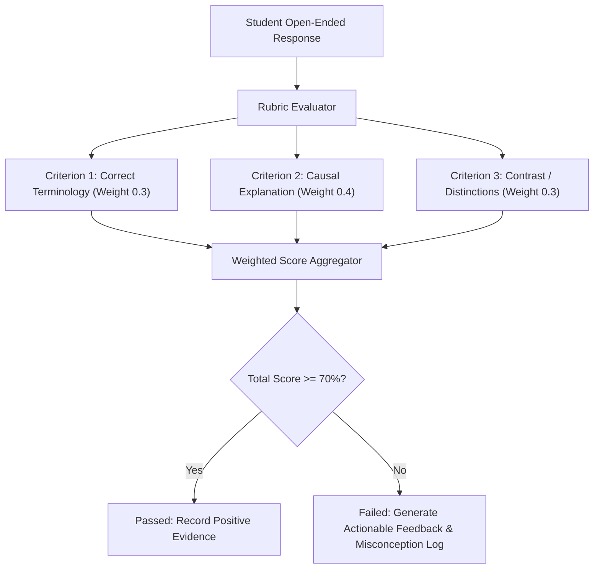
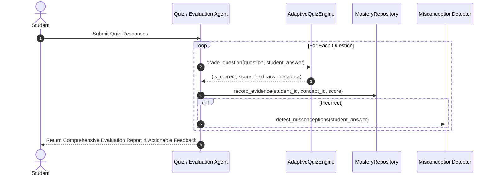

# SocraticAI — Adaptive Assessment & Evaluation Architecture

## Overview

The Adaptive Assessment subsystem transitions SocraticAI from simple multiple-choice evaluations to a multi-modal assessment engine capable of grading objective questions deterministically and subjective responses using structured rubrics.

Assessments serve two purposes:
1. Validating learning comprehension for the student.
2. Generating empirical `LearningEvidence` to update concept mastery states.

---

## 1. Supported Question Modalities

| Question Type | Primary Use Case | Evaluation Mechanism |
| :--- | :--- | :--- |
| `multiple_choice` | Fast diagnostic checks, factual recall | Deterministic exact option or text match. |
| `true_false` | Concept truth verification | Deterministic boolean/literal normalization. |
| `numerical` | Quantitative calculation, STEM derivation | Deterministic absolute and relative tolerance checking. |
| `conceptual` / `application` | Complex reasoning, synthesis, explanation | Multi-criteria rubric evaluation. |

---

## 2. Deterministic Evaluation Engine

The `AdaptiveQuizEngine` handles objective grading without invoking costly, nondeterministic LLMs:

### 2.1 Multiple Choice & True/False
- **Option Normalization**: Strips punctuation, whitespace, and resolves choices by leading option indicator (e.g., `"A"`, `"B."`, `"Option C"`) or option text substring.
- **Boolean Parsing**: Parses `"true"`, `"t"`, `"yes"`, `"1"` vs `"false"`, `"f"`, `"no"`, `"0"`.

### 2.2 Numerical Answers with Tolerances
Numerical questions compare student responses against the expected target value using both absolute and relative tolerances:

$$\text{Error}_{\text{abs}} = |y_{\text{student}} - y_{\text{expected}}|$$
$$\text{Error}_{\text{rel}} = \frac{|y_{\text{student}} - y_{\text{expected}}|}{|y_{\text{expected}}|}$$

A numerical answer is accepted if:
$$\text{Error}_{\text{abs}} \le \text{tol}_{\text{abs}} \quad \text{OR} \quad \text{Error}_{\text{rel}} \le \text{tol}_{\text{rel}}$$

By default, $\text{tol}_{\text{rel}} = 0.01$ (1.0% relative tolerance) and $\text{tol}_{\text{abs}} = 10^{-4}$, accommodating minor rounding differences in student calculations (e.g. $3.14$ vs $3.14159$).

---

## 3. Rubric-Based Subjective Grading

For open-ended conceptual explanations and derivation steps, `SubjectiveRubric` decomposes grading across weighted criteria:

### Rubric Schema:
- `criteria`: List of target criteria, each with `name`, `weight`, and `description`.
- `key_points`: Must-have concepts or vocabulary.
- `common_mistakes`: Known false arguments or confusions to penalize.

---

## 4. End-to-End Evaluation Workflow

