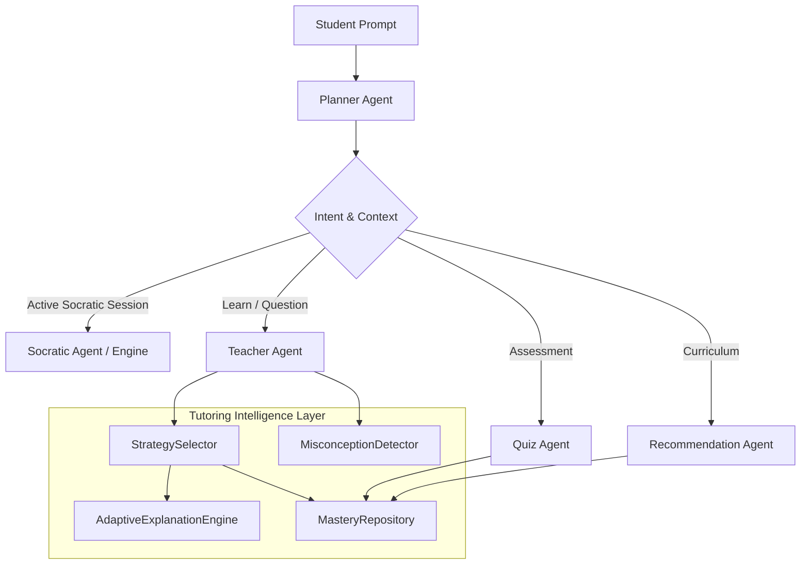
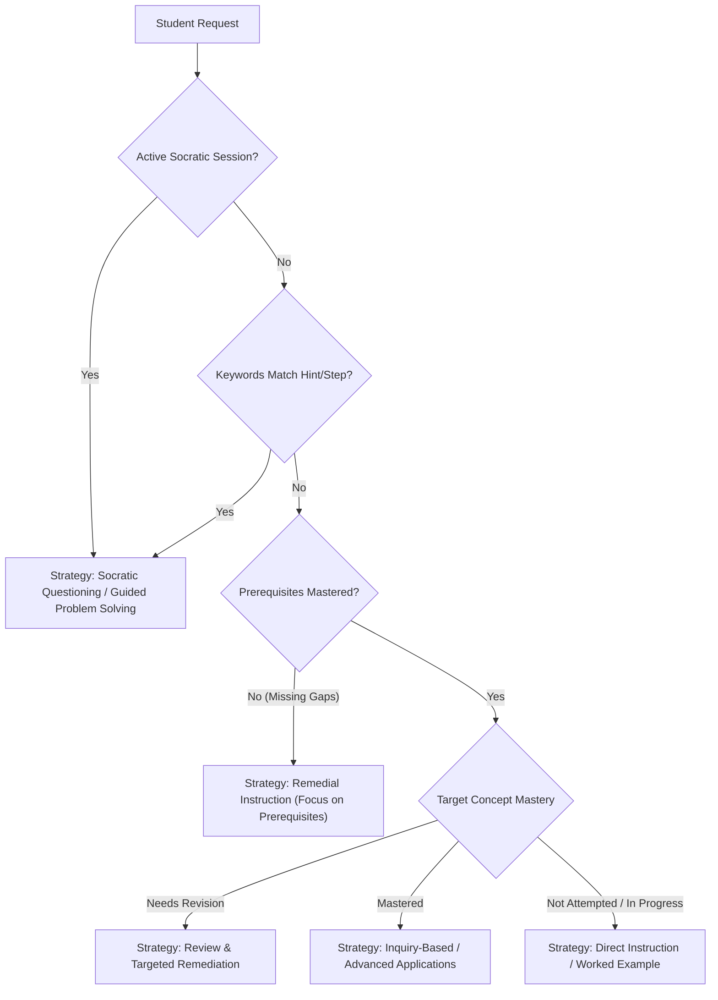
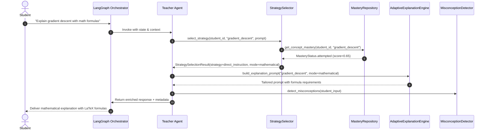

# SocraticAI — Adaptive Tutoring Architecture

## Overview

The Adaptive Tutoring subsystem in SocraticAI is designed to personalize learning interactions dynamically based on student mastery, prerequisite readiness, interaction intent, and historical misconceptions.

Rather than delivering monolithic lectures or generic responses, the tutoring system adapts across two primary dimensions:
1. **Pedagogical Strategy Selection**: Direct instruction, Socratic questioning, guided problem-solving, worked examples, inquiry-based exploration, remedial instruction, or review.
2. **Pedagogical Explanation Modes**: Depth, analogies, concrete examples, and mathematical formalisms tailored to the student's mastery and preferences (`beginner`, `intermediate`, `advanced`, `mathematical`, `intuitive`, `exam_oriented`).

---

## 1. Architecture and Component Interactions

---

## 2. Strategy Selection Logic

The `StrategySelector` combines deterministic heuristics, student mastery state, and prerequisite graphs:

### Decision Rules:
1. **Active Socratic Session**: If the student is in an ongoing multi-turn problem-solving session, the strategy defaults to `socratic_questioning` or `guided_problem_solving`.
2. **Missing Prerequisites**: If the concept has unsatisfied prerequisites (mastery status $\ne$ `mastered`), `remedial_instruction` is chosen with high priority to close foundational gaps.
3. **Low Mastery / Revision Needed**: If the student has repeated failures ($\text{score} < 0.60$), the strategy pivots to `remedial_instruction` or `worked_example` before further testing.
4. **Mastered Concepts**: When students explore concepts they have already mastered, explanations shift to `inquiry_based` or `advanced` depth to encourage synthesis.

---

## 3. Explanation Mode Adaptation

The `AdaptiveExplanationEngine` modulates 4 pedagogical levers:
- **Depth**: High-level conceptual overview vs rigorous mechanical derivation.
- **Analogies**: Real-world intuitive metaphors for beginners.
- **Concrete Examples**: Code, arithmetic illustrations, and case studies.
- **Mathematical Formalism**: Explicit equations, loss functions, and derivations.

| Mode | Target Audience | Key Characteristics |
| :--- | :--- | :--- |
| `beginner` | New learners, low mastery | Intuitive metaphors, step-by-step breakdown, no complex math. |
| `intermediate` | Progressing learners | Balanced theory and practice, concrete examples. |
| `advanced` | Mastered learners | Deep architectural nuances, performance tradeoffs, edge cases. |
| `mathematical` | STEM/Technical focus | Formal notation, derivations, proofs, loss functions. |
| `intuitive` | Conceptual focus | Visualizations, mental models, everyday analogies. |
| `exam_oriented` | Revision / Test prep | Bulleted key points, definitions, common pitfalls, formula summaries. |

---

## 4. End-to-End Tutoring Turn Sequence

