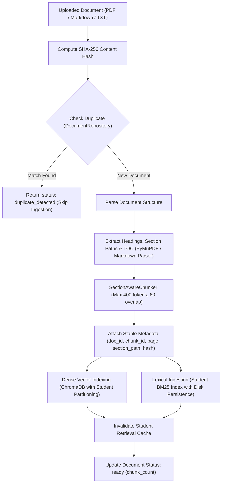
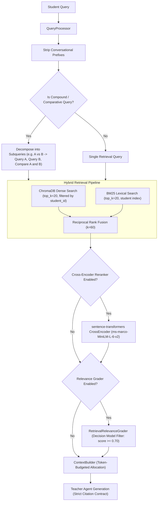
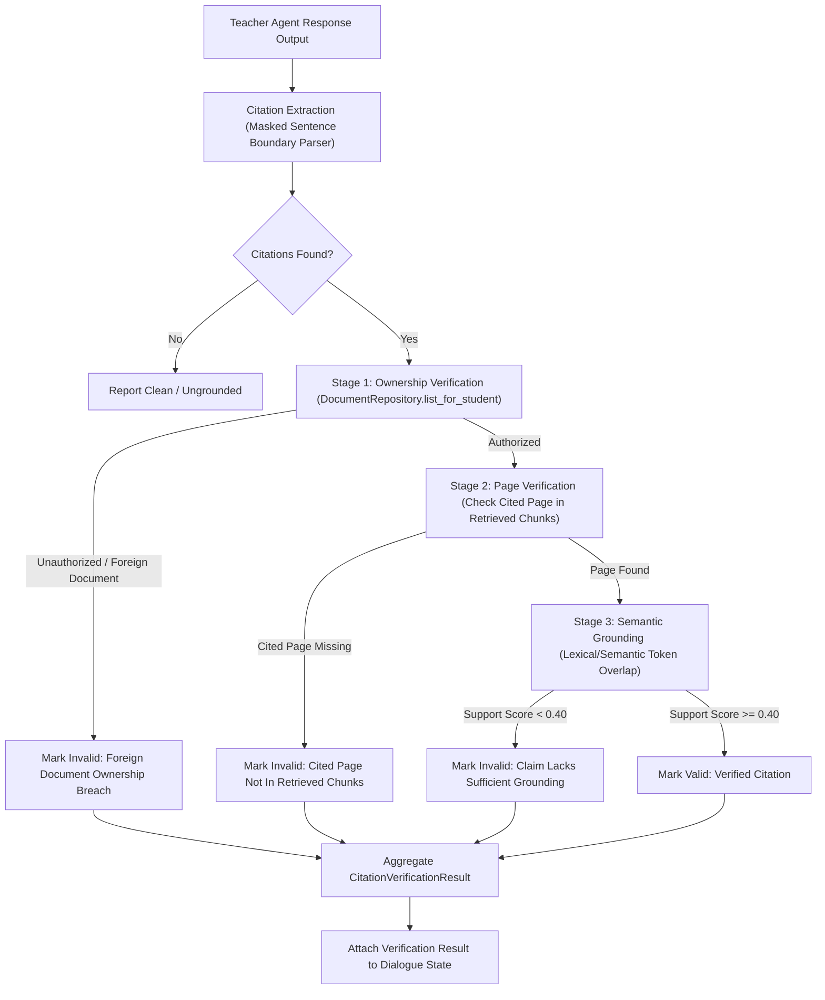

# SocraticAI — Advanced RAG Architecture

**System Architecture Specification**  
**Module:** Retrieval-Augmented Generation & Intelligent Tutoring Grounding  
**Author:** SocraticAI LLM Systems Engineering Team  
**Status:** Active Production Architecture  

---

## 1. High-Level Architectural Overview

The SocraticAI Advanced RAG subsystem provides personalized, authoritative, and strictly verifiable learning grounding for students. It replaces naive flat-vector search with a multi-stage, section-aware, hybrid retrieval architecture that enforces:

1. **Deterministic Student Isolation**: Every vector collection and lexical index strictly gates operations by `student_id`.
2. **Structural Document Awareness**: Chunking preserves document titles, chapter/section headings, and page boundaries.
3. **Multi-Modal Candidate Generation**: Combines dense semantic proximity (ChromaDB) with lexical exact-match indexing (`rank-bm25`).
4. **Rank Fusion & Two-Stage Reranking**: Reciprocal Rank Fusion (RRF) followed by Cross-Encoder neural scoring.
5. **Decision-Model Relevance Grading**: High-precision semantic verification of candidate chunks before prompt injection.
6. **Citation Grounding & Verification**: Automatic verification of document ownership, cited pages, and semantic claim support.

---

## 2. Document Ingestion Architecture



### Ingestion Stages:
1. **Deduplication Check**: Before allocating vector storage or performing embedding passes, a SHA-256 checksum is compared against `documents.content_hash` for the current `student_id`. If an identical document exists, duplicate processing is prevented.
2. **Hierarchy Extraction**: For PDFs, PyMuPDF parses the outline TOC. For Markdown, heading tokens (`#`, `##`, `###`) are tracked in a stateful stack to maintain full `section_path` context (e.g. `Physics > Unit 1 > 1.2 Conservation of Momentum`).
3. **Chunking**: `SectionAwareChunker` splits content along section boundaries. If a section exceeds the chunk size (400 tokens), it splits on paragraph boundaries (`\n\n`), then sentence boundaries (`[.!?]\s+`), ensuring sentences are never sliced mid-concept.
4. **Dual Index Ingestion**: Chunks are added to ChromaDB using embedding vectors and to the student's isolated BM25 pickle index.

---

## 3. Retrieval & Re-ranking Lifecycle



---

## 4. Context Selection & Compression in `ContextBuilder`

The assembled candidate chunks are packed into the final tutor prompt via `ContextBuilder`. To prevent context window saturation and maximize reasoning quality:

1. **Deduplication**: Retains only unique passages by content hash.
2. **Budget Gating**: Allocates up to 1,500 tokens exclusively for retrieved course notes.
3. **Structured Heading Injection**: Chunks are formatted with section breadcrumbs and citation identifiers:
   ```markdown
   ### Source: physics_notes.pdf (Page 4) | Section: Dynamics > Newton's Third Law
   [doc_phys::c3] For every action, there is an equal and opposite reaction.
   ```
4. **Token Budget Enforcement**: ContextBuilder computes exact token counts using `cl100k_base` tiktoken encoding, safely truncating lower-ranked chunks when the 1,500 token ceiling is approached.

---

## 5. Citation Generation & Multi-Stage Verification



### Verification Guarantees:
- **Tenant Isolation**: If a hallucinated response cites a document belonging to a different student or an unindexed filename, the ownership check flags it immediately with `ownership_verified=False`.
- **Hallucination Prevention**: If a factual assertion in the tutor response is completely unsupported by the cited passage (support ratio $< 0.40$), the verification flags the claim with `support_score` diagnostics.

---

## 6. Storage & Indexing Isolation Guarantees

| Storage Layer | Partitioning Key | Mechanism | Isolation Guarantee |
|---|---|---|---|
| **ChromaDB** | `student_id` metadata | `{"where": {"student_id": student_id}}` | Student A can never view or search chunks belonging to Student B. |
| **BM25 Lexical** | `student_id` index file | `data/bm25/{student_id}.pkl` | Every student has an isolated lexical corpus and vocabulary matrix. |
| **SQLite ORM** | `documents.student_id` | Foreign Key + Repository Constraints | Document records and hashes are queried strictly by `student_id`. |
| **Cache Manager** | `student_id` prefix | `retrieval:{student_id}:{hash}` | Invalidation and lookups are strictly partitioned by student ID. |
