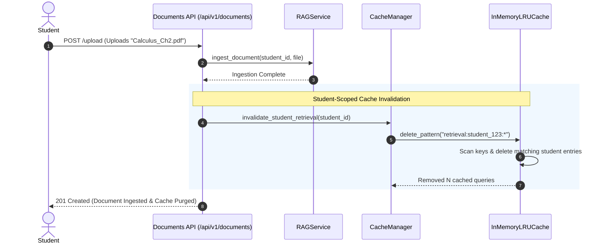

# SocraticAI — Caching Architecture

## High-Performance Multi-Tier Caching & Invalidation Subsystem

**Document Version:** 1.0.0  
**Status:** Implemented and Tested  
**Components:** [`apps/backend/app/cache/`](file:///d:/ML/EduAgent-master/apps/backend/app/cache/), [`apps/backend/app/rag/pipelines/service.py`](file:///d:/ML/EduAgent-master/apps/backend/app/rag/pipelines/service.py), [`apps/backend/app/api/v1/routes/documents.py`](file:///d:/ML/EduAgent-master/apps/backend/app/api/v1/routes/documents.py)

---

## 1. Architectural Overview

Prior to Milestone 1.5, SocraticAI recalculated vector embeddings for identical text snippets, re-executed full-collection ChromaDB vector searches for identical queries, and made redundant LLM calls for deterministic responses.

The caching subsystem provides an in-memory, thread-safe, multi-namespace cache with Least Recently Used (LRU) eviction and Time-To-Live (TTL) expiration. It includes student-scoped invalidation hooks triggered automatically upon document ingestion or deletion.

```
┌─────────────────────────────────────────────────────────────────────────────┐
│                       SocraticAI CacheManager Topology                      │
└─────────────────────────────────────────────────────────────────────────────┘

                               Inbound Request
                                      │
                                      ▼
                      ┌───────────────────────────────┐
                      │    CacheManager Namespace     │
                      └───────┬───────────────┬───────┘
                              │               │
            ┌─────────────────┴─┐           ┌─┴─────────────────┐
            │                   │           │                   │
            ▼                   ▼           ▼                   ▼
    ┌───────────────┐   ┌───────────────┐ ┌───────────────┐  ┌───────────────┐
    │  Embeddings   │   │   Retrieval   │ │   Responses   │  │ Student Store │
    │     Cache     │   │     Cache     │ │     Cache     │  │ (Invalidator) │
    │ (TTL: 24 hrs) │   │ (TTL: 1 hour) │ │ (TTL: 30 min) │  │               │
    └───────┬───────┘   └───────┬───────┘ └───────┬───────┘  └───────┬───────┘
            │                   │                 │                  │
            ▼                   ▼                 ▼                  ▼
    ┌────────────────────────────────────────────────────────────────────────┐
    │          Thread-Safe In-Memory LRU Backend (Threading.RLock)           │
    │          • OrderedDict Storage  • TTL Expiration Checks                │
    │          • Wildcard Invalidation (`delete_pattern`)                   │
    └────────────────────────────────────────────────────────────────────────┘
```

---

## 2. Cache Tier Specifications

### 2.1 Embedding Cache (`embeddings`)
- **Purpose:** Caches floating-point vector representations generated by embedding providers (e.g., SentenceTransformers, OpenAI embeddings).
- **Default TTL:** 86,400 seconds (24 hours).
- **Default Max Size:** 50,000 entries.
- **Key Derivation:**
  $$\text{Key} = \text{"emb:"} + \text{SHA256}(\text{model\_name} + \text{"::"} + \text{normalized\_text})$$
- **Benefits:** Prevents expensive local CPU matrix computations or remote API embedding calls when re-indexing recurring phrases or processing frequent user queries.

### 2.2 Retrieval Cache (`retrieval`)
- **Purpose:** Caches top-$k$ retrieved chunks (`List[RetrievedChunk]`) for student document queries.
- **Default TTL:** 3,600 seconds (1 hour).
- **Default Max Size:** 5,000 entries.
- **Key Derivation:**
  $$\text{Key} = \text{"retrieval:"} + \text{student\_id} + \text{":"} + \text{SHA256}(\text{normalized\_query} + \text{":k="} + k + \text{":filters="} + \text{JSON}(\text{filters}))$$
- **Student Scoping:** The key is explicitly prefixed with the `student_id` to enable fine-grained invalidation without clearing other students' cached results.

### 2.3 Response Cache (`response`)
- **Purpose:** Caches pre-formatted, deterministic responses (such as fast-path greetings, small-talk answers, or standard syllabus outlines).
- **Default TTL:** 1,800 seconds (30 minutes).
- **Default Max Size:** 2,000 entries.
- **Key Derivation:**
  $$\text{Key} = \text{"resp:"} + \text{SHA256}(\text{route} + \text{"::"} + \text{normalized\_input})$$

---

## 3. LRU Eviction & Concurrency Model

### 3.1 Thread Safety
The underlying `InMemoryLRUCache` uses a re-entrant lock (`threading.RLock`) safeguarding every atomic operation:
```python
with self._lock:
    if key in self._store:
        entry = self._store[key]
        if entry.is_expired():
            del self._store[key]
            self._misses += 1
            return None
        self._store.move_to_end(key)  # Mark as recently used
        self._hits += 1
        return entry.value
```

### 3.2 Eviction Lifecycle
When `set(key, value)` is called:
1. If the key exists, it is overwritten, given a new expiry timestamp, and moved to the end of the `OrderedDict`.
2. If the key does not exist and `len(self._store) >= max_size`, the oldest item is evicted via `self._store.popitem(last=False)`.
3. An `evictions` metric counter is incremented.

---

## 4. Student-Scoped Invalidation Hooks

A core vulnerability in naive caching systems is stale retrieval context: if a student uploads a new chapter or deletes an outdated syllabus, cached search results must not return outdated chunks.

SocraticAI achieves zero stale context using event-driven wildcard invalidation.



The exact same invalidation hook is executed when a student calls `DELETE /api/v1/documents/{doc_id}`.

---

## 5. Metrics & Observability

Every cache namespace exposes real-time operational telemetry through `CacheStats`:
```json
{
  "namespace": "retrieval",
  "size": 142,
  "max_size": 5000,
  "hits": 1820,
  "misses": 230,
  "evictions": 0,
  "hit_rate": 0.8878
}
```

The hit rate is calculated dynamically:
$$\text{Hit Rate} = \frac{\text{Hits}}{\text{Hits} + \text{Misses}}$$

---

## 6. Hardware Tuning Guide

| Profile | Target Environment | Embeddings Max Size | Retrieval Max Size | Est. Memory Footprint |
|---|---|---|---|---|
| **Low-Resource (2 GB)** | Raspberry Pi / Minimal VPS | 1,000 | 500 | $< 25\text{ MB}$ |
| **Standard (8 GB)** | Developer Laptop / Staging | 20,000 | 2,500 | $< 120\text{ MB}$ |
| **Production (32 GB)** | High-Concurrency Server | 100,000 | 25,000 | $< 600\text{ MB}$ |

All settings can be dynamically tuned via environment variables in `.env` without modifying Python code:
```env
CACHE_EMBEDDING_MAX_SIZE=50000
CACHE_RETRIEVAL_MAX_SIZE=5000
CACHE_RESPONSE_MAX_SIZE=2000
CACHE_EMBEDDING_TTL=86400
CACHE_RETRIEVAL_TTL=3600
CACHE_RESPONSE_TTL=1800
```

