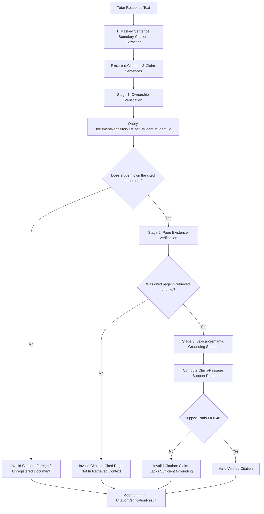

# SocraticAI — Citation Generation & Multi-Stage Verification Pipeline

**System Architecture Specification**  
**Module:** Pedagogical Grounding & Citation Verification  
**Author:** SocraticAI LLM Systems Engineering Team  
**Status:** Active Production Architecture  

---

## 1. Problem Statement & Pedagogical Need

In personalized AI tutoring, generating authoritative explanations is insufficient if the tutor cites fabricated chapters, non-existent page numbers, or notes belonging to another student. Students rely on citations to verify textbook proofs, study for exams, and trust the agent's guidance.

Without strict citation verification, generative LLMs suffer from three dangerous failure modes:
1. **Hallucinated Citations**: The model generates plausible-looking citations (e.g. `[Source: Biology_Chapter_3.pdf, p. 45]`) that exist nowhere in the student's library.
2. **Unsupported Claims**: The model cites a genuine textbook page, but attributes a claim to that page that the text does not actually state.
3. **Cross-Tenant Data Leakage**: In multi-tenant environments, a model could inadvertently cite materials uploaded by a different student.

To eliminate these failure modes, SocraticAI implements an automated, multi-stage **Citation Generation and Verification Pipeline**.

---

## 2. Citation Prompt Contract

The Teacher Agent's system prompt strictly requires that every factual assertion derived from course notes must be backed by a standardized bracketed citation tag:

```text
Format:
[Source: {filename}, p. {page}]
or with section:
[Source: {filename}, p. {page}, sec: {section_title}]

Example:
Photosynthesis converts solar photons into chemical energy stored in glucose [Source: biology_notes.pdf, p. 2].
```

---

## 3. Multi-Stage Verification Pipeline



---

## 4. Pipeline Components

### 4.1 Masked Sentence Boundary Citation Extraction
A major technical challenge in citation extraction is that standard sentence splitters (e.g. `re.split(r"(?<=[.!?])\s+")`) split inside citations that contain abbreviations like `p. 2` or `sec. 3`.

`CitationVerifier.extract_citations` solves this using **masked sentence boundary extraction**:
1. Creates a masked copy of the text where all characters inside `[...]` are replaced with spaces of equal length.
2. Identifies sentence boundaries (`[\.\!\?]\s+|\n+`) on the masked text, guaranteeing that periods inside citations never trigger a boundary.
3. Maps each citation match back to its exact sentence span in the original text, isolating the claim sentence cleanly.

### 4.2 Stage 1: Ownership Verification
The verifier calls `DocumentRepository.list_for_student(student_id)`.
- If the cited filename does not match any document owned by that student, the citation is flagged as an ownership breach:
  `reason = "Document 'physics_secret.pdf' does not belong to student student_1 or does not exist"`
- This guarantees student data isolation cannot be bypassed through prompt injection.

### 4.3 Stage 2: Page Existence Verification
The verifier inspects the candidate chunks retrieved for the turn.
- If the model cites page 42, but only pages 1 to 5 were retrieved in the context window, the citation is flagged:
  `reason = "Cited page 42 was not found in retrieved chunks for notes.pdf"`

### 4.4 Stage 3: Lexical-Semantic Claim Grounding
The claim sentence (with citation tag stripped) is tokenized and compared against the cited passage:
1. Stopwords (`the`, `a`, `is`, `with`, `on`, etc.) are removed to isolate substantive domain terms.
2. The support ratio is calculated:
   $$\text{Support Ratio} = \frac{|\text{Tokens}(\text{Claim}) \cap \text{Tokens}(\text{Passage})|}{|\text{Tokens}(\text{Claim})|}$$
3. If $\text{Support Ratio} < 0.40$ (configurable via `CITATION_VERIFICATION_THRESHOLD`), the citation is flagged as an unsupported claim.

---

## 5. Domain Models & Verification Schema

Defined in [`apps/backend/app/schemas/domain.py`](file:///d:/ML/EduAgent-master/apps/backend/app/schemas/domain.py):

```python
class Citation(BaseModel):
    document_id: str
    source: str
    page: int | None = None
    section_title: str | None = None
    claim: str = ""

class VerifiedCitation(BaseModel):
    citation: Citation
    is_valid: bool = True
    ownership_verified: bool = True
    page_verified: bool = True
    support_score: float = 1.0
    reason: str = ""

class CitationVerificationResult(BaseModel):
    citations: list[VerifiedCitation] = Field(default_factory=list)
    all_valid: bool = True
    citation_correctness: float = 1.0
    citation_completeness: float = 1.0
    unsupported_claim_count: int = 0
```

---

## 6. Verification Metrics & Operational Telemetry

Every tutor dialogue response turn records:
- **`citation_correctness`**: Ratio of valid citations over total citations generated ($N_{valid} / N_{total}$).
- **`unsupported_claim_count`**: Count of claims failing semantic grounding.
- **`all_valid`**: Boolean flag indicating flawless grounding across all assertions.

These metrics are persisted in the conversation turn metadata, providing real-time telemetry on hallucination rates and pedagogical reliability.
