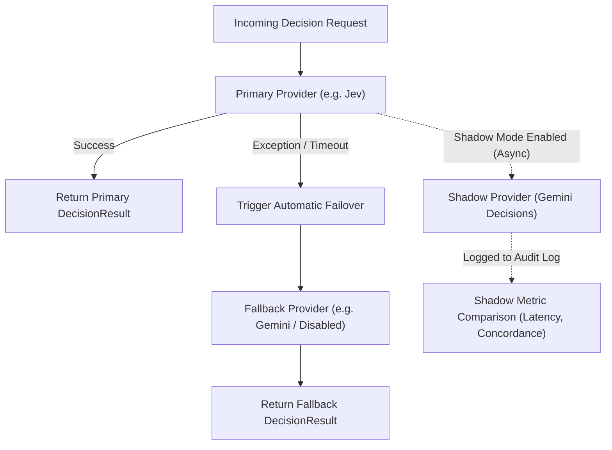

# SocraticAI — Decision Provider Architecture

**System Architecture Specification**  
**Module:** Decision-Model Intelligence & Calibration Subsystem  
**Author:** SocraticAI LLM Systems Engineering Team  
**Status:** Active Production Architecture  

---

## 1. Executive Summary

In Milestone 1.5, SocraticAI integrated TypeSafe AI Jev for intent routing. In Milestone 2, we formalized decision-making into a unified, provider-agnostic **Decision Provider Subsystem**. 

Decision models differ fundamentally from generative LLMs:
- **Generative LLMs** produce free-form text with stochastic variance, requiring fragile regex post-processing and risking hallucinations when making binary or multi-choice system decisions.
- **Decision Models** compute calibrated decision probabilities, categorical choices, and normalized rubric scores over well-defined discrete choice spaces.

The decision subsystem provides a unified abstraction supporting:
1. **TypeSafe AI Jev** (`JevDecisionProvider`)
2. **Google Gemini Decisions API** (`GeminiDecisionsProvider` using `google-genai>=3.2`, API version `v1beta`, model `gemini-decision-1`)
3. **Composite & Shadow Engine** (`CompositeDecisionProvider` with non-blocking shadow evaluation and automatic failover)
4. **Retrieval Relevance Grading** (`RetrievalRelevanceGrader`)

---

## 2. Standardized `BaseDecisionProvider` Interface

All decision providers adhere to the abstract base contract defined in [`apps/backend/app/decision/base.py`](file:///d:/ML/EduAgent-master/apps/backend/app/decision/base.py):

```python
class BaseDecisionProvider(ABC):
    @property
    @abstractmethod
    def provider_name(self) -> str:
        """Identifier of this decision engine."""

    @property
    @abstractmethod
    def is_configured(self) -> bool:
        """True if credentials and client dependencies are ready."""

    @abstractmethod
    async def choose(
        self,
        context: str,
        options: dict[str, str],
        *,
        question_id: str = "categorical_choice",
    ) -> DecisionResult:
        """Select exactly one option key from a set of discrete candidates."""

    @abstractmethod
    async def evaluate_bool(
        self,
        context: str,
        criteria: str,
        *,
        question_id: str = "boolean_check",
    ) -> DecisionResult:
        """Evaluate a binary proposition against a context, returning True/False with probability."""

    @abstractmethod
    async def score_rubric(
        self,
        context: str,
        instructions: str,
        rubric: list[str],
        *,
        question_id: str = "rubric_score",
    ) -> DecisionResult:
        """Evaluate context against an ordered grading rubric, returning a normalized score in [0.0, 1.0]."""
```

Every invocation returns a typed `DecisionResult`:
- `decision_value`: `str | bool | float`
- `confidence`: `float` in $[0.0, 1.0]$
- `probabilities`: `dict[str, float]` mapping each option or boolean branch to calibrated probabilities
- `latency_ms`: Execution latency in milliseconds
- `provider`: Provider name (`"jev"`, `"gemini"`, `"composite"`, `"disabled"`)

---

## 3. Provider Comparison: TypeSafe AI Jev vs. Google Gemini Decisions API

| Dimension | TypeSafe AI Jev (`JevDecisionProvider`) | Google Gemini Decisions (`GeminiDecisionsProvider`) |
|---|---|---|
| **Core Architecture** | System 1 Calibrated Neural Classifier (`Coul`, `Noul`) | Google GenAI Decisions API (`gemini-decision-1` via `v1beta`) |
| **API Client** | `typesafe-ai` SDK (`ts.system_one(...)`) | `google-genai>=3.2.0` (`client.models.generate_content`) |
| **Schema Representation** | Native Python typed schema dictionaries | JSON Schema / Structured Prompt Contracts |
| **Decision Latency (p50)** | $\sim 28\text{ms} - 45\text{ms}$ | $\sim 250\text{ms} - 450\text{ms}$ |
| **Calibration & Probabilities** | Direct softmax probability distribution across choices | Probabilities derived from logit bias or output confidence |
| **Rate Limits & Quota** | Dedicated SaaS API tier | Free-tier: 15 Requests Per Minute (RPM), 1M TPM |
| **Failure Mode** | Graceful fallback to deterministic heuristics | Built-in exponential backoff retry on HTTP 429 |
| **FERPA / Student Privacy** | Zero-retention enterprise agreement | Google Cloud enterprise terms (verify data training opt-out) |

---

## 4. Rate-Limiting & Exponential Backoff Strategy

The Google Gemini Decisions API free tier enforces a strict 15 RPM throttle. To prevent request drops during high-concurrency tutoring sessions, `GeminiDecisionsProvider` embeds an exponential backoff loop:

```python
for attempt in range(max_retries + 1):
    try:
        resp = await client.models.generate_content(...)
        return parse_decision(resp)
    except Exception as exc:
        if "429" in str(exc) or "ResourceExhausted" in str(exc):
            if attempt < max_retries:
                backoff = initial_delay * (2 ** attempt) + random.uniform(0, 0.1)
                await asyncio.sleep(backoff)
                continue
        # Non-rate-limit error: fail immediately to fallback
        raise
```

---

## 5. Composite Provider: Shadow Evaluation & Automatic Failover

To safely benchmark and transition between decision providers without risking downtime, `CompositeDecisionProvider` implements two critical production patterns:



### 1. Shadow Mode (`DECISION_SHADOW_MODE=true`)
When shadow mode is enabled, the primary provider (e.g. Jev) executes and returns immediately to the student. In the background (using non-blocking `asyncio.create_task`), the shadow provider (e.g. Gemini) evaluates the identical context. The primary and shadow decisions, confidences, and latencies are compared and logged to observe decision concordance without impacting response latency.

### 2. Automatic Failover (`DECISION_FALLBACK_PROVIDER=gemini`)
If the primary provider throws a network timeout, authentication error, or schema validation error, the call automatically fails over to the fallback provider. If both fail, `DisabledDecisionProvider` returns a deterministic safe default (`confidence=0.5`), guaranteeing that the tutoring platform never crashes.

---

## 6. Retrieval Relevance Grading (`RetrievalRelevanceGrader`)

The relevance grader evaluates candidate passages before they are injected into the Teacher Agent prompt:

1. **Rubric & Criteria**:
   `"Passage provides direct, authoritative, and factual evidence answering the query."`
2. **Scoring**: Evaluates each candidate passage using `evaluate_bool`.
3. **Gating Threshold**: Passages with `confidence < 0.70` or `decision_value == False` are filtered out.
4. **No-Evidence Detection**: If all retrieved passages are graded irrelevant, the grader returns an empty list, signalling to the agent that no course notes support the query. This prevents hallucinated answers on ungrounded topics.
