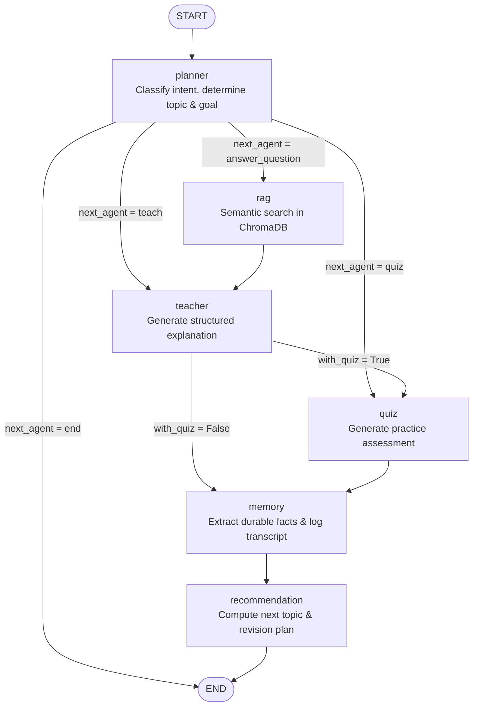
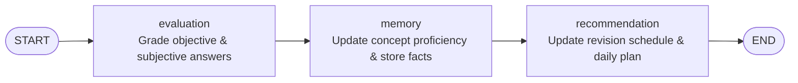
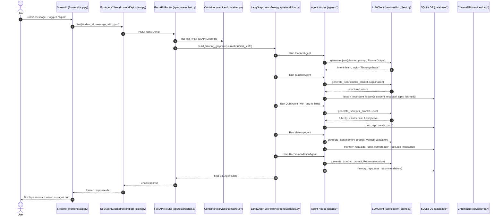

# EduAgent — Existing Architecture Audit

**Document Status:** Complete Baseline Analysis  
**Audit Date:** November 2026  
**Auditor:** Senior AI Engineer & Software Architect  

---

## 1. Executive Summary

EduAgent is an AI-powered personalized tutoring system designed around multi-agent orchestration, LangGraph state machines, retrieval-augmented generation (RAG), and persistent student profiling.

While functionally mature with an extensive 102-test automated test suite and high benchmark evaluation scores, the physical and logical organization of the repository currently exhibits characteristics of an early-stage prototype:
* **Flat root structure:** The root directory contains 11 source directories (`agents`, `api`, `config`, `database`, `evaluation`, `experiments`, `frontend`, `graphs`, `models`, `prompts`, `services`, `utils`), 12 test files in a flat `tests/` directory, and miscellaneous scripts and demo files at the root.
* **Monolithic modules:** Key modules such as `frontend/app.py` combine UI layout, page-level routing, session-state management, charting, and error handling in a single 378-line file. Similarly, `graphs/workflow.py` defines multiple disparate workflows and routing functions in one place.
* **Tight coupling and implicit dependencies:** The dependency injection container (`services/container.py`) directly imports across all layers, and agents import from concrete schema and persistence layers without distinct boundary layers.
* **Missing modern packaging:** No root `pyproject.toml`, `Makefile`, or container orchestration (`docker-compose.yml`) exists; dependencies are split across unpinned or loosely pinned text files.

This audit documents the complete baseline codebase prior to architectural restructuring.

---

## 2. Inventory of Existing Modules and Responsibilities

The baseline codebase comprises 91 Python files across 11 primary packages and root utilities.

```text
EduAgent (Baseline Root)
├── .env / .env.example       # Environment configuration
├── main.py                   # FastAPI uvicorn entry point
├── e2e_verify.py             # HTTP integration verification script
├── e2e_sample_doc.py         # Sample PDF generator for E2E verification
├── chat_demo.json            # Sample chat API payload
├── eval_demo.json            # Sample evaluation API payload
├── quiz_submit.json          # Sample quiz submission API payload
├── rag_demo.json             # Sample RAG query payload
├── pytest.ini / ruff.toml    # Tooling configuration
├── requirements.txt          # Production dependencies
├── requirements-dev.txt      # Development & testing dependencies
│
├── agents/                   # Agent implementations
│   ├── base.py               # Shared helpers (prompt blocks, profile loading)
│   ├── context.py            # AgentContext dataclass holding dependencies
│   ├── planner.py            # Intent classification and graph routing
│   ├── teacher.py            # Lesson generation & concept explanation
│   ├── quiz.py               # MCQ/numerical/subjective quiz generation
│   ├── evaluation.py         # Quiz scoring & concept proficiency updates
│   ├── memory.py             # Long-term fact extraction & transcript logging
│   ├── recommendation.py     # Next-step study recommendation engine
│   └── rag.py                # RAG retrieval agent node
│
├── api/                      # REST API (FastAPI)
│   ├── main.py               # Application factory, lifespan, CORS, middleware
│   ├── dependencies.py       # FastAPI dependency injection providers
│   ├── exception_handlers.py # EduAgentError translation to JSON responses
│   └── routers/              # Route handlers
│       ├── chat.py           # POST /api/v1/chat, POST /api/v1/chat/submit-quiz
│       ├── dashboard.py      # GET /api/v1/dashboard/{student_id}
│       ├── documents.py      # POST/GET/DELETE /api/v1/documents/*
│       ├── health.py         # GET /health
│       ├── quizzes.py        # GET /api/v1/quizzes/*, GET /api/v1/quiz/*
│       └── students.py       # GET/PUT /api/v1/students/*
│
├── config/                   # Central configuration
│   ├── constants.py          # Route identifiers and evaluation metric constants
│   └── settings.py           # Pydantic BaseSettings models with env-prefix grouping
│
├── database/                 # Persistence layer (SQLAlchemy + SQLite)
│   ├── connection.py         # Database engine, sessionmaker, SQLite FK enforcement
│   ├── models.py             # 10 DeclarativeBase ORM tables
│   └── repositories/         # 8 Repository classes encapsulating SQL operations
│       ├── base_repository.py
│       ├── conversation_repository.py
│       ├── document_repository.py
│       ├── lesson_repository.py
│       ├── memory_repository.py
│       ├── progress_repository.py
│       ├── quiz_repository.py
│       └── student_repository.py
│
├── frontend/                 # Streamlit UI
│   ├── app.py                # Single-file Streamlit application (Chat, Quiz, Dashboard, Docs)
│   └── api_client.py         # Synchronous httpx HTTP client for API communication
│
├── graphs/                   # Workflow orchestration (LangGraph)
│   └── workflow.py           # Tutoring graph and evaluation graph definitions
│
├── models/                   # Domain schemas and state definitions
│   ├── enums.py              # System enums (ChatIntent, StudentLevel, etc.)
│   ├── schemas.py            # Pydantic v2 schemas for API & internal contracts
│   └── state.py              # EduAgentState TypedDict for LangGraph
│
├── prompts/                  # Prompt management
│   ├── loader.py             # YAML loader with string.Template safe substitution
│   ├── planner.yaml          # Planner prompt template
│   ├── teacher.yaml          # Teacher prompt template
│   ├── quiz.yaml             # Quiz prompt template
│   ├── evaluation.yaml       # Evaluation prompt template
│   ├── memory.yaml           # Memory extraction prompt template
│   └── recommendation.yaml   # Recommendation prompt template
│
├── services/                 # Shared application services
│   ├── container.py          # Process-wide dependency container (Container)
│   ├── llm_client.py         # LLMClient (OpenAI, Gemini) with JSON validation & retry
│   ├── llm_demo.py           # DemoLLMClient offline deterministic stub
│   └── rag/                  # RAG subsystem
│       ├── chunking.py       # Token-aware / word-based text chunkers
│       ├── embeddings.py     # SentenceTransformer and Trigram embedders
│       ├── ingestion.py      # PDF/TXT/MD document loader and processor
│       ├── vector_store.py   # ChromaDB persistent collection manager
│       └── service.py        # RAGService high-level coordination
│
├── utils/                    # Shared utility modules
│   ├── async_utils.py        # Async retry with exponential backoff
│   ├── errors.py             # Typed EduAgentError hierarchy
│   ├── helpers.py            # ID generation, ISO timestamps, JSON parsing
│   └── logging.py            # Structured logging setup
│
├── evaluation/               # Benchmark suite (M1–M8)
│   ├── common.py             # Metric calculations, charting, hermetic test harness
│   ├── run_all.py            # CLI benchmark runner
│   ├── make_sample_docs.py   # Ground-truth corpus generator
│   ├── benchmark_*.py        # 8 standalone benchmark modules
│   └── results/              # Pre-computed CSV and JSON evaluation summaries
│
├── experiments/              # RAG empirical experiments
│   ├── chunkers.py           # Alternate chunking implementations
│   ├── make_corpus.py        # Experiment corpus builder
│   ├── run_experiments.py    # 5-model x 4-chunker grid search runner
│   └── findings.md           # Experiment analysis and recommendations
│
└── tests/                    # Automated tests
    ├── conftest.py           # Isolated fixtures (temp DB, fake embedder, fake container)
    ├── fakes.py              # FakeLLMClient, FakeEmbedder
    └── test_*.py             # 10 test suites covering all units and workflows
```

---

## 3. LangGraph Workflows and State Transitions

EduAgent utilizes LangGraph (`StateGraph`) to coordinate agent interactions. State is passed through a mutable `EduAgentState` (`TypedDict`), where mutating keys are updated directly and historical lists (`messages`, `memory_updates`, `errors`) accumulate using `operator.add`.

### Workflow 1: Tutoring Graph (`build_tutoring_graph`)

The tutoring graph models a complete student turn during chat.



**State Transitions & Routing Logic:**
1. **Planner Node:** Computes `output.intent`. Deterministically maps intent:
   - `ChatIntent.LEARN` $\rightarrow$ `Routes.TEACH`
   - `ChatIntent.ANSWER_QUESTION` $\rightarrow$ `Routes.ANSWER_QUESTION`
   - `ChatIntent.PRACTICE` $\rightarrow$ `Routes.QUIZ`
   - `ChatIntent.GENERAL` / `UPLOAD` $\rightarrow$ `Routes.END` (generates brief conversational reply)
2. **Conditional Edge from Planner:**
   - Routes to `teacher`, `rag`, `quiz`, or `END`.
3. **RAG to Teacher Edge:**
   - RAG populates `state["rag_context"]` with retrieved chunks; Teacher consumes them via `rag_prompt_section()`.
4. **Conditional Edge from Teacher:**
   - If `state["with_quiz"] == True`, routes to `quiz`.
   - Otherwise, routes to `memory`.
5. **Tail Chain:**
   - Always converges through `memory -> recommendation -> END`.

### Workflow 2: Evaluation Graph (`build_evaluation_graph`)

Triggered on quiz submission (`POST /api/v1/chat/submit-quiz`).



**Execution Details:**
- **Evaluation Node:** Fetches original quiz from `quiz_repo`. Grades MCQs via deterministic string equality, numerical questions via float tolerance ($\le 10^{-6}$), and subjective questions via LLM. Computes final scores and updates concept proficiency in `student_repo`.
- **Memory Node:** Records evaluation feedback as long-term memory facts.
- **Recommendation Node:** Suggests remedial lessons if weak concepts were identified.

---

## 4. End-to-End Execution Flow

A typical user interaction traces through the following architectural layers:



---

## 5. Persistence and Vector Storage

### SQLite / SQLAlchemy Schema

The physical persistence tier is managed by SQLAlchemy ORM with a custom SQLite foreign-key enforcement hook.

| Table | Model Class | Primary Key | Key Relationships | Purpose |
|---|---|---|---|---|
| `students` | `Student` | `id` (VARCHAR) | 1:M to all tables | Core student profile, mastery arrays, learning style |
| `topics` | `Topic` | `id` (INT) | FK `students.id` | Topics encountered by learner and mastery flag |
| `concept_scores` | `ConceptScoreRow` | `id` (INT) | FK `students.id` | Rolling proficiency (0.0–1.0) and attempt counter |
| `lessons` | `Lesson` | `id` (INT) | FK `students.id` | Taught explanations, summaries, analogies, recaps |
| `quizzes` | `Quiz` | `id` (VARCHAR) | FK `students.id`, 1:M `quiz_questions` | Generated quiz headers |
| `quiz_questions` | `QuizQuestion` | `id` (INT) | FK `quizzes.id` | Question text, options (JSON), correct answer, points |
| `quiz_attempts` | `QuizAttempt` | `id` (VARCHAR) | FK `students.id`, FK `quizzes.id` | Graded submissions, score, percentage, feedback |
| `conversations` | `Conversation` | `id` (INT) | FK `students.id` | Transcript of user and assistant messages |
| `memory_entries` | `MemoryEntry` | `id` (INT) | FK `students.id` | Extracted facts (academic, preference, goal) |
| `documents` | `Document` | `id` (VARCHAR) | FK `students.id` | Document upload metadata and processing status |
| `recommendations` | `Recommendation` | `id` (INT) | FK `students.id` | Latest recommended topic, daily plan, revision schedule |
| `progress_snapshots`| `ProgressSnapshot` | `id` (INT) | FK `students.id` | Point-in-time scores for learning curve tracking |

### Vector Storage (ChromaDB)

- **Engine:** ChromaDB `PersistentClient` targeting `./data/chroma`.
- **Collection:** `edueagent_notes`.
- **Embedder:** `all-MiniLM-L6-v2` via `sentence-transformers` (384-dimensional dense vectors), with an offline fallback `TrigramEmbedder` for testing.
- **Chunking Strategy:** Fixed-size chunking (default 600 tokens, 100 overlap) with `tiktoken` when available, falling back to whitespace tokenization.

---

## 6. Configuration Management and Environment Variables

Configuration is handled by `config/settings.py` via `pydantic-settings`. All settings are read once into a cached `Settings` singleton. Direct access to `os.environ` is avoided.

| Prefix | Class | Key Fields | Purpose |
|---|---|---|---|
| `APP_` | `AppSettings` | `name`, `version`, `host`, `port`, `debug`, `allowed_origins` | Server host, port, CORS |
| `LLM_` | `LLMSettings` | `provider`, `openai_api_key`, `gemini_api_key`, `timeout_seconds`, `max_retries` | Provider selection & credentials |
| `DATABASE_`| `DatabaseSettings` | `url`, `echo`, `create_on_startup` | SQLite connection string & startup behavior |
| `VECTOR_` | `VectorStoreSettings`| `persist_directory`, `collection_name`, `embedding_model`, `top_k` | ChromaDB persistence & search config |
| `API_` | `ApiSettings` | `prefix`, `upload_dir`, `pagination_default_size` | API routes and uploads directory |
| `LOGGING_` | `LoggingSettings` | `level`, `json_format`, `log_dir`, `rotation_bytes` | File rotation & logging levels |
| `FRONTEND_`| `FrontendSettings`| `api_base_url` | Base URL used by Streamlit client |

---

## 7. Test Suite Audit

The current test suite consists of 12 files under `tests/`:
- `tests/test_agents.py` (22 tests): Verifies each agent's execution, output schemas, and state updates.
- `tests/test_api.py` (19 tests): Verifies FastAPI REST endpoints using `starlette.testclient.TestClient`.
- `tests/test_chunking.py` (7 tests): Tests token windowing, overlap, and clean-text normalization.
- `tests/test_documents_api.py` (6 tests): Tests document upload, listing, and deletion flows.
- `tests/test_graphs.py` (10 tests): Tests full execution of tutoring and evaluation graphs with fakes.
- `tests/test_llm_demo.py` (10 tests): Tests deterministic demo LLM output generation and JSON parsing.
- `tests/test_rag.py` (8 tests): Tests RAGService chunking, ingestion, and context assembly.
- `tests/test_repositories.py` (12 tests): Verifies CRUD operations across all 8 repositories.
- `tests/test_vector_store.py` (8 tests): Tests ChromaDB collection creation, search, and document removal.

**Test Execution:** Hermetic; all 102 tests run in ~16 seconds using an in-memory SQLite database (`:memory:`) and `FakeEmbedder` / `DemoLLMClient`. No external network requests or API keys are required.

---

## 8. Architectural Coupling, Redundancy, and Deficiencies

The analysis identified the following architectural concerns:

1. **Unstructured Root Namespace:**
   - 11 top-level package directories pollute the project root.
   - Scripts (`e2e_verify.py`, `e2e_sample_doc.py`) and demo payloads (`chat_demo.json`, etc.) sit in the root directory without categorization.
2. **Monolithic Frontend Architecture:**
   - `frontend/app.py` is an all-in-one script containing page rendering, widget logic, form submissions, state initialization, and chart generation. It should be partitioned into `pages/`, `components/`, and state utilities.
3. **Graph and Routing Tight Coupling:**
   - Both `build_tutoring_graph` and `build_evaluation_graph` reside in a single `graphs/workflow.py` file. Conditional routing functions and state typing are embedded inside the graph builder rather than separated into distinct routing and state submodules.
4. **Agent Internal Organization:**
   - All 7 agents reside in a single flat directory (`agents/`), each in a separate file, without subdirectories for individual agent assets, schemas, or specific logic.
5. **RAG Component Grouping:**
   - `services/rag/` currently contains chunking, embedding, vector store, and ingestion logic mixed together within the generic `services/` directory rather than as a dedicated, composable subsystem.
6. **Hardcoded Prompt Loading Path:**
   - `prompts/loader.py` resolves YAML files relative to `__file__`, tying prompt resolution to the source tree location rather than externalized, configurable paths.
7. **Lack of Standard Python Packaging:**
   - The repository lacks a `pyproject.toml` configuration, build system specification, package discovery, and container definitions (`docker-compose.yml`, `Makefile`).

---

## 9. Baseline Audit Conclusion

The EduAgent application is logically functional and well-tested, but its physical architecture requires restructuring into clean frontend, backend, shared packages, external configs, and documentation directories to ensure long-term maintainability and modular growth.

This baseline audit provides the foundation for the reorganization documented in `docs/architecture/NEW_ARCHITECTURE.md`.

