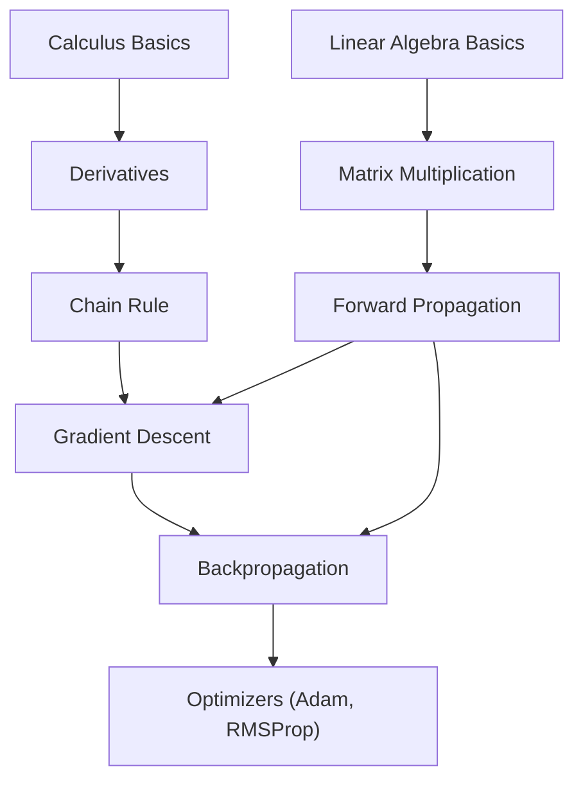
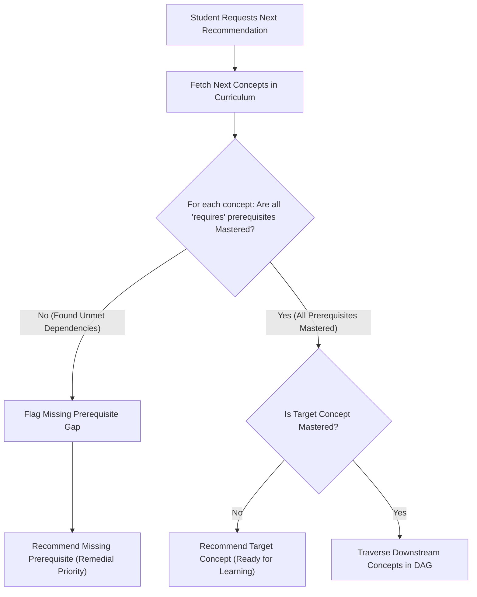

# SocraticAI — Prerequisite-Aware Learning Recommendations

## Overview

A fundamental challenge in personalized tutoring is recommending the right topic at the right time. Suggesting advanced concepts (such as `backpropagation`) to a student who has not mastered foundational prerequisites (such as `derivatives` or the `chain_rule`) leads to frustration and high cognitive overload.

SocraticAI implements a **Prerequisite-Aware Recommendation Engine** powered by a relational concept dependency Directed Acyclic Graph (DAG) stored natively in SQLite.

---

## 1. Concept Dependency Graph (DAG)

The graph structure is stored in the `concept_prerequisites` table:
- `concept_id`: The target or dependent concept.
- `prerequisite_concept_id`: The required foundational concept.
- `relation_type`: `requires` (strict prerequisite), `recommends`, `extends`, or `part_of`.

---

## 2. Prerequisite Resolution Algorithm

When generating learning recommendations for a student:

### Steps:
1. **Adjacency Lookup**: For candidate concept $C$, retrieve all prerequisites:
   $$\text{Prereqs}(C) = \{ P \mid (C, P) \in \text{Edges} \land \text{relation} = \text{'requires'} \}$$
2. **Satisfaction Verification**:
   $$\text{Satisfied}(C) \iff \forall P \in \text{Prereqs}(C), \quad \text{Status}(P) = \text{'mastered'}$$
3. **Gap Prioritization**: If any $P \in \text{Prereqs}(C)$ is not mastered, the recommendation engine halts forward advancement and recommends the unsatisfied prerequisite $P$, labeling it with `is_prerequisite_gap=True`.
4. **Topological Ordering**: Concepts whose prerequisites are fully met are prioritized by difficulty and student interest.

---

## 3. Recommendation Response Schema

The recommendation engine outputs `RecommendationWithPrerequisites`:
- `concept_id`: Recommended concept slug.
- `title`: Human-readable title.
- `reason`: Rationale explaining why this concept was selected.
- `priority`: Numerical priority ($1.0$ for critical gaps, $0.8$ for ready concepts).
- `prerequisites`: List of all required prerequisite slugs.
- `unmet_prerequisites`: List of prerequisite slugs not yet mastered.
- `is_prerequisite_gap`: Boolean flag indicating remedial status.
