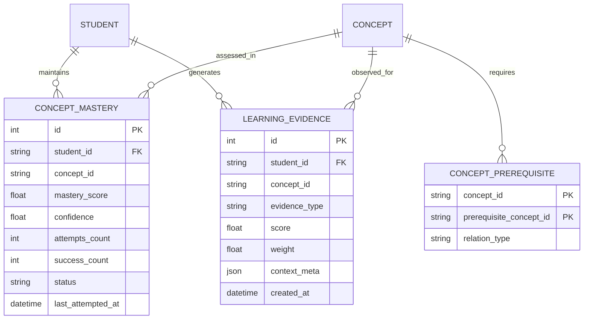
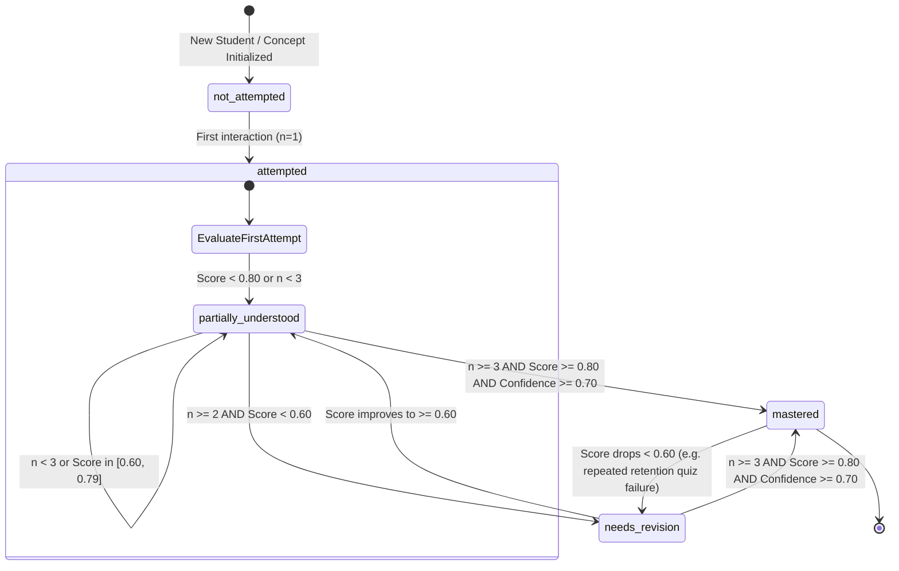

# SocraticAI — Concept-Level Learning State Architecture

## Overview

Traditional learning management systems track coarse metrics such as total questions answered or overall course completion percentages. SocraticAI introduces a **fine-grained, concept-level learning state model**.

Every curriculum domain is modeled as a set of atomic concepts (e.g., `derivatives`, `chain_rule`, `gradient_descent`, `backpropagation`). Each student maintains an independent learning state for every concept.

---

## 1. Learning State Schema

---

## 2. Learning State Machine

### State Definitions

| State | Criteria | Meaning | Recommended Strategy |
| :--- | :--- | :--- | :--- |
| `not_attempted` | $n = 0$ attempts | The student has never interacted with this concept. | Direct Instruction / Overview |
| `attempted` | $n = 1$ attempt, score $< 0.80$ | Initial engagement recorded; insufficient evidence for mastery. | Guided Practice / Worked Example |
| `partially_understood` | $n \ge 1$, score $\ge 0.60$, but $n < 3$ or confidence $< 0.70$ | Student demonstrates partial understanding, but needs reinforcement. | Socratic Questioning / Practice |
| `mastered` | $n \ge 3$, score $\ge 0.80$, confidence $\ge 0.70$ | High demonstrated competence with statistical confidence. | Advanced Applications / New Topics |
| `needs_revision` | $n \ge 2$, score $< 0.60$ | Demonstrates persistent struggle, confusion, or regressions. | Remedial Instruction / Prerequisite Review |

---

## 3. Evidence Collection & Types

The system ingests structured evidence from multiple modalities:

| Evidence Type | Default Weight | Description |
| :--- | :---: | :--- |
| `quiz_submission` | $1.0$ | Direct evaluation from adaptive quizzes (MCQ, True/False, Numerical). |
| `socratic_turn` | $0.8$ | Independent problem-solving step validation during Socratic dialogue. |
| `practice_problem` | $0.7$ | Ungraded or guided exercises. |
| `teacher_observation` | $0.9$ | Automated pedagogical evaluation from conversational responses. |
| `self_assessment` | $0.3$ | Student-reported confidence ratings. |

Evidence items are logged append-only into `learning_evidence` to preserve an immutable audit trail of learning progression.
