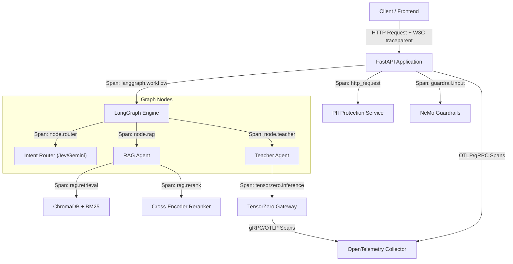

# SocraticAI — LLMOps & Observability Architecture

**Document Version:** 1.0.0  
**Status:** Implemented (Milestone 4)  
**Related Modules:**  
- [`apps/backend/app/telemetry/tracing.py`](file:///d:/ML/EduAgent-master/apps/backend/app/telemetry/tracing.py)  
- [`apps/backend/app/telemetry/metrics.py`](file:///d:/ML/EduAgent-master/apps/backend/app/telemetry/metrics.py)  
- [`configs/prometheus/prometheus.yml`](file:///d:/ML/EduAgent-master/configs/prometheus/prometheus.yml)  
- [`configs/prometheus/alerts.yml`](file:///d:/ML/EduAgent-master/configs/prometheus/alerts.yml)  
- [`configs/grafana/provisioning/dashboards/dashboards.yml`](file:///d:/ML/EduAgent-master/configs/grafana/provisioning/dashboards/dashboards.yml)  
- [`configs/otel/otel-collector-config.yml`](file:///d:/ML/EduAgent-master/configs/otel/otel-collector-config.yml)  

---

## 1. Overview & Objectives

In production educational AI systems, visibility into latency bottlenecks, token consumption, retrieval quality, safety interventions, and error cascades is critical. Milestone 4 establishes an enterprise-grade LLMOps and Observability foundation for SocraticAI without introducing unapproved heavy frameworks (e.g., Langfuse or LiteLLM).

The telemetry infrastructure delivers:
1. **OpenTelemetry Distributed Tracing**: End-to-end tracing across HTTP request boundaries, LangGraph state machine node transitions, hybrid RAG retrieval and reranking, NeMo Guardrails safety evaluations, and TensorZero gateway model calls.
2. **W3C Trace Context Propagation**: Full distributed trace propagation across services (`traceparent` and `tracestate` headers).
3. **Prometheus Metrics**: Direct application-level monitoring exposed at `/metrics` across request rates, latencies, LLM token consumption, fallback events, guardrail triggers, and PII redactions.
4. **Grafana Visualization**: 4 pre-provisioned dashboards covering Application Health, LLM Gateway, RAG & Guardrails, and Infrastructure.
5. **Zero-PII & Zero-Secret Guarantee**: Automated sanitization of span attributes and metric labels to prevent PII, passwords, and API credentials from ever reaching collectors or visualization stores.

---

## 2. Distributed Tracing Architecture (OpenTelemetry)



### 2.1 Trace Lifecycle & Span Hierarchy
Every incoming user request initiates an OpenTelemetry root span (`http_request`) or adopts the incoming `traceparent` header. Downstream components create child spans using contextual helpers:
- `span_context(name, attributes)` for synchronous blocks.
- `async_span_context(name, attributes)` for asynchronous coroutines.

Key traced spans:
- `http_request`: Root API request span, capturing route, HTTP method, and response status.
- `pii.redact` / `pii.restore`: Span covering PII entity extraction and safe reconstruction.
- `guardrail.input` / `guardrail.output` / `guardrail.retrieval`: Spans covering rail rule evaluations.
- `langgraph.workflow`: Execution of the compiled StateGraph.
- `langgraph.node.<node_name>`: Individual agent node executions (e.g., `planner`, `rag`, `teacher`, `quiz`, `evaluator`).
- `rag.retrieval`: Dense + lexical hybrid search execution.
- `rag.rerank`: Cross-encoder scoring and sorting.
- `tensorzero.inference`: Gateway API invocation including function name, model, latency, and token metrics.

### 2.2 Trace Context Propagation
SocraticAI implements the W3C Trace Context standard:
```python
from app.telemetry.tracing import inject_trace_context, extract_trace_context

# Outgoing calls inject traceparent
headers = inject_trace_context({"Content-Type": "application/json"})

# Incoming requests extract trace context
context = extract_trace_context(dict(request.headers))
```

### 2.3 Strict Attribute Sanitization
To ensure security and regulatory compliance:
- Prompt text and LLM outputs are **never** attached as raw span attributes.
- Only metadata (token counts, function names, latency, model versions, cache hits) is preserved.
- Any dictionary passed to span attributes is sanitized via `sanitize_span_attributes()` which strips sensitive keys (`password`, `token`, `secret`, `api_key`, `authorization`, `credit_card`, `ssn`).

---

## 3. Prometheus Metrics & Scrape Endpoint

Metrics are exposed via the standard endpoint `GET /metrics` in Prometheus exposition format.

### 3.1 Metric Catalog

| Metric Name | Type | Labels | Description |
|---|---|---|---|
| `socraticai_http_requests_total` | Counter | `method`, `endpoint`, `status` | Total HTTP requests handled. |
| `socraticai_http_request_duration_seconds` | Histogram | `method`, `endpoint` | End-to-end HTTP request latency. |
| `socraticai_llm_inference_duration_seconds` | Histogram | `provider`, `model`, `function_name` | Latency of LLM model invocations. |
| `socraticai_llm_tokens_total` | Counter | `provider`, `model`, `type` (`prompt`/`completion`) | Total tokens consumed. |
| `socraticai_llm_failures_total` | Counter | `provider`, `model`, `error_type` | Total LLM inference failures. |
| `socraticai_llm_fallback_total` | Counter | `primary`, `fallback`, `function_name` | Total fallback activations. |
| `socraticai_rag_retrieval_duration_seconds` | Histogram | `retrieval_type`, `has_reranking` | Latency of RAG retrieval operations. |
| `socraticai_guardrail_checks_total` | Counter | `rail_type`, `decision` (`allowed`/`blocked`) | Total guardrail evaluations and blocks. |
| `socraticai_pii_redactions_total` | Counter | `entity_type` | Count of detected & redacted PII entities. |

---

## 4. Grafana Dashboards

Grafana dashboards are located in `configs/grafana/dashboards/` and auto-provisioned via Docker Compose:

1. **Application Health & Latency (`application_health.json`)**:
   - Request throughput (req/sec) by route.
   - P50, P95, and P99 latency heatmaps.
   - HTTP error rates (4xx, 5xx) with threshold alerts.
2. **LLM Gateway & Cost Tracking (`llm_gateway.json`)**:
   - Inferences per minute broken down by model and function (`tutor_chat`, `tutor_json`).
   - Prompt and completion token velocity.
   - Est. cost trajectory and fallback invocation frequencies.
3. **RAG & Guardrails Operations (`rag_guardrails.json`)**:
   - Retrieval latency (Dense vs BM25 vs RRF vs Cross-Encoder).
   - Guardrail intervention rate by rail type (`input`, `output`, `retrieval`, `execution`).
   - PII redactions broken down by entity category (`PERSON`, `EMAIL`, `PHONE`, `GOVERNMENT_ID`).
4. **Infrastructure & Runtime (`infrastructure.json`)**:
   - Backend process uptime, active memory, and event loop metrics.

---

## 5. Prometheus Alerting Rules

Defined in `configs/prometheus/alerts.yml`:
- `HighErrorRate`: HTTP 5xx responses exceed 5% of total requests over a 5-minute rolling window.
- `LLMHighLatency`: LLM inference P95 latency exceeds 5 seconds over 5 minutes.
- `LLMHighFailureRate`: LLM failure rate exceeds 10% over 5 minutes.
- `GuardrailHighBlockRate`: Guardrail rejections exceed 15% of total requests (potential attack indicator).
