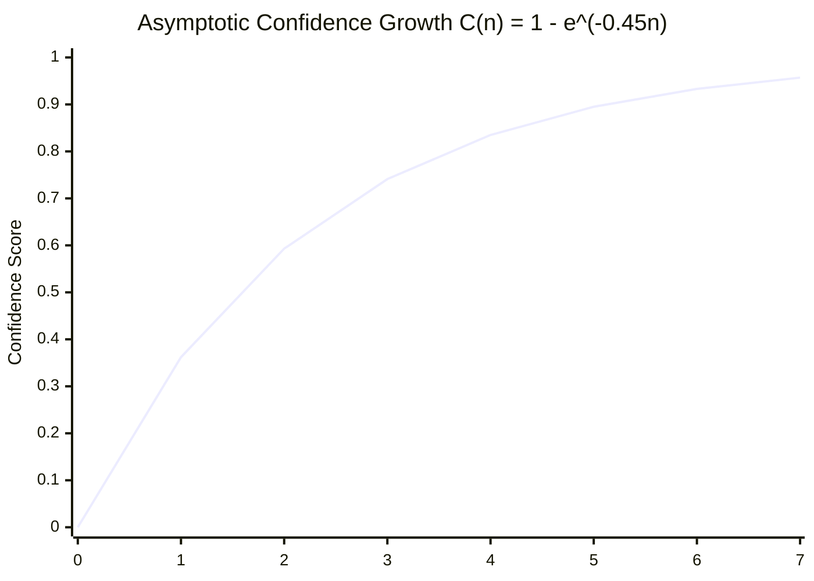

# SocraticAI — Mastery Tracking & Confidence Modeling

## Overview

Accurate mastery tracking requires balancing two competing demands:
1. **Responsiveness**: Quickly acknowledging genuine learning gains and improvements.
2. **Robustness**: Preventing premature declaration of mastery from lucky guesses or single-question flukes, while simultaneously preventing permanent penalties from early mistakes.

SocraticAI achieves this through a dual-model framework combining **Exponential Moving Average (EMA) Score Smoothing** and an **Asymptotic Bayesian-Style Confidence Function**.

---

## 1. Mathematical Formulations

### 1.1 Exponential Moving Average (EMA) Score Smoothing

To ensure that recent performance informs current mastery without discarding past learning history, mastery score $S_t$ updates smoothly upon receiving new evidence $s_t$:

$$S_t = (1 - \alpha) \cdot S_{t-1} + \alpha \cdot s_t$$

Where:
- $S_t \in [0.0, 1.0]$ is the smoothed mastery score at evidence count $t$.
- $s_t \in [0.0, 1.0]$ is the normalized score of the new evidence.
- $\alpha = 0.30$ is the smoothing weight (configurable via `MASTERY_ALPHA_SMOOTHING`).
- Initial condition: For the first attempt ($t=1$), $S_1 = s_1$.

### 1.2 Asymptotic Confidence Function

The confidence $C(n)$ measures statistical certainty in the student's estimated mastery score as a function of total evidence points $n$:

$$C(n) = 1.0 - e^{-k \cdot n}$$

Where:
- $n \in \mathbb{N}_{\ge 0}$ is the cumulative number of recorded evidence points.
- $k = 0.45$ is the exponential evidence saturation rate (configurable via `MASTERY_CONFIDENCE_GROWTH_RATE`).
- Range: $C(n) \in [0.0, 1.0)$ for all $n \ge 0$, asymptotically approaching $1.0$.

---

## 2. Mathematical Properties & Transition Thresholds

### Table of Numerical Values:

| Evidence Count ($n$) | Confidence $C(n)$ | Can Achieve `mastered`? | Permitted States |
| :---: | :---: | :---: | :--- |
| **0** | $0.000$ | No | `not_attempted` |
| **1** | $0.362$ | No ($C < 0.70$) | `attempted`, `partially_understood` |
| **2** | $0.593$ | No ($C < 0.70$) | `partially_understood`, `needs_revision` |
| **3** | **$0.741$** | **Yes** ($C \ge 0.70$) | `mastered`, `partially_understood`, `needs_revision` |
| **4** | $0.835$ | Yes | `mastered`, `partially_understood`, `needs_revision` |
| **5** | $0.895$ | Yes | `mastered`, `partially_understood`, `needs_revision` |

### Guardrails Against False Mastery:
- **Single Guess Protection**: Even if a student gets 100% ($s_1 = 1.0$) on their first attempt, their confidence is only $0.362 < 0.70$. The state machine restricts them to `partially_understood`.
- **Minimum Evidence Requirement**: At least $n \ge 3$ consistent evidence points are strictly required before transitioning to `mastered`.
- **High Performance Bar**: The smoothed score must satisfy $S_t \ge 0.80$ concurrently with $C(n) \ge 0.70$.

---

## 3. Worked Numerical Examples

### Scenario A: Progressive Mastery (Legitimate Learner)
- **Attempt 1**: Score $s_1 = 0.85$.
  - $S_1 = 0.85$
  - $C(1) = 1 - e^{-0.45(1)} = 0.3624$
  - Status: `partially_understood` (Confidence $< 0.70$, $n < 3$).
- **Attempt 2**: Score $s_2 = 0.90$.
  - $S_2 = (0.70 \times 0.85) + (0.30 \times 0.90) = 0.595 + 0.270 = 0.865$
  - $C(2) = 1 - e^{-0.45(2)} = 0.5934$
  - Status: `partially_understood` (Confidence $< 0.70$, $n < 3$).
- **Attempt 3**: Score $s_3 = 0.95$.
  - $S_3 = (0.70 \times 0.865) + (0.30 \times 0.95) = 0.6055 + 0.285 = 0.8905$
  - $C(3) = 1 - e^{-0.45(3)} = 0.7408$
  - Status: **`mastered`** ($S_3 \ge 0.80$, $C(3) \ge 0.70$, $n \ge 3$).

### Scenario B: Lucky Guess Fluke
- **Attempt 1**: Score $s_1 = 1.0$ (lucky guess on multiple choice).
  - $S_1 = 1.0$
  - $C(1) = 0.3624$
  - Status: `partially_understood` (Protected against false mastery).
- **Attempt 2**: Score $s_2 = 0.20$ (true knowledge deficiency emerges).
  - $S_2 = (0.70 \times 1.0) + (0.30 \times 0.20) = 0.76$
  - $C(2) = 0.5934$
  - Status: `partially_understood`.
- **Attempt 3**: Score $s_3 = 0.30$.
  - $S_3 = (0.70 \times 0.76) + (0.30 \times 0.30) = 0.532 + 0.090 = 0.622$
  - Status: `partially_understood`.
- **Attempt 4**: Score $s_4 = 0.20$.
  - $S_4 = (0.70 \times 0.622) + (0.30 \times 0.20) = 0.4354 + 0.060 = 0.4954 < 0.60$
  - Status: **`needs_revision`** (Persistent struggle flagged).
