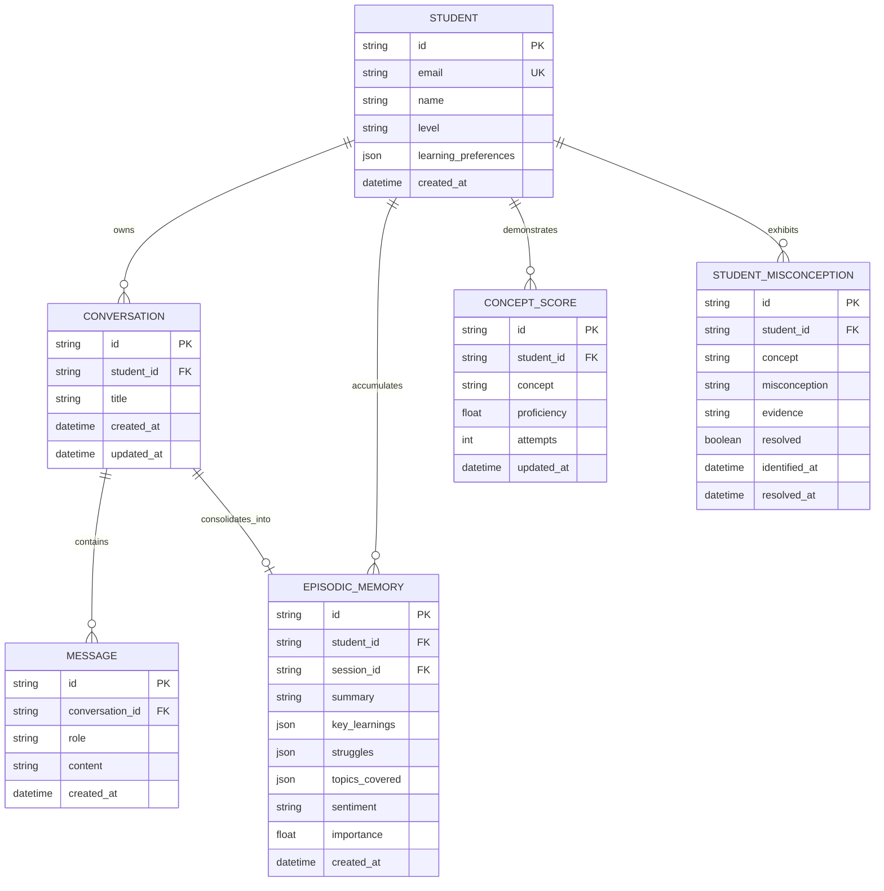
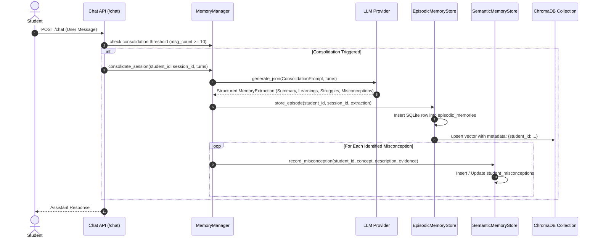

# SocraticAI — Memory Architecture

## Three-Tier Conversational & Longitudinal Student Memory

**Document Version:** 1.0.0  
**Status:** Implemented and Tested  
**Components:** [`apps/backend/app/memory/`](file:///d:/ML/EduAgent-master/apps/backend/app/memory/), [`apps/backend/app/models/orm.py`](file:///d:/ML/EduAgent-master/apps/backend/app/models/orm.py), [`apps/backend/app/repositories/student_repository.py`](file:///d:/ML/EduAgent-master/apps/backend/app/repositories/student_repository.py)

---

## 1. Architectural Overview

SocraticAI implements a biologically-inspired three-tier memory architecture designed to provide contextual continuity across multi-turn tutoring dialogues and multi-session learning trajectories.

```
┌─────────────────────────────────────────────────────────────────────────────┐
│                          SocraticAI Memory Hierarchy                        │
└─────────────────────────────────────────────────────────────────────────────┘

  ┌─────────────────────────────────────────────────────────────────────────┐
  │ 1. Working Memory (Short-Term / Session Scope)                          │
  │    • Recent dialogue turns (configurable N turns)                       │
  │    • Exact verbatim user prompts and assistant responses                │
  │    • Backed by: SQLite `conversations` and `messages` tables            │
  └────────────────────────────────────┬────────────────────────────────────┘
                                       │
                      Periodic Session Consolidation
                                       │
                                       ▼
  ┌─────────────────────────────────────────────────────────────────────────┐
  │ 2. Episodic Memory (Medium-Term / Cross-Session Events)                 │
  │    • Session summaries, breakthroughs, struggles, topics covered        │
  │    • Structured event representations with temporal decay               │
  │    • Backed by: SQLite `episodic_memories` + ChromaDB vector embeddings │
  └────────────────────────────────────┬────────────────────────────────────┘
                                       │
                     Concept Mastery & Misconception Sync
                                       │
                                       ▼
  ┌─────────────────────────────────────────────────────────────────────────┐
  │ 3. Semantic Memory (Long-Term / Longitudinal Profile)                   │
  │    • Concept proficiency scores (EMA weighted: 0.0 - 1.0)               │
  │    • Identified student misconceptions with evidence and status         │
  │    • Learning preferences, student level, and revision schedules        │
  │    • Backed by: `students`, `concept_scores`, `student_misconceptions` │
  └─────────────────────────────────────────────────────────────────────────┘
```

---

## 2. Memory Tier Specifications

### 2.1 Tier 1: Working Memory (Dialogue History)
- **Scope:** Active tutoring session.
- **Persistence:** Relational database (`messages` table) linked to `conversation_id`.
- **Retrieval:** Managed by `ConversationRepository.list_messages`.
- **Windowing:** Governed by `ConversationSettings.working_memory_turns` (default: 10 turns $\rightarrow$ 20 messages).
- **Token Budget:** Enforced by `ContextBuilder.budget_working_history` (default: 1,000 tokens).

### 2.2 Tier 2: Episodic Memory (Cross-Session Experience)
- **Scope:** Cross-session episodic events for an individual student.
- **Persistence:** Dual persistence:
  1. Relational database (`episodic_memories` table) for ACID transactions, metadata queries, and auditing.
  2. ChromaDB collection (`socraticai_episodic_memory`) for dense semantic retrieval.
- **Data Model:**
  - `id`: Unique identifier (UUID).
  - `student_id`: Owning student foreign key.
  - `session_id`: Source conversation ID.
  - `summary`: Abstractive synopsis of the interaction.
  - `key_learnings`: JSON array of concepts mastered or practiced.
  - `struggles`: JSON array of difficulties encountered.
  - `topics_covered`: JSON array of topics explored.
  - `sentiment`: Interaction tone (`positive`, `neutral`, `frustrated`, `confused`).
  - `importance`: Float score ($0.0 \le s \le 1.0$) indicating instructional significance.
  - `created_at`: UTC timestamp.

### 2.3 Tier 3: Semantic Memory (Mastery & Misconceptions)
- **Scope:** Permanent learning profile.
- **Persistence:** SQLite relational tables:
  1. `student_concept_scores`: Proficiency per concept evaluated using Exponential Moving Average (EMA).
  2. `student_misconceptions`: Specific false intuitions or procedural errors identified by the teacher or evaluation agent.
- **EMA Formula:**
  $$\text{Proficiency}_{t} = \alpha \cdot \text{Score}_{t} + (1 - \alpha) \cdot \text{Proficiency}_{t-1}$$
  where $\alpha$ is configurable via `MemorySettings.ema_alpha` (default: $0.3$).

---

## 3. Database Schemas

### 3.1 Entity Relationship Diagram



### 3.2 ChromaDB Episodic Collection Schema

The collection `socraticai_episodic_memory` indexes episodic memory vectors:
- **Document Text:** Natural language summary and key learnings.
- **Embeddings:** Dense vector (384-d or 1536-d depending on configured embedder).
- **Metadata Filters:**
  ```json
  {
    "student_id": "student_abc_123",
    "session_id": "conv_xyz_789",
    "importance": 0.85,
    "timestamp": 1718000000.0
  }
  ```

---

## 4. Memory Consolidation Pipeline

Session consolidation extracts structural knowledge from completed or thresholded dialogue turns and commits it to episodic and semantic storage.

### 4.1 Sequence Diagram



### 4.2 Consolidation Prompt Contract

When consolidation runs, the extraction prompt requests strict JSON conformant to the following schema:
```json
{
  "summary": "The student explored photosynthesis and understood chloroplast function, but struggled with the Calvin cycle.",
  "key_learnings": ["Chloroplast light reactions generate ATP and NADPH"],
  "struggles": ["Carbon fixation mechanism in Calvin cycle"],
  "misconceptions": [
    {
      "concept": "Calvin Cycle",
      "misconception": "Believes the light-independent reactions only take place in darkness.",
      "evidence": "Student stated: 'The dark reaction occurs at night because sunlight damages enzymes.'"
    }
  ],
  "sentiment": "neutral",
  "importance": 0.75
}
```

---

## 5. Contextual Memory Retrieval Algorithm

When assembling context for a new user turn, `MemoryManager.retrieve_contextual_memories` queries the episodic memory store for events relevant to the current query.

### 5.1 Retrieval Scoring Formula

The relevance score $S$ combines semantic vector similarity with an exponential temporal decay penalty:

$$S(d, q, \Delta t) = \text{CosineSimilarity}(\vec{e}_q, \vec{e}_d) \times \exp\left(-\frac{\ln(2)}{T_{1/2}} \cdot \Delta t\right) \times (0.5 + 0.5 \cdot \text{Importance})$$

Where:
- $\vec{e}_q$ is the query embedding vector.
- $\vec{e}_d$ is the episodic document embedding vector.
- $\Delta t$ is the elapsed time in days since memory creation.
- $T_{1/2}$ is the half-life in days (configurable via `MemorySettings.episodic_decay_half_life_days`, default: 30 days).
- $\text{Importance} \in [0.0, 1.0]$ is the assessed pedagogical importance of the memory.

### 5.2 Strict Student Isolation Guarantees

Every episodic vector search mandates a ChromaDB metadata filter:
```python
results = self._collection.query(
    query_embeddings=[query_embedding],
    n_results=limit,
    where={"student_id": student_id},  # STRICT DATA ISOLATION
)
```
No student query can retrieve another student's episodic memories or misconceptions under any condition.

---

## 6. Pruning and Compaction Strategy

To prevent unbounded table and index growth over multi-year tutoring relationships:
1. **Low-Importance Pruning:** Episodic entries with $\text{Importance} < 0.3$ and age $> 90$ days are pruned during scheduled maintenance.
2. **Episodic Rollup:** Multiple episodic memories on the same topic are periodically rolled up into a single consolidated milestone memory.
3. **Misconception Lifecycle:** When a misconception is addressed and verified as resolved in subsequent evaluation quizzes, `resolved` is set to `True`, `resolved_at` is updated, and it is excluded from the active system prompt context.

