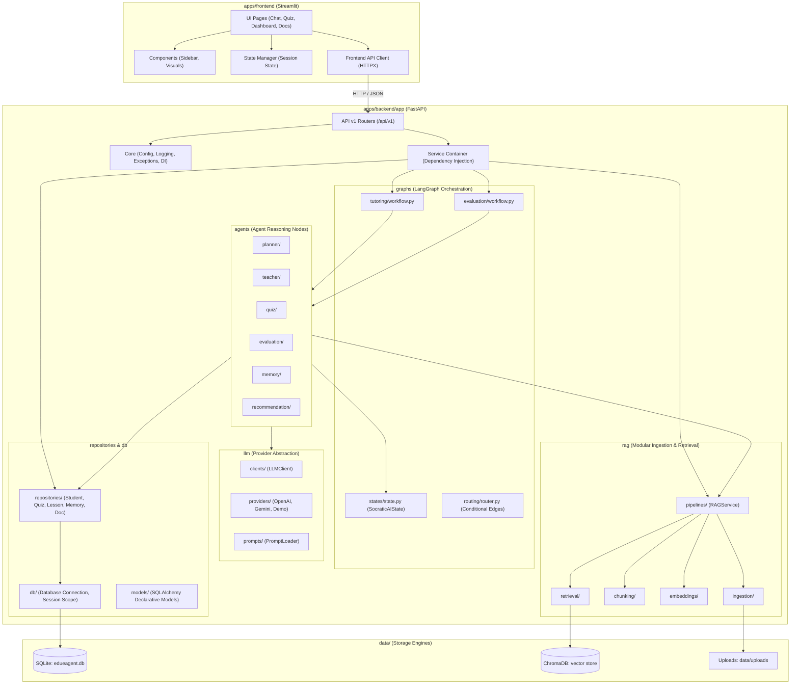
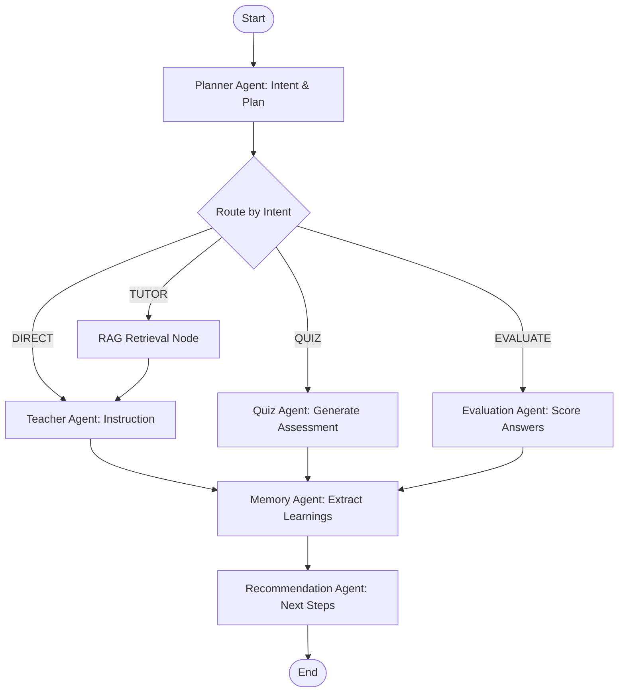

# SocraticAI — Restructured Architecture Specification

## 1. Architectural Overview

SocraticAI is a production-oriented, modular multi-agent tutoring platform built on top of **FastAPI**, **LangGraph**, **ChromaDB**, **SQLAlchemy**, and **Streamlit**.

The restructured architecture achieves complete separation of concerns across presentation, API routing, agent orchestration, retrieval-augmented generation (RAG), and database persistence.



---

## 2. Structural Layer Responsibilities

### 2.1 Backend (`apps/backend/app/`)

| Directory | Layer / Purpose | Key Modules |
| :--- | :--- | :--- |
| `api/v1/` | Versioned RESTful API routes & routers | `routes/health.py`, `routes/chat.py`, `routes/quizzes.py`, `routes/documents.py`, `routes/dashboard.py`, `routes/students.py`, `router.py` |
| `core/` | Framework plumbing, centralized configuration, DI & errors | `config.py`, `logging.py`, `exceptions.py`, `dependencies.py` |
| `agents/` | Specialized agent reasoning engines | `planner/`, `teacher/`, `quiz/`, `evaluation/`, `memory/`, `recommendation/`, `rag/`, `base.py`, `context.py` |
| `graphs/` | LangGraph workflows, state definitions, and routing | `states/state.py`, `routing/router.py`, `tutoring/workflow.py`, `evaluation/workflow.py` |
| `rag/` | Modular Retrieval-Augmented Generation pipeline | `chunking/chunker.py`, `embeddings/provider.py`, `ingestion/pipeline.py`, `retrieval/vector_store.py`, `pipelines/service.py` |
| `llm/` | LLM client abstraction, provider adapters, prompt loaders | `clients/client.py`, `providers/demo.py`, `prompts/loader.py` |
| `services/` | Application dependency injection container | `container.py` |
| `repositories/` | Encapsulated relational database access operations | `student_repository.py`, `quiz_repository.py`, `lesson_repository.py`, `memory_repository.py`, `document_repository.py`, etc. |
| `models/` | SQLAlchemy declarative database models | `orm.py` |
| `schemas/` | Pydantic data schemas, DTOs, and domain enums | `enums.py`, `domain.py` |
| `db/` | Database engine management and transactional session scopes | `connection.py` |
| `utils/` | Reusable cross-cutting helpers (async, string, logging) | `async_utils.py`, `helpers.py`, `logging.py` |

### 2.2 Frontend (`apps/frontend/`)

The Streamlit UI has been modularized to decouple page layouts from network operations and session persistence:

- `app.py`: Main dashboard entry point, navigation dispatcher, and branding.
- `pages/`: Individual application pages:
  - `chat.py`: Interactive tutoring chat interface with multi-turn streaming/response display.
  - `quiz.py`: Dynamic quiz generation, interactive question rendering, submission, and automated score breakdown.
  - `dashboard.py`: Analytics visualizer displaying learning curves, mastery by topic, quiz performance history, and memory items.
  - `documents.py`: Document upload portal, RAG status tracker, and retrieval inspector.
- `components/`: Reusable UI widgets:
  - `sidebar.py`: Navigation drawer, active student selector, and live backend connection health indicator.
- `services/`: Dedicated HTTP API client (`api_client.py`) isolating all network calls and error handling from UI components.
- `utils/`: UI state management (`state.py`) initializing and validating Streamlit session state keys.

### 2.3 Packages (`packages/`)

- `packages/shared/`: Shared domain constants, common type aliases, and lightweight shared utilities.
- `packages/evaluation/`: Agent benchmarking suite containing accuracy, hallucination, latency, quiz quality, and retrieval evaluators.
- `packages/experiments/`: Chunking and embedding parameter exploration harnesses.

### 2.4 Centralized Configurations (`configs/`)

- `configs/prompts/`: Externalized YAML prompt templates for each agent (`planner.yaml`, `teacher.yaml`, `quiz.yaml`, `evaluation.yaml`, `memory.yaml`, `recommendation.yaml`).
- `configs/agents/`: Configuration file `agents.yaml` specifying agent role definitions, temperature overrides, and retry behaviors.
- `configs/rag/`: Configuration file `rag.yaml` defining chunk sizes, chunk overlap, top-k retrieval bounds, and embedding models.

---

## 3. LangGraph Multi-Agent Orchestration

### 3.1 State Representation

All agent transitions exchange the central `SocraticAIState` (aliased as `EduAgentState` for backward compatibility) defined in `app/graphs/states/state.py`. The state is typed and immutable across transitions:

```python
class SocraticAIState(TypedDict, total=False):
    student_id: str
    session_id: str
    message: str
    history: list[dict[str, Any]]
    student_profile: dict[str, Any]
    active_plan: dict[str, Any]
    retrieved_context: list[str]
    intent: str
    next_action: str
    teacher_response: str
    quiz_data: dict[str, Any]
    evaluation_result: dict[str, Any]
    memories_extracted: list[dict[str, Any]]
    recommendations: list[str]
    error: str | None
```

### 3.2 Tutoring Workflow (`tutoring/workflow.py`)

The tutoring graph orchestrates an adaptive learning flow:



- **Planner Agent:** Inspects student query, current progress, and historical memory to decide whether the user needs teaching, quizzing, evaluation, or conversational guidance.
- **RAG Node:** Performs vector similarity search against uploaded course materials to retrieve grounded context.
- **Teacher Agent:** Synthesizes pedagogical responses tailored to the student's mastery level and retrieved context.
- **Quiz Agent:** Generates multiple-choice or short-answer assessment items.
- **Evaluation Agent:** Assesses submitted answers, assigns grades, and provides constructive feedback.
- **Memory Agent:** Extracts key student facts, misconceptions, and breakthroughs, saving them to SQLite.
- **Recommendation Agent:** Suggests personalized next topics or remedial study areas based on session outcomes.

### 3.3 Evaluation Workflow (`evaluation/workflow.py`)

A dedicated evaluation graph that assesses student answers or system response quality against reference benchmarks without re-invoking the full tutoring loop.

---

## 4. RAG Pipeline Architecture

The RAG subsystem (`apps/backend/app/rag/`) is organized into decoupled stages:

1. **Ingestion (`ingestion/pipeline.py`):** Ingests raw PDFs and text documents using PyMuPDF (`fitz`), performing sanitization, metadata tagging, and page tracking.
2. **Chunking (`chunking/chunker.py`):** Uses token-aware sliding window splitting (`tiktoken`) with configurable chunk size and overlap.
3. **Embeddings (`embeddings/provider.py`):** Supports pluggable embedding backends:
   - `SentenceTransformerProvider` (local embedding models, e.g., `all-MiniLM-L6-v2`).
   - `ChromaOnnxProvider` (lightweight ONNX-accelerated embeddings).
4. **Retrieval (`retrieval/vector_store.py`):** Encapsulates ChromaDB persistence, collection management, vector similarity search, and distance filtering.
5. **Pipeline Service (`pipelines/service.py`):** The `RAGService` acts as the single coordinator invoked by the service container and agent nodes.

---

## 5. Persistence Architecture

- **Relational Storage:** SQLite managed via SQLAlchemy 2.0 ORM (`app/models/orm.py`). Repositories (`app/repositories/`) isolate transactional access for:
  - `StudentRepository`: Profile, mastery, grade level.
  - `ConversationRepository`: Chat turns and sessions.
  - `LessonRepository`: Curricula, topics, and lesson plans.
  - `QuizRepository`: Quizzes, questions, options, and student submissions.
  - `MemoryRepository`: Extracted student memories and facts.
  - `ProgressRepository`: Mastery progression logs.
  - `DocumentRepository`: Ingested document registry and metadata.
- **Thread-safe Engine Singleton:** `app.db.connection.Database` manages thread-safe SQLite connection pools with foreign keys enabled and WAL mode.
- **Vector Storage:** ChromaDB stored in `data/chroma/`, managing document embeddings.

---

## 6. LLM Provider Abstraction

SocraticAI isolates all LLM calls behind `app.llm.clients.client.LLMClient`:

- **OpenAI Provider:** Uses `langchain-openai` (`ChatOpenAI`) for GPT-4o, GPT-4o-mini, etc.
- **Gemini Provider:** Uses `langchain-google-genai` (`ChatGoogleGenerativeAI`) for Gemini 1.5 Flash and Pro.
- **Demo Provider:** Offline, deterministic mock LLM provider (`app.llm.providers.demo.DemoLLMProvider`) enabling 100% offline development, testing, and continuous integration without API keys.

---

## 7. Extensibility for Future Capabilities

The new architecture directly enables anticipated roadmap items without structural refactoring:

1. **Multi-Modal Support:** Adding image or audio inputs only requires updating schemas in `app.schemas.domain` and attaching multi-modal encoders in `app.rag.embeddings`.
2. **Distributed Workflows:** LangGraph state checkpointers (e.g. Postgres or Redis checkpointers) can be plugged directly into `tutoring/workflow.py` without modifying agent logic.
3. **Hybrid RAG:** Sparse retrieval (BM25) can be introduced alongside dense vector retrieval by adding a retriever under `app.rag.retrieval` and updating `RAGService`.
4. **API Version 2:** New endpoints can be deployed concurrently under `apps/backend/app/api/v2/` while leaving `/api/v1` intact.

