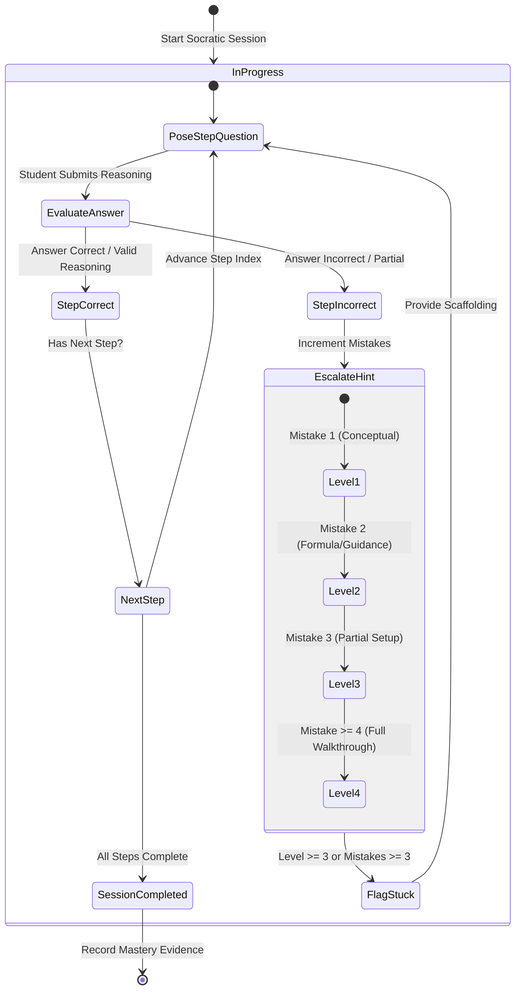
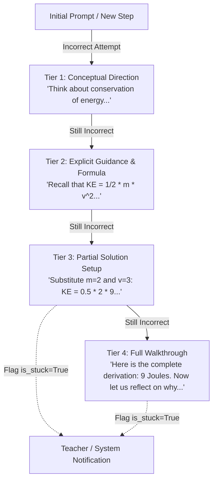
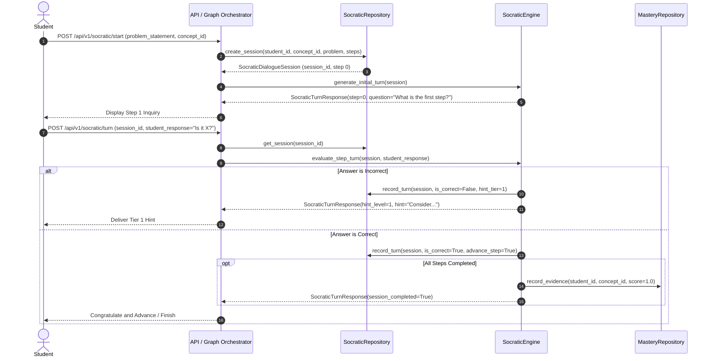

# SocraticAI — Socratic Dialogue Architecture

## Overview

The Socratic Dialogue subsystem is designed to implement active, inquiry-based learning. Instead of directly giving away solutions to complex problems, SocraticAI guides students through structured problem decomposition, evaluates their intermediate reasoning, and provides progressive scaffolding when they struggle.

---

## 1. Core Principles

1. **No Answer Leakage**: The engine explicitly prohibits exposing the final numerical or conceptual answer in early turns. It guides the student to derive the answer independently.
2. **Step Decomposition**: Multi-step problems are divided into discrete sub-questions ($S_1, S_2, \dots, S_N$).
3. **Bounded Dialogue**: Each step has a maximum mistake tolerance. If a student remains stuck, the system escalates scaffolding rather than entering an infinite conversational loop.
4. **Progressive Hint Escalation**: 4 distinct scaffolding tiers:
   - **Tier 1 (Conceptual Direction)**: Re-orient the student toward the foundational concept or relevant law.
   - **Tier 2 (Explicit Guidance / Formula)**: Identify the exact formula, variable, or theorem to apply.
   - **Tier 3 (Partial Solution / Setup)**: Substitute known values or solve the initial algebraic step.
   - **Tier 4 (Full Solution Walkthrough)**: Reveal the step solution with a complete explanation.
5. **Stuck Student Detection**: When `consecutive_mistakes` $\ge 3$ or hint tier reaches Level 4, `is_stuck` is flagged, alerting the orchestrator and human educators.

---

## 2. State Machine and Escalation Lifecycle

---

## 3. Hint Escalation Ladder

---

## 4. Multi-Turn Session Sequence

---

## 5. Persistence and Recovery

Each Socratic dialogue session is backed by the `socratic_dialogue_sessions` table in SQLite:
- `session_id`: UUID primary key.
- `student_id`: Student foreign key.
- `concept_id`: Linked curriculum concept.
- `current_step`: Zero-indexed current step.
- `total_steps`: Number of steps defined for this problem.
- `hint_level`: Currently escalated hint tier (0 to 4).
- `consecutive_mistakes`: Number of consecutive incorrect submissions on the current step.
- `is_stuck`: Boolean flag indicating whether the student is blocked.
- `history_turns`: JSON-encoded transcript of all student submissions and tutor feedback.

When network interruptions or page reloads occur, the session can be retrieved via `GET /api/v1/socratic/session/{session_id}`, enabling seamless resumption of the guided dialogue.
