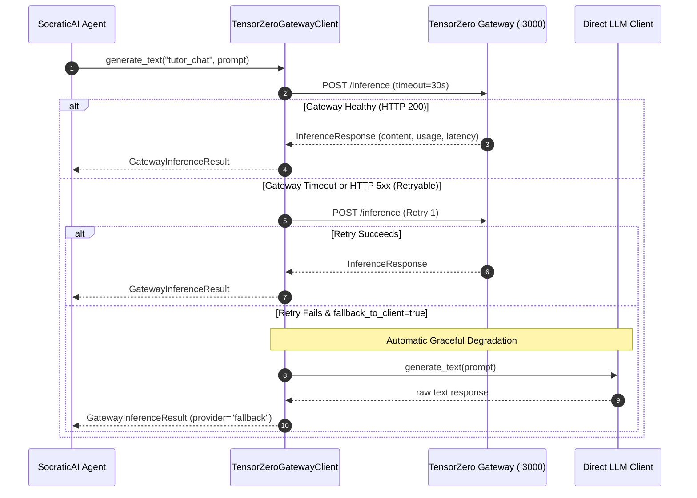

# SocraticAI — TensorZero LLM Gateway Integration

**Document Version:** 1.0.0  
**Status:** Implemented (Milestone 4)  
**Related Modules:**  
- [`apps/backend/app/llm/gateway/tensorzero_client.py`](file:///d:/ML/EduAgent-master/apps/backend/app/llm/gateway/tensorzero_client.py)  
- [`apps/backend/app/llm/gateway/models.py`](file:///d:/ML/EduAgent-master/apps/backend/app/llm/gateway/models.py)  
- [`apps/backend/app/llm/clients/client.py`](file:///d:/ML/EduAgent-master/apps/backend/app/llm/clients/client.py)  
- [`configs/tensorzero/tensorzero.toml`](file:///d:/ML/EduAgent-master/configs/tensorzero/tensorzero.toml)  

---

## 1. Overview & Rationale

Direct point-to-point LLM API calls in microservices create multiple operational challenges:
- Vendor lock-in and scattered SDK dependencies.
- Inconsistent retry logic and timeout policies.
- Lack of centralized token cost tracking and caching.
- Inability to dynamically shift traffic between models without redeploying code.

To solve this cleanly, SocraticAI integrates **TensorZero** as its centralized LLM Gateway. All generative model inferences flow through TensorZero gateway functions, providing unified model routing, automated retries, fallback cascading, latency tracking, and token observability.

---

## 2. Gateway Function Design

TensorZero defines inference entry points as named **functions** in `configs/tensorzero/tensorzero.toml`. SocraticAI implements two primary gateway functions:

### 2.1 `tutor_chat` (Generative Chat Dialogue)
- **Type**: `chat`
- **Purpose**: Conversational tutoring responses, Socratic step generation, and guided hints.
- **Routing Variants**:
  - `primary`: Default production model (e.g., `openai::gpt-4o-mini` with weight 100).
  - `fallback`: High-reliability alternative (e.g., `anthropic::claude-3-5-sonnet` or self-hosted model).
- **System Schema**: Guides educational tone, Socratic questioning, and structured markdown.

### 2.2 `tutor_json` (Structured JSON Extraction & Assessment)
- **Type**: `json`
- **Purpose**: Strictly typed JSON schemas for quiz question generation, student evaluation, and intent classification.
- **Output Schema**: Validated against Pydantic models (`apps/backend/app/schemas/domain.py`) using schema enforcement.

---

## 3. Reliability & Resilience Architecture



### 3.1 Retry & Timeout Policies
1. **Exponential Backoff**: Configurable retry attempts (`TENSORZERO_MAX_RETRIES`, default: 2) with jittered backoff.
2. **Strict Timeouts**: HTTP request timeouts (`TENSORZERO_TIMEOUT_SECONDS`, default: 30.0s) enforced per call to prevent worker thread starvation.
3. **HTTP Status Handling**: 4xx client errors fail fast without retry; 5xx server errors and network connection errors trigger retry logic.

### 3.2 Dynamic Fallback Mechanism
If TensorZero is disabled (`TENSORZERO_ENABLED=false`), unreachable, or fails after retries:
1. `TensorZeroGatewayClient` checks `TENSORZERO_FALLBACK_TO_CLIENT` (default: `true`).
2. The request seamlessly falls back to the configured native client (`DemoLLMClient`, `OpenAILLMClient`, or `AnthropicLLMClient`).
3. Fallback metrics (`socraticai_llm_fallback_total`) and warning logs are immediately recorded.
4. The user experience remains uninterrupted.

---

## 4. Usage, Token, and Latency Tracking

Every gateway response is parsed into a normalized `GatewayInferenceResult`:
```python
class GatewayInferenceResult(BaseModel):
    content: str
    parsed_json: dict[str, Any] | None = None
    model: str
    function_name: str
    latency_ms: float
    prompt_tokens: int = 0
    completion_tokens: int = 0
    total_tokens: int = 0
    raw_response: dict[str, Any] = Field(default_factory=dict)
```

These metrics are instantly recorded via `app.telemetry.metrics`:
- `record_llm_inference(provider, model, function_name, latency, prompt_tokens, completion_tokens)`
- `record_llm_failure(provider, model, error_type)`
- `record_llm_fallback(primary, fallback, function_name)`

---

## 5. Configuration & Setup

In `.env`:
```env
TENSORZERO_ENABLED=true
TENSORZERO_GATEWAY_URL=http://localhost:3000
TENSORZERO_TIMEOUT_SECONDS=30.0
TENSORZERO_MAX_RETRIES=2
TENSORZERO_FALLBACK_TO_CLIENT=true
```

Running via Docker Compose:
```bash
docker compose up -d tensorzero-gateway
```
The gateway mounts `configs/tensorzero/tensorzero.toml` and binds to port `3000`.
