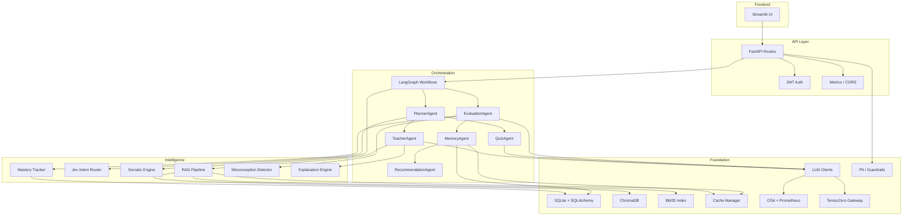
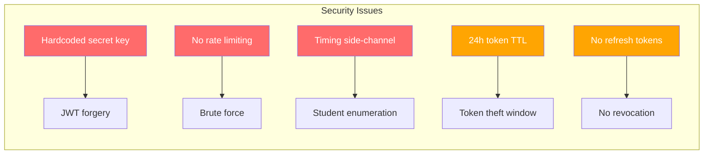
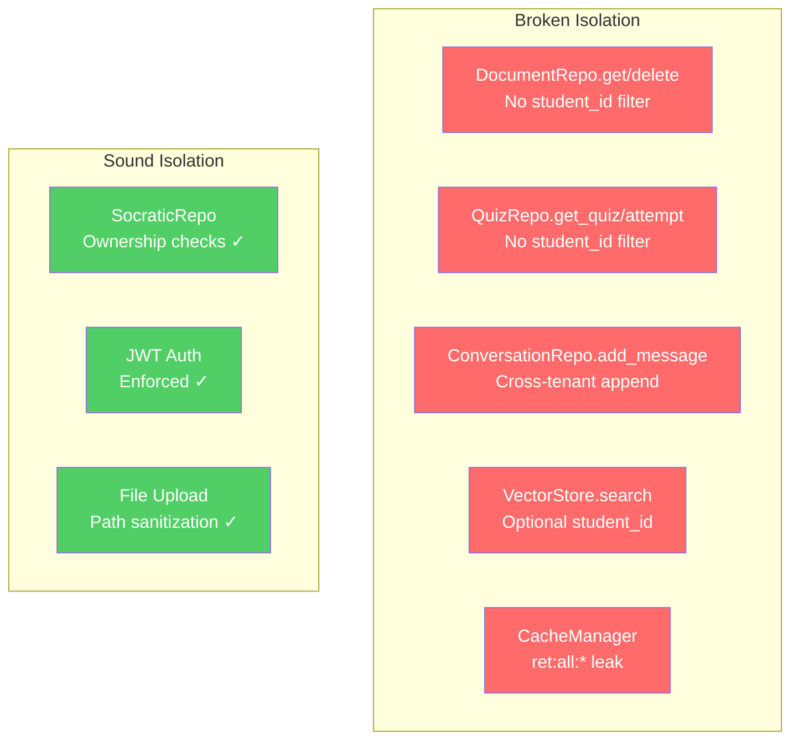

# SocraticAI — Comprehensive Codebase Gap Analysis

> **Audit Date:** November 2026
> **Scope:** Full codebase audit across 9 subsystems after Milestones 1–4
> **Status:** Inspection and documentation only — no code changes

---

## Executive Summary

This audit examined the entire SocraticAI codebase across **9 subsystems**, covering every layer from configuration and security through agents, API, RAG, database, memory, guardrails, telemetry, testing, frontend, and adaptive tutoring.

### Aggregate Findings

| Subsystem | Critical | Warnings | Missing Features | Code Quality Notes |
|---|:---:|:---:|:---:|:---:|
| [Core / Config / Security](#1-core-configuration-and-security) | 7 | 8 | 7 | 7 |
| [Agents / LangGraph](#2-agents-and-langgraph-orchestration) | 4 | 6 | 6 | 6 |
| [API / Routes / Schemas](#3-api-routes-and-schemas) | 5 | 6 | 5 | 7 |
| [RAG / Retrieval](#4-rag-and-retrieval-pipeline) | 4 | 6 | 8 | 6 |
| [Database / Repositories](#5-database-and-repositories) | 4 | 5 | 6 | 6 |
| [Memory / Cache / Routing](#6-memory-cache-and-routing) | 4 | 5 | 5 | 5 |
| [PII / Guardrails / Telemetry](#7-pii-guardrails-and-telemetry) | 5 | 6 | 6 | 6 |
| [Tests / Frontend / Infra](#8-tests-frontend-and-infrastructure) | 5 | 6 | 5 | 5 |
| [Adaptive Tutoring](#9-adaptive-tutoring-and-learning-intelligence) | 4 | 6 | 6 | 5 |
| **Total** | **42** | **54** | **54** | **53** |

### Risk Distribution

```mermaid
xychart-beta
  title "Issues by Subsystem"
  x-axis ["Core", "Agents", "API", "RAG", "DB", "Memory", "PII", "Tests", "Tutor"]
  y-axis "Count" 0 --> 10
  bar [7, 4, 5, 4, 4, 4, 5, 5, 4]
  bar [8, 6, 6, 6, 5, 5, 6, 6, 6]
```

### Subsystem Dependency Map

---

## 1. Core Configuration and Security

**Files inspected:**
[config.py](file:///d:/ML/EduAgent-master/apps/backend/app/core/config.py) ·
[security.py](file:///d:/ML/EduAgent-master/apps/backend/app/core/security.py) ·
[dependencies.py](file:///d:/ML/EduAgent-master/apps/backend/app/core/dependencies.py) ·
[exceptions.py](file:///d:/ML/EduAgent-master/apps/backend/app/core/exceptions.py) ·
[main.py](file:///d:/ML/EduAgent-master/apps/backend/app/main.py) ·
[.env](file:///d:/ML/EduAgent-master/.env) ·
[pyproject.toml](file:///d:/ML/EduAgent-master/pyproject.toml)

### Critical Issues

> [!CAUTION]
> **7 critical security and reliability issues identified.**

1. **Insecure hardcoded default secret key.**
   `AuthSettings.secret_key` defaults to `socraticai-dev-insecure-secret-key-32b-min!!`. The `.env` file omits `AUTH_SECRET_KEY`, so running instances use this publicly known key, allowing arbitrary JWT forgery.
   — [config.py, line 164](file:///d:/ML/EduAgent-master/apps/backend/app/core/config.py)

2. **Active API key exposed in `.env`.**
   `LLM_GEMINI_API_KEY=AIzaSy...[REDACTED]` is present as a plain-text credential. While `.env` is in `.gitignore`, working-tree credentials risk accidental commit or container layer leakage.
   — [.env](file:///d:/ML/EduAgent-master/.env)

3. **Roll-your-own JWT implementation.**
   [security.py](file:///d:/ML/EduAgent-master/apps/backend/app/core/security.py) manually constructs and parses JWT tokens via `hmac` and `json.loads` instead of PyJWT. Missing standard claims (`nbf`, `aud`, `iss`), no token type validation, and non-ASCII tokens cause unhandled `UnicodeEncodeError` → HTTP 500.

4. **Zero rate limiting.**
   No rate-limiting mechanism exists on authentication endpoints (`/login`, `/register`) or LLM inference endpoints. Vulnerable to brute-force, credential stuffing, and denial-of-wallet attacks.

5. **Timing side-channel for student enumeration.**
   `StudentRepository.authenticate` returns immediately (~0.1 ms) for non-existent students but runs bcrypt (~250 ms) for existing ones. Attackers can enumerate valid student IDs via response timing.
   — [student_repository.py](file:///d:/ML/EduAgent-master/apps/backend/app/repositories/student_repository.py)

6. **Undeclared critical runtime dependencies.**
   `bcrypt`, `prometheus_client`, and OpenTelemetry packages are imported but not declared in [pyproject.toml](file:///d:/ML/EduAgent-master/pyproject.toml) or [requirements.txt](file:///d:/ML/EduAgent-master/requirements.txt). They exist only as transitive deps of `chromadb`.

7. **Debug mode defaults to `True`, host to `0.0.0.0`.**
   Production instances expose interactive tracebacks and bind to all network interfaces.
   — [config.py](file:///d:/ML/EduAgent-master/apps/backend/app/core/config.py)

### Warnings

| # | Warning | Location |
|---|---|---|
| 1 | 24-hour JWT expiration with no refresh tokens or revocation | [config.py](file:///d:/ML/EduAgent-master/apps/backend/app/core/config.py) |
| 2 | No HTTP security headers (CSP, HSTS, X-Frame-Options, nosniff) | [main.py](file:///d:/ML/EduAgent-master/apps/backend/app/main.py) |
| 3 | Wildcard CORS (`allow_methods=["*"]`, `allow_headers=["*"]`) with credentials | [main.py](file:///d:/ML/EduAgent-master/apps/backend/app/main.py) |
| 4 | Silent password truncation at 72 bytes; potential UTF-8 boundary slicing | [security.py](file:///d:/ML/EduAgent-master/apps/backend/app/core/security.py) |
| 5 | JWT claim overwriting via `payload.update(additional_claims)` without reserved claim protection | [security.py](file:///d:/ML/EduAgent-master/apps/backend/app/core/security.py) |
| 6 | `python-multipart>=0.0.9` lower bound admits CVE-2024-41989 / CVE-2024-41991 (DoS) | [pyproject.toml](file:///d:/ML/EduAgent-master/pyproject.toml) |
| 7 | Discrepancy between `pyproject.toml` and `requirements.txt` — 3 packages missing from requirements | [requirements.txt](file:///d:/ML/EduAgent-master/requirements.txt) |
| 8 | Broad dependency version ranges; `uv.lock` out of sync | [pyproject.toml](file:///d:/ML/EduAgent-master/pyproject.toml) |

### Missing Features

- Pydantic validators/constrained fields across 28+ settings fields (temperature bounds, threshold ranges, enum restrictions, URL validation).
- Refresh token architecture and token revocation/blacklisting.
- Account lockout and failed login throttling.
- Constant-time dummy bcrypt verification for non-existent users.
- Password complexity policy beyond `min_length=6`.
- Global catch-all exception handler for non-domain exceptions.
- Credential/PII redaction in log output.

### Code Quality Notes

- Roll-your-own JWT bypasses standard claims enforcement.
- `verify_password` swallows all exceptions (`except Exception`) instead of specifically handling `ValueError`.
- Mutable default list in `PIISettings.enabled_categories` without `default_factory`.
- DDL `create_all()` runs on lifespan startup — race condition under multi-worker deployments.
- Internal identity leakage in authentication error messages.
- Legacy `EduAgentError = SocraticAIError` alias remains in exceptions.
- 28 configuration fields defined but never read by application code.

### Observations

- `AuthSettings.algorithm` is defined but hardcoded in `security.py` — the config field is dead.
- Duplicate `recommendation` / `adaptive_recommendation` nested settings.
- No security scanning tools (`bandit`, `safety`, `pip-audit`) in developer configuration.
- `rank-bm25` package unmaintained since 2020.

---

## 2. Agents and LangGraph Orchestration

**Files inspected:**
[base.py](file:///d:/ML/EduAgent-master/apps/backend/app/agents/base.py) ·
[planner/agent.py](file:///d:/ML/EduAgent-master/apps/backend/app/agents/planner/agent.py) ·
[teacher/agent.py](file:///d:/ML/EduAgent-master/apps/backend/app/agents/teacher/agent.py) ·
[evaluation/agent.py](file:///d:/ML/EduAgent-master/apps/backend/app/agents/evaluation/agent.py) ·
[memory/agent.py](file:///d:/ML/EduAgent-master/apps/backend/app/agents/memory/agent.py) ·
[graphs/\_\_init\_\_.py](file:///d:/ML/EduAgent-master/apps/backend/app/graphs/__init__.py) ·
[graphs/tutoring.py](file:///d:/ML/EduAgent-master/apps/backend/app/graphs/tutoring.py) ·
[graphs/evaluation.py](file:///d:/ML/EduAgent-master/apps/backend/app/graphs/evaluation.py)

### Critical Issues

> [!CAUTION]
> **4 critical agent/orchestration issues that impact correctness and reliability.**

1. **TeacherAgent omits the student's actual message from its prompt.**
   The prompt uses topic, level, and learning_goal but drops `state["user_input"]`. When routing `ANSWER_QUESTION → rag → teacher`, the teacher generates generic explanations instead of answering the student's specific question.
   — [teacher/agent.py](file:///d:/ML/EduAgent-master/apps/backend/app/agents/teacher/agent.py)

2. **General chat turns bypass conversation persistence.**
   When PlannerAgent routes to `Routes.END` for conversational/upload intents, neither the user's message nor the assistant's reply is persisted. MemoryAgent is never invoked, so no facts are extracted.
   — [planner/agent.py](file:///d:/ML/EduAgent-master/apps/backend/app/agents/planner/agent.py)

3. **Crashing `%e` format specifier in EvaluationAgent.**
   Line 222 uses `logger.warning("... %s: %e", topic, e)`. The `%e` exponential format specifier crashes with `TypeError` when passed an `Exception` object, crashing the error handler itself.
   — [evaluation/agent.py, line 222](file:///d:/ML/EduAgent-master/apps/backend/app/agents/evaluation/agent.py)

4. **No error handling in core agent pipelines.**
   MemoryAgent, PlannerAgent, QuizAgent, RAGAgent, and TeacherAgent lack `try/except` around LLM generations, vector searches, and domain engines. Failures crash the LangGraph turn without populating `state['errors']`.

### Warnings

| # | Warning | Impact |
|---|---|---|
| 1 | Ineffective `thread_id` — no LangGraph checkpointer registered | No checkpoint persistence across turns |
| 2 | Disconnected `conversation_id` propagation — most agents ignore it | Artifacts not queryable by session |
| 3 | High token consumption without metering — 3–5 LLM calls per turn | No budget guards or cost tracking |
| 4 | Double intent classification: JevRouter then PlannerAgent | Redundant LLM call, latency overhead |
| 5 | Planner does not control downstream workflow; `prerequisites` discarded | Single-step router, not a real planner |
| 6 | 10+ state schema fields never read or populated | Schema debt and confusion |

### Missing Features

- Formal agent base class / Protocol enforcing lifecycle contracts.
- LangGraph checkpointer integration (MemorySaver or AsyncPostgresSaver).
- Error handling and recovery nodes in the graph.
- Session-scoped learning artifact association.
- Dynamic multi-step planning (DAG/adaptive plans).
- Token usage metering and cost limits.

### Code Quality Notes

- `base.py` contains no base classes — only prompt-rendering helpers.
- `AgentContext` is a 26-dependency God Object violating ISP.
- Agent methods annotate state as `dict` instead of `SocraticAIState`.
- In-place mutation of state objects in MemoryAgent.
- Dead routing constants `Routes.RAG_ONLY` and `Routes.TUTORING`.
- Deferred imports as circular dependency workaround.

### Observations

- Single-compilation lifecycle: graphs compiled once and cached as lazy singletons.
- Strict service isolation: agents don't perform direct DB, HTTP, or FS I/O.
- Clean hybrid grading: deterministic for objective, LLM for subjective.
- Linear evaluation workflow (`START → evaluation → memory → recommendation → END`) is clean.
- Modular agent boundaries: agents don't import each other.

---

## 3. API Routes and Schemas

**Files inspected:**
[routes/chat.py](file:///d:/ML/EduAgent-master/apps/backend/app/api/v1/routes/chat.py) ·
[routes/documents.py](file:///d:/ML/EduAgent-master/apps/backend/app/api/v1/routes/documents.py) ·
[routes/quizzes.py](file:///d:/ML/EduAgent-master/apps/backend/app/api/v1/routes/quizzes.py) ·
[routes/students.py](file:///d:/ML/EduAgent-master/apps/backend/app/api/v1/routes/students.py) ·
[routes/health.py](file:///d:/ML/EduAgent-master/apps/backend/app/api/v1/routes/health.py) ·
[routes/socratic.py](file:///d:/ML/EduAgent-master/apps/backend/app/api/v1/routes/socratic.py) ·
[schemas/domain.py](file:///d:/ML/EduAgent-master/apps/backend/app/schemas/domain.py) ·
[main.py](file:///d:/ML/EduAgent-master/apps/backend/app/main.py)

### Critical Issues

> [!CAUTION]
> **5 critical API issues including data leakage and observability risks.**

1. **Quiz answers/rubrics leaked to students.**
   `GET /api/v1/quiz/{quiz_id}` returns `quiz.model_dump()` using the internal Quiz model, transmitting `correct_answer`, `explanation`, and grading rubrics to the student before submission.
   — [quizzes.py](file:///d:/ML/EduAgent-master/apps/backend/app/api/v1/routes/quizzes.py)

2. **Prometheus high-cardinality TSDB memory exhaustion.**
   HTTP metrics middleware records raw `request.url.path` as the `endpoint` label. Dynamic path parameters create an unbounded number of time series → server OOM risk.
   — [main.py](file:///d:/ML/EduAgent-master/apps/backend/app/main.py)

3. **Unvalidated string enums in `StudentProfileUpdate`.**
   `level` and `learning_style` are plain `str` instead of enums. Invalid values write to the database and crash subsequent profile loads with `ValueError` (HTTP 500).
   — [students.py](file:///d:/ML/EduAgent-master/apps/backend/app/api/v1/routes/students.py)

4. **Soft error handling returns HTTP 200 for failures.**
   Quiz evaluation failures, document ingestion errors, and guardrail blocks return `{"error": ...}` with HTTP 200 instead of proper 4xx/5xx codes.
   — [chat.py](file:///d:/ML/EduAgent-master/apps/backend/app/api/v1/routes/chat.py), [documents.py](file:///d:/ML/EduAgent-master/apps/backend/app/api/v1/routes/documents.py)

5. **No rate limiting on any endpoint** (same as Core §1.4).

### Warnings

| # | Warning |
|---|---|
| 1 | Missing `response_model` on many routes — returns untyped dicts |
| 2 | In-memory file upload buffering up to 25 MB per concurrent request |
| 3 | Unpaginated list endpoints (`/documents`, `/quizzes`, `/mastery`) |
| 4 | Oversized monolithic payloads without filtering on `/dashboard/me` |
| 5 | Missing path/query parameter validation (length, regex, range) |
| 6 | Overly permissive CORS defaults with credentials |

### Missing Features

- Streaming / SSE for long LLM operations.
- Standardized error response schemas in OpenAPI.
- Student-facing quiz view schema (stripping answers/rubrics).
- Pagination query parameters on all list endpoints.
- Field filtering / sparse fieldsets (`?fields=...`).

### Code Quality Notes

- `SubmitQuizRequest` uses `list[dict[str, Any]]` instead of existing `AnswerSubmission` schema.
- Domain schemas use untyped `dict[str, Any]` for provenance fields.
- Redundant `student_id` path parameter pattern — should use JWT `current_student` directly.
- Inconsistent URL naming: `/quizzes/{student_id}` (plural) vs `/quiz/{quiz_id}` (singular).
- Route-specific request models declared inline instead of centralized in `app.schemas`.
- `ApiSettings.pagination_default_size` defined but never referenced.
- Unused `DashboardSummary` schema — routes return raw dicts.

### Observations

- Clean repository pattern: no route directly accesses the database engine.
- Strict authentication enforcement on all business routes.
- Robust file upload security: path traversal mitigation, size limits, magic byte validation.

---

## 4. RAG and Retrieval Pipeline

**Files inspected:**
[rag/service.py](file:///d:/ML/EduAgent-master/apps/backend/app/rag/service.py) ·
[rag/chunker.py](file:///d:/ML/EduAgent-master/apps/backend/app/rag/chunker.py) ·
[rag/ingestion.py](file:///d:/ML/EduAgent-master/apps/backend/app/rag/ingestion.py) ·
[rag/vector_store.py](file:///d:/ML/EduAgent-master/apps/backend/app/rag/vector_store.py) ·
[rag/bm25.py](file:///d:/ML/EduAgent-master/apps/backend/app/rag/bm25.py) ·
[rag/hybrid.py](file:///d:/ML/EduAgent-master/apps/backend/app/rag/hybrid.py) ·
[rag/reranker.py](file:///d:/ML/EduAgent-master/apps/backend/app/rag/reranker.py) ·
[rag/citations.py](file:///d:/ML/EduAgent-master/apps/backend/app/rag/citations.py) ·
[cache/manager.py](file:///d:/ML/EduAgent-master/apps/backend/app/cache/manager.py) ·
[context/builder.py](file:///d:/ML/EduAgent-master/apps/backend/app/context/builder.py)

### Critical Issues

> [!CAUTION]
> **4 critical retrieval issues including a code execution vulnerability.**

1. **Retrieval cache strips critical metadata on cache hit.**
   `CacheManager.get_retrieval` reconstructs `RetrievedChunk` with only `content`, `source`, `page`, `score` — discarding `chunk_id`, `document_id`, `section_title`, `section_path`, and `content_hash`. Citation verification and evaluation metrics break on cache hits.
   — [manager.py, lines 93-101](file:///d:/ML/EduAgent-master/apps/backend/app/cache/manager.py)

2. **Tenant data isolation bypass in vector search.**
   `student_id` is optional in `VectorStore.search()`. When omitted, ChromaDB queries the shared `socraticai_notes` collection without filtering, returning chunks across all students.
   — [vector_store.py](file:///d:/ML/EduAgent-master/apps/backend/app/rag/vector_store.py)

3. **Arbitrary code execution via `pickle.load()`.**
   `BM25Index._get_or_load_index()` deserializes per-student indices from `{safe_id}.pkl` without cryptographic signing. Manipulated index files execute arbitrary code.
   — [bm25.py](file:///d:/ML/EduAgent-master/apps/backend/app/rag/bm25.py)

4. **No document versioning — re-upload creates duplicate stale chunks.**
   Re-uploading an edited document generates a new `doc_id`. Previous versions remain indexed in ChromaDB and BM25, causing duplicate and conflicting chunks in retrieval results.
   — [documents.py](file:///d:/ML/EduAgent-master/apps/backend/app/api/v1/routes/documents.py)

### Warnings

| # | Warning |
|---|---|
| 1 | Unweighted hybrid fusion — no configurable dense/BM25 weight balance |
| 2 | Fallback ONNX embedder ignores configured model name |
| 3 | BM25 O(N) in-memory rebuild on every document add/delete |
| 4 | Coarse cache invalidation; `ret:all:*` keys never invalidated |
| 5 | Memory pressure from single-batch embedding of up to 2000 chunks |
| 6 | Brittle regex citation verification — fails on alternative citation styles |

### Missing Features

- OCR / scanned document processing.
- Table-aware PDF extraction (PyMuPDF `find_tables()` unused).
- Sentence-aware / semantic boundary chunking.
- Enterprise inverted index for BM25 (Tantivy, SQLite FTS5).
- Weighted / parameterized hybrid fusion.
- Rich metadata filtering in vector search beyond `student_id`.
- Distributed caching backend (Redis/KeyDB).
- NLI-based citation entailment (instead of token-overlap heuristics).

### Code Quality Notes

- Dead heading patterns in `SectionAwareChunker` — only `#` pattern used.
- `ChunkingSettings.strategy` and `max_section_size` defined but ignored.
- Non-stable `hash()` used instead of `hashlib` — randomized across processes.
- Inconsistent chunk ID formats across chunker, vector store, BM25, and hybrid retriever.
- Magic numbers: 600 tokens, 100 overlap, 2000 max chunks, 60 RRF-k, 0.1 BM25 floor.
- Orphaned `configs/rag/rag.yaml` — never loaded by backend code.

### Observations

- **Chunking:** Pseudo-section-aware. Markdown splits on `#` headings; PDFs/text default to pages. Within sections, fixed-size 600-token sliding windows with 100-token overlap via tiktoken `cl100k_base`.
- **Embedding:** `all-MiniLM-L6-v2` (384 dims) by default. Configurable but ONNX fallback hardcodes the model.
- **Hybrid retrieval:** RRF with `k=60`, unweighted. Dense and BM25 each contribute 10 candidates.
- **Reranker:** `cross-encoder/ms-marco-MiniLM-L-6-v2`, disabled by default. Lazy-loaded with graceful fallback.
- **ChromaDB:** Single global `socraticai_notes` collection with cosine distance and metadata filtering.
- **Documents loaded entirely into memory** — uploads, parsing, chunking, and embedding all in-memory.

---

## 5. Database and Repositories

**Files inspected:**
[models/orm.py](file:///d:/ML/EduAgent-master/apps/backend/app/models/orm.py) ·
[database/connection.py](file:///d:/ML/EduAgent-master/apps/backend/app/database/connection.py) ·
[repositories/student_repository.py](file:///d:/ML/EduAgent-master/apps/backend/app/repositories/student_repository.py) ·
[repositories/conversation_repository.py](file:///d:/ML/EduAgent-master/apps/backend/app/repositories/conversation_repository.py) ·
[repositories/quiz_repository.py](file:///d:/ML/EduAgent-master/apps/backend/app/repositories/quiz_repository.py) ·
[repositories/document_repository.py](file:///d:/ML/EduAgent-master/apps/backend/app/repositories/document_repository.py) ·
[repositories/mastery_repository.py](file:///d:/ML/EduAgent-master/apps/backend/app/repositories/mastery_repository.py) ·
[repositories/memory_repository.py](file:///d:/ML/EduAgent-master/apps/backend/app/repositories/memory_repository.py) ·
[repositories/socratic_repository.py](file:///d:/ML/EduAgent-master/apps/backend/app/repositories/socratic_repository.py) ·
[container.py](file:///d:/ML/EduAgent-master/apps/backend/app/container.py)

### Critical Issues

> [!CAUTION]
> **4 critical data integrity and isolation issues.**

1. **Broken data isolation / IDOR vulnerabilities.**
   Multiple repository methods query by primary key without `student_id` filtering: `DocumentRepository.get()`, `.delete()`, `.update_status()`, `QuizRepository.get_quiz()`, `.get_attempt()`, `ConversationRepository.get_session()`, and all single-session operations in `SocraticRepository`. `ConversationRepository.add_message` can append messages across student boundaries.

2. **Fragmented transaction management — no Unit of Work.**
   Repositories auto-commit per method. Multi-repository operations (grade quiz → update mastery → record attempt → save progress) cannot share a transactional boundary. Intermediate failures cause partial commits and corrupt state.

3. **Missing foreign key cascades → `IntegrityError` on delete.**
   All 18 tables lack `ondelete='CASCADE'`. No `relationship(cascade='all, delete-orphan')` exists. Deleting a `Student` or `Quiz` triggers `IntegrityError` from surviving dependent records.

4. **No Alembic migration framework.**
   Schema changes rely on `Base.metadata.create_all()` (purely additive). Cannot alter columns, modify types, add constraints, or update indexes on existing production databases.

### Warnings

| # | Warning |
|---|---|
| 1 | Missing indexes on all foreign key columns in high-cardinality tables |
| 2 | N+1 query risks: `check_prerequisites_satisfied` (1+N), `seed_default_curriculum` (30+ roundtrips) |
| 3 | Unconfigured connection pooling; SQLite lacks WAL mode and `busy_timeout` |
| 4 | Timestamps stored as `String(32)` instead of native `DateTime(timezone=True)` |
| 5 | Missing uniqueness constraints on concept/mastery/prerequisite records |

### Missing Features

- Alembic migration environment.
- Request-scoped Unit of Work / session lifecycle management.
- Complete student account deletion / GDPR erasure with cascading cleanup.
- Soft delete support (`is_deleted`, `deleted_at`).
- `CheckConstraint` on numeric fields (score, confidence in 0.0–1.0; points ≥ 0).
- Dedicated repositories for `StudentMisconception` and `EpisodicMemoryRow`.

### Code Quality Notes

- Repository return type inconsistency: mix of ORM models, domain schemas, raw dicts, and scalars.
- `semantic.py` and `episodic.py` bypass the repository layer — direct session access.
- In-memory filtering and deduplication instead of SQL `WHERE`/`DISTINCT`.
- Inconsistent student provisioning: some repos create dummy records, others raise FK violations.
- `StudentProfileRow = Student` alias defined 3 times in ORM.
- Thread-unsafe `get_container()` singleton — no `threading.Lock`.

### Observations

- Zero raw SQL injection vectors — all queries use SQLAlchemy 2.0 `select()` / `delete()` / `func.count()`.
- Several relational IDs lack FK constraints entirely (`Conversation.conversation_id`, `SocraticDialogueSession.conversation_id`).
- Complete absence of SQLAlchemy `relationship()` / `back_populates` — no eager loading possible.
- Redundant student state across Student JSON columns, Topic table, ConceptScoreRow, and ConceptMasteryRow.
- Duplicate `create_schema()` execution on startup.

---

## 6. Memory, Cache, and Routing

**Files inspected:**
[memory/manager.py](file:///d:/ML/EduAgent-master/apps/backend/app/memory/manager.py) ·
[memory/semantic.py](file:///d:/ML/EduAgent-master/apps/backend/app/memory/semantic.py) ·
[memory/episodic.py](file:///d:/ML/EduAgent-master/apps/backend/app/memory/episodic.py) ·
[cache/manager.py](file:///d:/ML/EduAgent-master/apps/backend/app/cache/manager.py) ·
[cache/lru.py](file:///d:/ML/EduAgent-master/apps/backend/app/cache/lru.py) ·
[context/builder.py](file:///d:/ML/EduAgent-master/apps/backend/app/context/builder.py) ·
[routing/jev_router.py](file:///d:/ML/EduAgent-master/apps/backend/app/routing/jev_router.py) ·
[llm/clients/client.py](file:///d:/ML/EduAgent-master/apps/backend/app/llm/clients/client.py) ·
[llm/clients/demo.py](file:///d:/ML/EduAgent-master/apps/backend/app/llm/clients/demo.py) ·
[llm/clients/tensorzero_client.py](file:///d:/ML/EduAgent-master/apps/backend/app/llm/clients/tensorzero_client.py)

### Critical Issues

> [!CAUTION]
> **4 critical issues affecting memory, context, and LLM integration.**

1. **Broken `agenerate()` call in memory consolidation.**
   `MemoryManager.consolidate_session` calls `self._llm.agenerate(system_prompt=..., user_prompt=...)`. No LLM client implements `agenerate` — the method is `generate(system, user)`. Every consolidation trigger crashes with `AttributeError` and silently degrades to a trivial static template string.
   — [manager.py, lines 98-101](file:///d:/ML/EduAgent-master/apps/backend/app/memory/manager.py)

2. **Unenforced total context token budget.**
   `ContextBuilder` calculates individual section budgets (totaling 4000 tokens) but doesn't budget `user_message` or enforce `total_budget` on the final assembled prompt. Large inputs exceed model context windows, causing API failures.
   — [builder.py](file:///d:/ML/EduAgent-master/apps/backend/app/context/builder.py)

3. **Cross-tenant cache collision risk.**
   `make_retrieval_key` generates `ret:{student_id or 'all'}:{query_hash}`. Queries without `student_id` cache under `ret:all:*`. Private document chunks cached under this key are served to any subsequent unauthenticated request.
   — [manager.py, line 77](file:///d:/ML/EduAgent-master/apps/backend/app/cache/manager.py)

4. **Temperature parameter silently ignored for Gemini provider.**
   In `LLMClient.generate()`, the runtime `temperature` parameter is only applied when `provider == 'openai'`. Gemini calls silently discard the temperature argument.
   — [client.py, lines 110-117](file:///d:/ML/EduAgent-master/apps/backend/app/llm/clients/client.py)

### Warnings

| # | Warning |
|---|---|
| 1 | Passive TTL expiration — stale cache keys remain in memory indefinitely |
| 2 | LLM response cache key lacks tenant isolation (no `student_id`) |
| 3 | MemoryAgent bypasses episodic and semantic vector stores — only writes to SQLite |
| 4 | No distributed cache backend — process-isolated caches in multi-worker deployments |
| 5 | Accumulation of conflicting chunks on document updates |

### Missing Features

- Streaming LLM generation support.
- Temporal decay / forgetting curve for episodic memory.
- Active background cache expiration (TTL sweeper).
- Unified `BaseLLMClient` ABC or Protocol.
- Document re-upload / in-place replacement workflow.

### Code Quality Notes

- `get_llm_response` / `set_llm_response` are implemented in CacheManager but never called.
- Brittle reflection-based dispatch in DemoLLMClient via `getattr`.
- Hardcoded `_REAL_PROVIDERS = ('openai', 'gemini')` prevents dynamic provider registration.
- Duplicated formatting logic in ContextBuilder for history assembly.
- OpenAI client instantiation churn on temperature overrides — breaks connection pooling.

### Observations

- Three-tier hybrid intent routing: pre-validation → Jev System One → deterministic regex/keyword fallback.
- Concurrent shadow benchmarking in `CompositeDecisionProvider` for cross-provider agreement metrics.
- Automated retrieval cache invalidation on ingestion/deletion.
- Deduplication in context assembly via content hash.

---

## 7. PII, Guardrails, and Telemetry

**Files inspected:**
[guardrails/pii.py](file:///d:/ML/EduAgent-master/apps/backend/app/guardrails/pii.py) ·
[guardrails/nemo.py](file:///d:/ML/EduAgent-master/apps/backend/app/guardrails/nemo.py) ·
[guardrails/rails.py](file:///d:/ML/EduAgent-master/apps/backend/app/guardrails/rails.py) ·
[telemetry/metrics.py](file:///d:/ML/EduAgent-master/apps/backend/app/telemetry/metrics.py) ·
[telemetry/tracing.py](file:///d:/ML/EduAgent-master/apps/backend/app/telemetry/tracing.py) ·
[llm/clients/tensorzero_client.py](file:///d:/ML/EduAgent-master/apps/backend/app/llm/clients/tensorzero_client.py) ·
[configs/guardrails/](file:///d:/ML/EduAgent-master/configs/guardrails) ·
[configs/tensorzero/tensorzero.toml](file:///d:/ML/EduAgent-master/configs/tensorzero/tensorzero.toml)

### Critical Issues

> [!CAUTION]
> **5 critical issues in PII protection, guardrails, and LLM gateway.**

1. **NeMo Colang flows are non-functional stubs.**
   `NeMoGuardrailsService` initializes `LLMRails` from `configs/guardrails/` but `self._llm_rails` is never invoked in any validation method. All validation relies exclusively on hardcoded Python regexes. The `.co`, `actions.py`, and `prompts.yml` files never execute at runtime.
   — [nemo.py](file:///d:/ML/EduAgent-master/apps/backend/app/guardrails/nemo.py)

2. **PII detector is regex-only — misses non-Western names entirely.**
   Name matching requires ASCII title-cased words preceded by rigid trigger prefixes (`"my name is"`, `"Mr."`). Completely misses: non-Latin scripts (Chinese, Arabic, Cyrillic, Devanagari), accented Latin names (José, François), mononyms, hyphenated/apostrophized names, and any name without a trigger prefix.
   — [pii.py](file:///d:/ML/EduAgent-master/apps/backend/app/guardrails/pii.py)

3. **PII redaction bypassed on document ingestion, quiz submissions, and embeddings.**
   Document uploads are parsed, chunked, and embedded into ChromaDB and external embedding APIs with zero PII redaction. Quiz answers pass to the evaluation graph unredacted. TensorZero gateway has no redaction hook.
   — [documents.py](file:///d:/ML/EduAgent-master/apps/backend/app/api/v1/routes/documents.py), [chat.py](file:///d:/ML/EduAgent-master/apps/backend/app/api/v1/routes/chat.py)

4. **ExecutionRails SQL injection check blocks legitimate educational content.**
   `'--'` substring match triggers false positives on CLI flags (`--help`), markdown dashes, math subtraction. Queries about database concepts (`drop table`, `union select`) are blocked when retrieving educational content.
   — [rails.py](file:///d:/ML/EduAgent-master/apps/backend/app/guardrails/rails.py)

5. **TensorZero `generate_json` has broken fallback.**
   On gateway failure, the fallback calls `self.fallback_client.generate()` (returning raw text) instead of `self.fallback_client.generate_json(model_class=model_class)`, causing `LLMOutputParsingError` on structured output fallback.
   — [tensorzero_client.py](file:///d:/ML/EduAgent-master/apps/backend/app/llm/clients/tensorzero_client.py)

### Warnings

| # | Warning |
|---|---|
| 1 | PII mapping context not thread-safe under concurrent subtasks |
| 2 | TensorZero client lacks connection pooling/keepalive configuration |
| 3 | Telemetry spans dropped on shutdown — no `TracerProvider.shutdown()/force_flush()` |
| 4 | HTTP and reranking histogram buckets too narrow for real workloads |
| 5 | OutputRails false positives on CS topics (`postgresql://`, `"how to hack into"`) |
| 6 | HTTP metrics middleware drops duration data on unhandled exceptions |

### Missing Features

- NER-based multilingual PII detection (Presidio or spaCy transformers).
- Runtime execution of NeMo Guardrails Colang flows.
- Gateway and pipeline PII redaction middleware.
- Dynamic JSON schema injection in TensorZero client.
- Full Ragas LLM-as-a-judge evaluation (not token-overlap heuristics).
- Client and telemetry resource lifecycle management (`close()/aclose()`, `TracerProvider.shutdown()`).

### Code Quality Notes

- Silent `except Exception: pass` in PII and guardrails metric recording.
- HTML escaping corrupts code and LaTeX expressions in restored PII content.
- Duplicate injection-detection regex patterns across InputRails and RetrievalRails.
- Static hardcoded permitted tools in ExecutionRails.
- Redundant JSON `dumps` → `safe_json_parse` roundtrip in TensorZero client.
- 28 pytest-asyncio deprecation warnings for Python 3.14+.

### Observations

- Evaluation tests are deterministic — `SecurityEvaluator` uses local regexes, `RagasEvaluator` uses token-overlap heuristics. No external network or LLM calls during tests.
- Clean provider fallback: `TensorZeroGatewayClient` falls back to `DemoLLMClient` when disabled.
- W3C traceparent headers properly injected via `inject_trace_context`.
- Span attribute redaction via `_sanitize_attributes` before export.
- `tensorzero.toml` defines `tutor_json` with `type='json'` but no `output_schema`.

---

## 8. Tests, Frontend, and Infrastructure

**Files inspected:**
[tests/conftest.py](file:///d:/ML/EduAgent-master/apps/backend/tests/conftest.py) ·
[tests/fixtures/conftest.py](file:///d:/ML/EduAgent-master/apps/backend/tests/fixtures/conftest.py) ·
[tests/](file:///d:/ML/EduAgent-master/apps/backend/tests) ·
[apps/frontend/app.py](file:///d:/ML/EduAgent-master/apps/frontend/app.py) ·
[apps/frontend/services/api_client.py](file:///d:/ML/EduAgent-master/apps/frontend/services/api_client.py) ·
[docker-compose.yml](file:///d:/ML/EduAgent-master/docker-compose.yml) ·
[Makefile](file:///d:/ML/EduAgent-master/Makefile) ·
[scripts/development/e2e_verify.py](file:///d:/ML/EduAgent-master/scripts/development/e2e_verify.py)

### Critical Issues

> [!CAUTION]
> **5 critical testing and deployment issues.**

1. **Docker Compose health check mismatch → deployment deadlock.**
   `health.py` defines `GET /health` on the root router (returns 200). `docker-compose.yml` checks `http://localhost:8000/api/v1/health` → returns 404. Backend is permanently "unhealthy", preventing frontend startup (`depends_on: condition: service_healthy`).
   — [health.py](file:///d:/ML/EduAgent-master/apps/backend/app/api/v1/routes/health.py), [docker-compose.yml](file:///d:/ML/EduAgent-master/docker-compose.yml)

2. **Frontend completely lacks authentication flow.**
   All backend endpoints require JWT Bearer auth. The Streamlit UI has no login interface, no token storage, and defaults to `token=None`. Every interactive operation fails with HTTP 401.
   — [apps/frontend/](file:///d:/ML/EduAgent-master/apps/frontend)

3. **`make verify` fails 100% (0/11 passed).**
   `e2e_verify.py` probes `/api/v1/health` (404) and runs all API requests without an Authorization header → all 11 steps fail with HTTP 401.
   — [e2e_verify.py](file:///d:/ML/EduAgent-master/scripts/development/e2e_verify.py)

4. **Zero SQL injection test coverage.**
   Despite 7 repositories performing database interactions, there are no SQL injection test cases — neither parameterized query enforcement nor adversarial input testing.

5. **Zero frontend test coverage.**
   The entire frontend application (`app.py`, `components/`, `pages/`, `services/`, `utils/`) has 0% automated test coverage.

### Warnings

| # | Warning |
|---|---|
| 1 | Missing health checks on `tensorzero`, `otel-collector`, `prometheus`, `grafana` in Docker Compose |
| 2 | Non-portable Makefile `clean` target — uses POSIX `find`, `rm -rf` (fails on Windows) |
| 3 | Missing tests for file upload abuse (zip bombs, SVG injection, polyglot, null-byte filenames) |
| 4 | Missing auth bypass tests (JWT none algorithm, signature manipulation, token replay) |
| 5 | Low test coverage on `explanation_engine.py` (28%), `logging.py` (30%), `async_utils.py` (33%), `jev_client.py` (34%), `tensorzero_client.py` (45%) |
| 6 | File-based SQLite in production Compose config — concurrency bottlenecks |

### Missing Features

- Frontend authentication & session persistence.
- Frontend conversation session integration with backend `/api/v1/conversations`.
- Frontend Socratic tutoring interface (`/api/v1/socratic/start`, `/respond`, `/hint`).
- Frontend mastery & prerequisite analytics views.
- Database migration framework (Alembic).

### Code Quality Notes

- Duplicate `conftest.py` at `tests/fixtures/conftest.py` (lacks `auth_header` fixture).
- Frontend error handling is simplistic — `except SocraticAIClientError: st.error(str(exc))` with no retry or fallback.
- Frontend API client defaults to `http://localhost:8000` hardcoded fallback.
- `docker-compose.yml` has `GF_SECURITY_ADMIN_PASSWORD=admin` in plain text.
- Legacy naming artifacts remain (`EduAgentClient`, `eduagent.egg-info`).

### Observations

- **Test isolation is well-designed.** Function-scoped fixtures provide isolated SQLite, Chroma, BM25, and upload directories per test via `tmp_path`.
- External dependencies properly mocked: `DemoLLMProvider`, deterministic `FakeEmbedder` (trigram CRC32), `AsyncMock` for decisions. But no wiremock/contract test coverage for live APIs.
- Architecture docs refer to "EduAgent" with flat paths — inconsistent with actual `SocraticAI` codebase structure.
- FastAPI router prefix discrepancy: ADR 0005 says `/api/v1`, but `api_v1_router` has no prefix. Health route registered without prefix.
- **Frontend is a non-functional skeleton** — cannot communicate with authenticated backend, lacks state recovery, omits key pedagogical features.

---

## 9. Adaptive Tutoring and Learning Intelligence

**Files inspected:**
[tutoring/socratic_engine.py](file:///d:/ML/EduAgent-master/apps/backend/app/tutoring/socratic_engine.py) ·
[tutoring/explanation_engine.py](file:///d:/ML/EduAgent-master/apps/backend/app/tutoring/explanation_engine.py) ·
[tutoring/misconception_detector.py](file:///d:/ML/EduAgent-master/apps/backend/app/tutoring/misconception_detector.py) ·
[tutoring/adaptive_quiz.py](file:///d:/ML/EduAgent-master/apps/backend/app/tutoring/adaptive_quiz.py) ·
[tutoring/mastery.py](file:///d:/ML/EduAgent-master/apps/backend/app/tutoring/mastery.py) ·
[tutoring/recommendation.py](file:///d:/ML/EduAgent-master/apps/backend/app/tutoring/recommendation.py) ·
[agents/evaluation/agent.py](file:///d:/ML/EduAgent-master/apps/backend/app/agents/evaluation/agent.py) ·
[routes/socratic.py](file:///d:/ML/EduAgent-master/apps/backend/app/api/v1/routes/socratic.py) ·
[routes/analytics.py](file:///d:/ML/EduAgent-master/apps/backend/app/api/v1/routes/analytics.py)

### Critical Issues

> [!CAUTION]
> **4 critical tutoring intelligence issues.**

1. **`AdaptiveExplanationEngine` is broken and orphaned.**
   Registered in Container and AgentContext but never called. If invoked, crashes immediately with `AttributeError` (accessing non-existent `student.interests`) and `ValidationError` (instantiating `Explanation` with invalid fields `content`/`key_takeaways` while omitting required `summary`/`explanation`).
   — [explanation_engine.py](file:///d:/ML/EduAgent-master/apps/backend/app/tutoring/explanation_engine.py)

2. **Misconception resolution false-positive bug in quiz evaluation.**
   In `EvaluationAgent._persist` (line 232), `q_correct = any(ok for t, lst in per_topic.items() if t == q.topic for ok, _ in lst)` checks if **any** question of that topic was correct. If a student gets one right and one wrong on the same topic, `q_correct=True` for all questions, suppressing misconception detection on wrong answers and erroneously calling `record_successful_demonstration`.
   — [evaluation/agent.py, line 232](file:///d:/ML/EduAgent-master/apps/backend/app/agents/evaluation/agent.py)

3. **Dual-storage architecture mismatch for misconceptions.**
   ORM table `student_misconceptions` exists via `StudentMisconception` and `SemanticMemoryStore`. But `MisconceptionDetector` ignores this table entirely and serializes misconceptions as raw text strings into `MemoryRepository.add_fact` with `fact_type='mistake'`.
   — [misconception_detector.py](file:///d:/ML/EduAgent-master/apps/backend/app/tutoring/misconception_detector.py), [memory/semantic.py](file:///d:/ML/EduAgent-master/apps/backend/app/memory/semantic.py)

4. **Trivial heuristic fallback in Socratic step evaluation.**
   If the LLM is absent or errors, the fallback evaluates any input with ≥ 2 words as valid (`len(words) >= 2` → True), allowing nonsensical or wrong answers to advance pedagogical steps.
   — [socratic_engine.py, lines 367-370](file:///d:/ML/EduAgent-master/apps/backend/app/tutoring/socratic_engine.py)

### Warnings

| # | Warning |
|---|---|
| 1 | Quiz generation is not adaptive — fixed composition (5 MCQ, 2 Numerical, 1 Subjective), no IRT/CAT |
| 2 | Socratic dialogue question generation uses hardcoded string templates |
| 3 | Static hint templates — generic boilerplate instead of problem-specific scaffolding |
| 4 | Shallow 1-hop prerequisite checks — no multi-hop DAG traversal or topological sorting |
| 5 | Unimplemented mastery decay — `decay_days=30` configured but never applied |
| 6 | Misconception resolution triggers on 1 success instead of configured `resolution_attempts_required=2` |

### Missing Features

- Dynamic LLM-driven Socratic problem decomposition.
- True Computerized Adaptive Testing (CAT) with Item Response Theory (IRT).
- Multi-hop DAG traversal and cycle detection for prerequisites.
- Time-based mastery decay / Ebbinghaus forgetting curve.
- Consecutive successful demonstration tracking for misconception resolution.
- Unified misconception schema bridging `MisconceptionDetector` and `StudentMisconception` ORM.

### Code Quality Notes

- High architectural modularity: clean separation across routers, schemas, ORM, repos, and tutoring engines.
- Strong multi-tenancy enforcement: ownership verification with 403 `AuthorizationError`.
- Robust deterministic objective grading: regex extraction for MCQ, True/False, and numerical with tolerances.
- Mathematically sound Bayesian mastery estimation: $C(n) = 1.0 - e^{-0.45n}$ prevents single-turn mastery exploitation.
- Naming misnomers: `AdaptiveQuizEngine` only grades (no generation), `AdaptiveExplanationEngine` is broken and bypassed.

### Observations

1. **Socratic engine:** Stateful multi-step dialogue machine backed by SQLite. Tracks `current_step`, `total_steps`, `hint_level`, `turn_count`, and `history_json`. Question formulation is template-driven, not multi-turn LLM reasoning.

2. **Hint escalation:** 4-tier progressive hierarchy (Conceptual Direction → Key Principle → Partial Solution → Complete Walkthrough). Strictly monotonic per step, resets on step advance.

3. **Mastery tracking formula:**
   $$\text{new\_score} = (1 - w) \cdot \text{current} + w \cdot \text{evidence}$$
   where $w = \min(1.0, \max(0.1, \alpha \cdot C(n)))$ and $C(n) = 1 - e^{-0.45n}$ with $\alpha = 0.35$.

4. **Misconception detection:** Hybrid — regex patterns for common misconceptions (physics, biology, statistics, math) followed by LLM fallback filtered at confidence ≥ 0.75.

5. **Quiz generation:** Static, non-adaptive. 5 MCQ + 2 Numerical + 1 Subjective via fixed prompt. Adapts only by passing difficulty/level as text parameters.

6. **Assessment grading:** Highly robust for objectives (MCQ letter/text, True/False normalization, float tolerance). Structured rubric grading for subjective (40% conceptual, 30% reasoning, 30% completeness).

7. **Prerequisite graph:** 15 curriculum edges seeded across ML, Calculus, Thermodynamics. 1-hop traversal only; frontier candidates hardcoded.

8. **Recommendation engine:** Genuinely grounded in mastery data. 5 prioritized tiers: missing prerequisites → needs revision → in-progress → unlocked frontier → prerequisite gaps.

9. **Stubs vs Real:**
   - ✅ **Real:** Socratic session machine, hint escalation, objective/rubric grading, Bayesian mastery tracking, prerequisite-grounded recommendations.
   - ❌ **Stubs/Dead:** AdaptiveExplanationEngine, StudentMisconception ORM persistence, mastery decay, quiz generation adaptivity.

10. **Session management:** Robust multi-tenant isolation with ownership checks, auto-abandonment of stale sessions, chronological turn auditing, and PII sanitization boundaries.

---

## Cross-Cutting Concerns

### Authentication & Security Flow

### Data Isolation Gaps

---

## Prioritized Remediation Roadmap

> [!IMPORTANT]
> Issues are grouped into 4 priority tiers based on security impact, data integrity risk, and functional correctness.

### Tier 1 — Immediate (Security & Data Integrity)

| # | Issue | Subsystem | Effort |
|---|---|---|---|
| 1 | Enforce non-default secret key in production | Core | Low |
| 2 | Remove/rotate exposed API key from `.env` | Core | Low |
| 3 | Replace roll-your-own JWT with PyJWT | Core | Medium |
| 4 | Add rate limiting (SlowAPI) on auth + LLM endpoints | Core / API | Medium |
| 5 | Add constant-time dummy bcrypt for missing users | Core | Low |
| 6 | Fix IDOR: add `student_id` filtering to all repository queries | Database | Medium |
| 7 | Fix tenant isolation in `VectorStore.search()` — make `student_id` required | RAG | Low |
| 8 | Fix cross-tenant cache collision (`ret:all:*` key design) | Memory | Low |
| 9 | Replace `pickle.load()` with safe deserialization in BM25 | RAG | Low |
| 10 | Fix quiz answer/rubric leakage — create `QuizStudentView` schema | API | Low |
| 11 | Strip `.env` API key; add `.env` to `.gitignore` pre-commit hook | Core | Low |
| 12 | Declare missing runtime dependencies (`bcrypt`, `prometheus_client`, OTel) | Core | Low |

### Tier 2 — High Priority (Correctness & Reliability)

| # | Issue | Subsystem | Effort |
|---|---|---|---|
| 13 | Include `user_input` in TeacherAgent prompt | Agents | Low |
| 14 | Fix `%e` → `%s` in EvaluationAgent error handler | Agents | Low |
| 15 | Fix broken `agenerate()` → `generate()` in memory consolidation | Memory | Low |
| 16 | Fix misconception resolution false-positive in `_persist` | Tutoring | Medium |
| 17 | Persist general chat turns to conversation store | Agents | Medium |
| 18 | Add error handling (try/except) to all agent pipelines | Agents | Medium |
| 19 | Fix retrieval cache metadata stripping | RAG | Low |
| 20 | Fix `generate_json` fallback in TensorZero client | PII/Telemetry | Low |
| 21 | Fix Docker Compose health check path (`/health` → `/api/v1/health`) | Infra | Low |
| 22 | Fix `make verify` to use authentication | Infra | Low |
| 23 | Validate string enums in `StudentProfileUpdate` | API | Low |
| 24 | Return proper HTTP error codes instead of 200 with error body | API | Medium |
| 25 | Fix Prometheus high-cardinality labels — normalize dynamic path params | API | Low |
| 26 | Apply temperature parameter for Gemini provider | Memory | Low |
| 27 | Fix AdaptiveExplanationEngine or remove from Container | Tutoring | Low |

### Tier 3 — Important (Architecture & Maintainability)

| # | Issue | Subsystem | Effort |
|---|---|---|---|
| 28 | Add foreign key cascades and `relationship()` to all ORM models | Database | High |
| 29 | Implement Alembic migration framework | Database | High |
| 30 | Implement request-scoped Unit of Work / session management | Database | High |
| 31 | Add LangGraph checkpointer (MemorySaver) | Agents | Medium |
| 32 | Add indexes on all foreign key columns | Database | Medium |
| 33 | Enforce total context token budget in ContextBuilder | Memory | Medium |
| 34 | Implement NER-based PII detection (Presidio or spaCy) | PII | High |
| 35 | Activate NeMo Guardrails Colang runtime or remove stubs | PII | Medium |
| 36 | Unify misconception storage (MisconceptionDetector ↔ StudentMisconception ORM) | Tutoring | Medium |
| 37 | Add frontend authentication flow | Frontend | High |
| 38 | Add `response_model` to all API routes | API | Medium |
| 39 | Add streaming / SSE for LLM operations | API / LLM | High |
| 40 | Reduce ExecutionRails false positives on educational content | PII | Medium |
| 41 | Add HTTP security headers middleware | Core | Low |
| 42 | Set `debug=False` and `host=127.0.0.1` as production defaults | Core | Low |

### Tier 4 — Enhancements (Future Capabilities)

| # | Issue | Subsystem | Effort |
|---|---|---|---|
| 43 | Dynamic multi-step planner (DAG/adaptive plans) | Agents | High |
| 44 | Computerized Adaptive Testing (IRT/CAT) | Tutoring | High |
| 45 | Dynamic LLM-driven Socratic problem decomposition | Tutoring | High |
| 46 | Multi-hop prerequisite DAG traversal with cycle detection | Tutoring | Medium |
| 47 | Spaced repetition / mastery decay implementation | Tutoring | Medium |
| 48 | OCR and table-aware document extraction | RAG | High |
| 49 | Sentence-aware / semantic chunking | RAG | Medium |
| 50 | NLI-based citation entailment | RAG | Medium |
| 51 | Distributed cache backend (Redis/KeyDB) | Memory | Medium |
| 52 | Token usage metering and cost tracking | Agents | Medium |
| 53 | Frontend conversation session integration | Frontend | Medium |
| 54 | Frontend Socratic tutoring interface | Frontend | Medium |
| 55 | Frontend mastery analytics views | Frontend | Medium |
| 56 | Full Ragas LLM-as-a-judge evaluation suite | PII/Eval | Medium |
| 57 | Formal `BaseLLMClient` Protocol / ABC | LLM | Low |
| 58 | GDPR erasure routine with cascading cleanup | Database | Medium |
| 59 | Soft delete support across aggregates | Database | Medium |
| 60 | Contract tests for live API endpoints | Tests | Medium |

---

## Appendix: Statistics

- **Total Python files audited:** ~120+
- **Backend test count:** ~275 tests
- **Backend line coverage:** ~86% (with significant gaps in `explanation_engine.py` at 28%, `logging.py` at 30%, `jev_client.py` at 34%)
- **Frontend test count:** 0
- **Configuration fields defined but never read:** 28
- **ORM tables:** 18 (zero with cascade deletes, zero with `relationship()`)
- **Dead/orphaned components:** AdaptiveExplanationEngine, NeMo Colang flows, `Routes.RAG_ONLY`, `Routes.TUTORING`, `rag.yaml`, `get_llm_response/set_llm_response` cache methods
