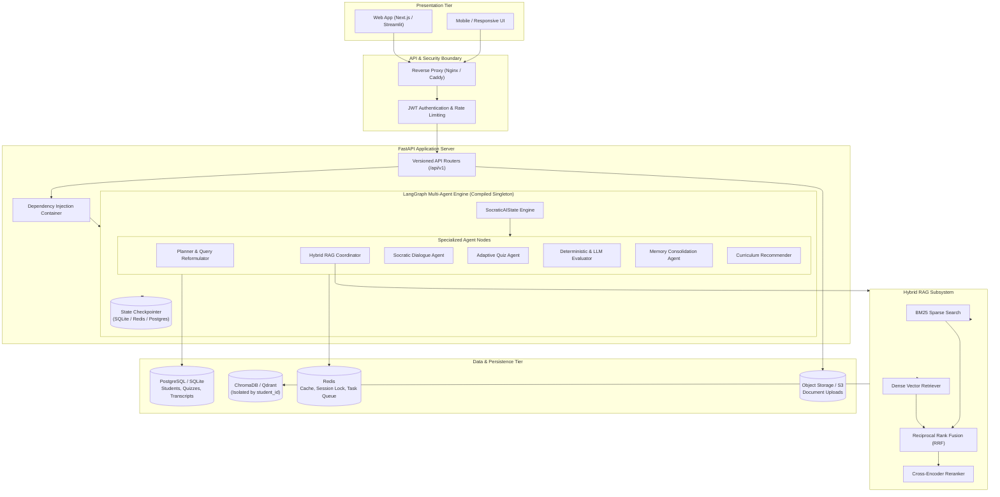
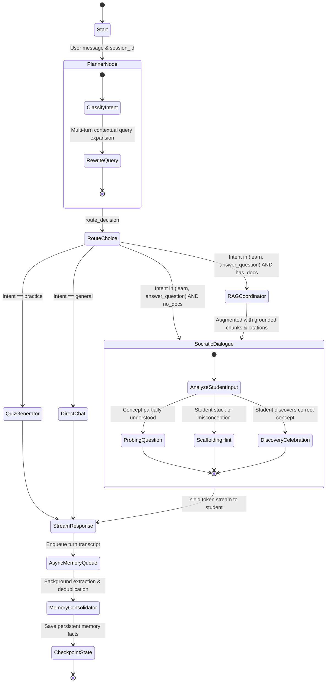
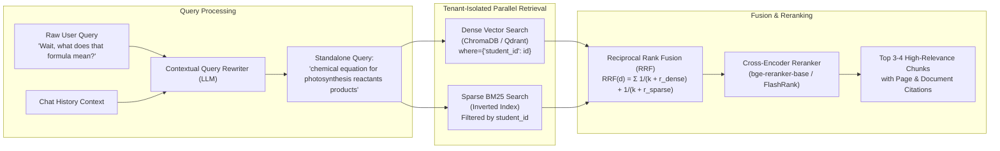
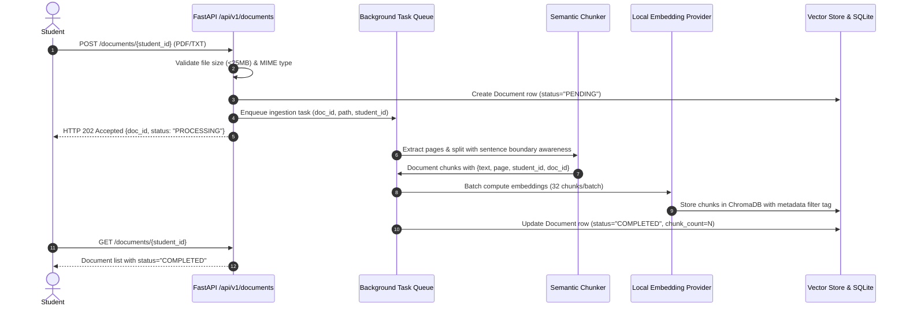
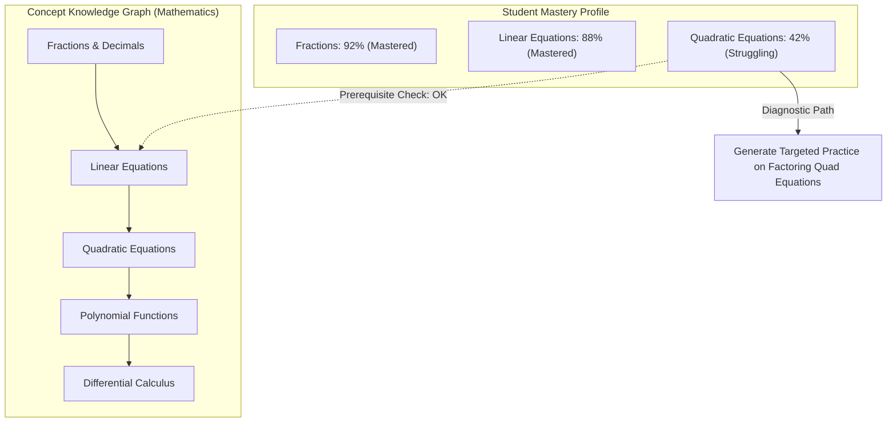
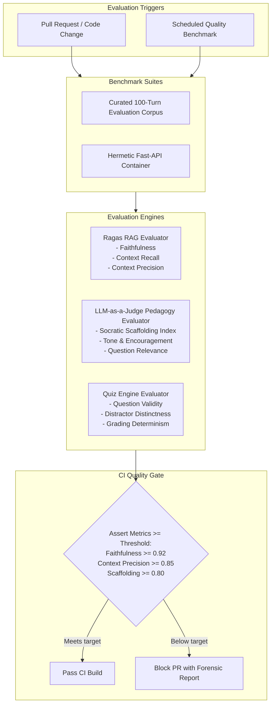
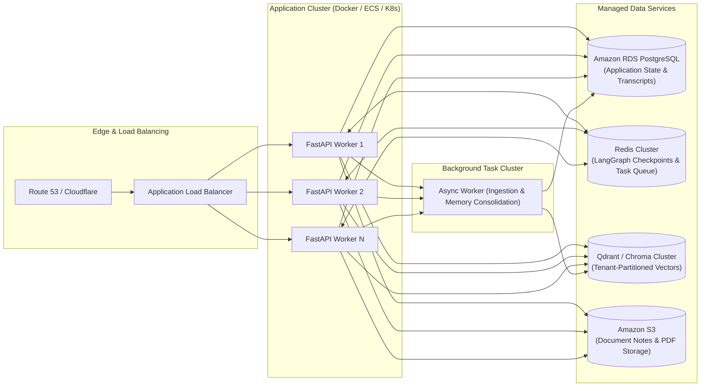
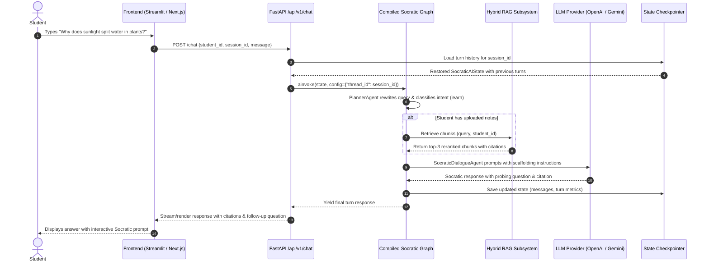

# SocraticAI — Proposed Target Architecture Specification

**Author:** Senior AI Engineer & LLM Systems Architect  
**Date:** November 2026  
**Status:** Target Architectural Specification (Phase 2)  
**Target Codebase:** [SocraticAI Repository](file:///d:/ML/EduAgent-master)

---

## 1. System Topology & Architectural Principles

The proposed architecture evolves SocraticAI from a synchronous, single-turn lecture platform into an enterprise-grade, stateful, multi-agent AI tutoring system.

### Core Architectural Principles
1. **True Socratic Interaction:** Pedagogical turns transition from passive lecture dumps to multi-turn guided inquiries that prompt critical thinking.
2. **Stateful Checkpointed Workflows:** Workflows maintain full conversational state across turns using persistent LangGraph checkpointers.
3. **Strict Multi-Tenant Isolation:** Vector indices and relational databases enforce multi-tenancy at the query level, preventing data cross-contamination.
4. **Resilient Hybrid Retrieval:** RAG combines dense semantic vectors with sparse BM25 keyword matching and cross-encoder reranking.
5. **Decoupled Asynchronous Processing:** Heavy operations (PDF extraction, embedding generation, memory consolidation) execute in background workers.

---

## 2. Advanced Multi-Agent Orchestration & Socratic Dialogue State Machine

### 2.1 Compiled Singleton Workflow with Persistent Checkpointing
Rather than recompiling the LangGraph workflow on every HTTP request, the compiled graph is built once during application startup and cached as a process singleton. Per-turn execution is managed by passing `{"configurable": {"thread_id": session_id}}` to the LangGraph checkpointer.

### 2.2 Socratic Dialogue Scaffolding Engine
Instead of emitting complete answers, the `SocraticDialogueAgent` uses a dynamic pedagogical state machine:

| Scaffolding Stage | Pedagogical Goal | Prompt Strategy | Example Tutor Output |
| :--- | :--- | :--- | :--- |
| **Stage 1: Elicitation** | Probe the student's existing intuition. | Ask what they already know about the topic. | *"Before we look at the formula, how do you think plants get energy when there is no food around them?"* |
| **Stage 2: Guided Inquiry** | Point out contradictions or misconceptions. | Present a relatable counter-example. | *"If plants absorbed all green light, what color would their leaves look to our eyes?"* |
| **Stage 3: Scaffolding** | Provide intermediate clues when stuck. | Break problem into smaller steps with hints. | *"Think about what happens to water ($H_2O$) when sunlight splits it. What gas gets released?"* |
| **Stage 4: Synthesis** | Prompt the student to summarize the core rule. | Ask the student to state the principle in their own words. | *"Spot on! Can you summarize the two main stages of photosynthesis in your own words?"* |

---

## 3. Production Hybrid RAG Pipeline Architecture

To achieve accurate grounding without cross-tenant data leaks or keyword blindness, the retrieval pipeline adopts **Tenant-Isolated Hybrid RAG with Cross-Encoder Reranking**.

### 3.3 Multi-Tenant Document Ingestion Lifecycle

---

## 4. Two-Tier Student Memory & Concept Knowledge Graph

### 4.1 Memory Hierarchy
The student profile is upgraded from a flat list of text facts into a formal two-tier memory architecture:

1. **Short-Term Conversational Memory:** Managed by the LangGraph Checkpointer (`thread_id=session_id`), storing verbatim dialogue, agent outputs, and immediate conversational turn context.
2. **Long-Term Consolidated Semantic Memory:** A structured profile containing verified student traits, learning styles, goals, and detected misconceptions.
3. **Concept Mastery Knowledge Graph (DAG):** A structured directed acyclic graph mapping subject domains into discrete concepts with prerequisite edges.

### 4.2 Spaced Repetition Memory Decay Algorithm (FSRS / SM-2)
Concept proficiency incorporates a time-decay factor $R(t) = e^{-\frac{t}{S}}$, where:
- $t$ is the elapsed time in days since the last quiz or practice session.
- $S$ is the concept stability factor, updated upon successful recall:
$$S_{new} = S_{prev} \cdot (1 + c \cdot \text{proficiency})$$
When retrieval probability $R(t)$ falls below $0.70$, the `RecommendationAgent` schedules an active recall prompt or short quiz item before new topics are introduced.

---

## 5. Evaluation & Quality Assurance Architecture

To ensure high pedagogical quality, zero hallucinations, and consistent quiz validity, an automated evaluation pipeline is integrated into continuous integration.

---

## 6. Backend Infrastructure & Production Scalability

---

## 7. End-to-End Chat Data Flow

