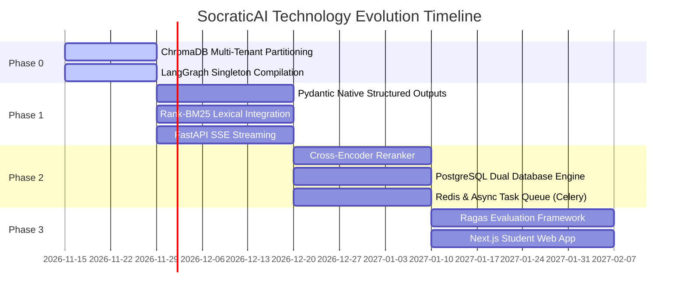

# SocraticAI Technology Stack Recommendations & Tradeoff Analysis

This document delivers an engineering-driven assessment of SocraticAI's existing technology stack. It evaluates current components against production requirements and specifies what should be **Retained**, **Replaced/Evolved**, or **Introduced**, accompanied by operational tradeoffs, migration risks, and developer experience implications.

---

## Executive Summary Matrix

| Component Layer | Current Technology | Recommendation | Target Technology | Migration Priority | Risk Level |
|---|---|---|---|---|---|
| **Agent Orchestration** | LangGraph 0.2+ | **Retain** | LangGraph (with persistent Checkpointers) | P0 (Config only) | Low |
| **API Framework** | FastAPI | **Retain** | FastAPI (with async SSE streaming) | P1 (Enhance) | Low |
| **Relational Database** | SQLite + SQLAlchemy | **Evolve** | Dual-driver: SQLite (dev) / PostgreSQL (prod) | P2 | Medium |
| **Vector Database** | ChromaDB (In-process) | **Evolve** | ChromaDB (dev) / Qdrant or Pgvector (prod) | P2 | Medium |
| **Structured Output Parsing** | Regex string matching | **Replace** | Native Pydantic Structured Outputs | P1 | Low |
| **Document Ingestion** | Sync FastAPI thread | **Replace** | Async Queue (Celery / ARQ + Redis) | P2 | Medium |
| **Retrieval Engine** | Bi-Encoder (MiniLM) | **Evolve** | Hybrid (Dense + BM25) + Cross-Encoder | P1 / P2 | Low |
| **Frontend UI** | Streamlit | **Transition** | Next.js (student) / Streamlit (admin portal) | P3 | High |
| **Evaluation Framework** | Hardcoded regex tests | **Introduce** | Ragas continuous evaluation harness | P3 | Low |
| **Caching & Checkpointing** | In-memory dicts | **Introduce** | Redis 7+ | P2 | Low-Medium |

---

## 1. Components to Retain

### 1.1 LangGraph
- **Current State**: Used for orchestrating multi-agent state machines ([`apps/backend/app/graphs/tutoring/workflow.py`](file:///d:/ML/EduAgent-master/apps/backend/app/graphs/tutoring/workflow.py)).
- **Why Retain**:
  - Cyclical state machine design is uniquely suited for multi-turn tutoring dialogues, quiz-evaluation retry loops, and pedagogical scaffolding.
  - Native integration with LangChain ecosystem, checkpointing protocols, human-in-the-loop inspection, and streaming (`astream_events`).
  - Far superior to rigid DAG orchestrators (Airflow, Prefect) or unconstrained autonomous agent frameworks (CrewAI, AutoGen) that lack deterministic state boundaries.
- **Tradeoffs**:
  - Learning curve for developers unfamiliar with state-reduction paradigms.
- **Action Required**: Retain core engine, but eliminate per-request graph re-compilation and wire persistent checkpointers (Redis/Postgres).

### 1.2 FastAPI
- **Current State**: High-performance asynchronous Python API framework ([`apps/backend/app/main.py`](file:///d:/ML/EduAgent-master/apps/backend/app/main.py)).
- **Why Retain**:
  - Native ASGI asynchronous request handling allows concurrent LLM streaming and background processing.
  - Automatic OpenAPI / Swagger documentation generation and tight integration with Pydantic v2 validation.
  - High community adoption, minimal overhead, and native dependency injection support.
- **Tradeoffs**:
  - Requires diligent async programming practices to avoid blocking the event loop with synchronous CPU-bound operations (e.g., PDF parsing).
- **Action Required**: Maintain existing structure; wrap CPU-bound operations into background workers or thread pools.

### 1.3 Sentence-Transformers (`all-MiniLM-L6-v2`)
- **Current State**: Generates 384-dimensional dense semantic embeddings locally ([`apps/backend/app/rag/embeddings/service.py`](file:///d:/ML/EduAgent-master/apps/backend/app/rag/embeddings/service.py)).
- **Why Retain**:
  - Free, fast, and entirely offline with zero per-token API cost or external network latency.
  - 384 dimensions offer an optimal balance between retrieval accuracy and memory footprint on CPU-only hosting environments.
- **Tradeoffs**:
  - Slightly lower retrieval performance compared to massive proprietary embedding models (e.g., OpenAI `text-embedding-3-large`).
- **Action Required**: Retain for baseline dense embeddings; supplement with lexical search (BM25) and a cross-encoder reranker.

### 1.4 PyMuPDF (fitz)
- **Current State**: Extracts text from uploaded PDF documents ([`apps/backend/app/rag/ingestion/loaders.py`](file:///d:/ML/EduAgent-master/apps/backend/app/rag/ingestion/loaders.py)).
- **Why Retain**:
  - One of the fastest and most reliable open-source C-backed PDF parsing libraries available for Python.
  - Provides precise page-level metadata necessary for accurate source citations.
- **Tradeoffs**:
  - Does not perform OCR on scanned/image-only PDFs.
- **Action Required**: Retain as default loader; optionally add an OCR fallback (Tesseract) for scanned documents in the future.

---

## 2. Components to Replace or Evolve

### 2.1 Structured Output Extraction: Regex Parsing $\rightarrow$ Native Pydantic Structured Outputs
- **Current State**: Agents use regex patterns (`re.search(r'\{.*\}', ..., re.DOTALL)`) to extract JSON from raw LLM responses.
- **Why Replace**:
  - Fragile and error-prone. Models frequently include conversational prefixes, wrap JSON in backticks, or emit minor syntax errors, causing regex parsing failures and returning empty or corrupt data.
- **Proposed Technology**:
  - Native provider JSON schema enforcement (OpenAI `beta.chat.completions.parse`, Gemini `response_schema`, Groq JSON mode) backed by Pydantic models and `json-repair` fallback.
- **Tradeoffs**:
  - Requires standardizing prompt invocation across multiple LLM providers.
- **Migration Risk**: **Very Low**. Simplifies agent codebase and immediately eliminates parsing errors.
- **Developer Experience**: Significantly improved. Agents work directly with typed, validated Python objects.

---

### 2.2 Relational Database: SQLite $\rightarrow$ Dual-Mode PostgreSQL (Prod) / SQLite (Dev)
- **Current State**: Single file SQLite database with SQLAlchemy async sessions ([`apps/backend/app/db/session.py`](file:///d:/ML/EduAgent-master/apps/backend/app/db/session.py)).
- **The Engineering Problem**:
  - SQLite acquires a full database-level lock during write operations. Under concurrent user traffic (multiple students taking quizzes, updating memory, and uploading documents simultaneously), API workers encounter `sqlite3.OperationalError: database is locked`.
  - SQLite lacks native connection pooling, advanced JSONB indexing, and multi-node horizontal scaling.
- **Proposed Technology**:
  - Maintain SQLite for local developer velocity (zero-configuration development).
  - Introduce PostgreSQL 16+ as the production database engine via environment-driven connection strings (`postgresql+asyncpg://`).
  - Introduce Alembic for declarative schema migrations.
- **Tradeoffs**:
  - Requires maintaining a PostgreSQL container or managed service in production environments.
- **Migration Risk**: **Low-Medium**. SQLAlchemy ORM abstracts SQL dialect differences cleanly.
- **Operational Overhead**: Low if using managed cloud databases (AWS RDS, Supabase, Neon) or Docker Compose.

---

### 2.3 Vector Database: In-Process ChromaDB $\rightarrow$ Scalable Architecture (Qdrant or Pgvector)
- **Current State**: ChromaDB running in-process via `chromadb.PersistentClient` saving to local disk ([`apps/backend/app/rag/retrieval/vector_store.py`](file:///d:/ML/EduAgent-master/apps/backend/app/rag/retrieval/vector_store.py)).
- **The Engineering Problem**:
  - In-process ChromaDB binds directly to the Python process and writes to a single SQLite metadata file and DuckDB/HNSW directory. It cannot be safely shared across multiple scaled-out FastAPI worker processes or Kubernetes pods without file-lock collisions.
  - In addition, the current implementation lacks multi-tenant metadata partitioning, resulting in cross-tenant data leakage.
- **Evaluation of Alternatives**:
  1. **Option A: Qdrant**:
     - *Pros*: Dedicated vector search engine written in Rust; exceptional HNSW indexing performance; advanced payload filtering (student isolation); native clustering and gRPC.
     - *Cons*: Additional infrastructure service to deploy and maintain.
  2. **Option B: Pgvector (PostgreSQL extension)**:
     - *Pros*: Consolidates relational data and vector embeddings into a single database; enables unified ACID transactions (deleting a student deletes their records and vectors simultaneously); zero extra operational services if PostgreSQL is already deployed.
     - *Cons*: Slightly lower query throughput at ultra-high vector scales (>10M vectors) compared to dedicated vector engines.
  3. **Option C: ChromaDB Server Mode**:
     - *Pros*: Minimal code changes; runs ChromaDB as a standalone Docker service over HTTP.
     - *Cons*: Slower HTTP roundtrip latency; limited enterprise clustering features compared to Qdrant.
- **Recommendation**:
  - **Short Term (Phase 0-1)**: Retain ChromaDB with strict student-level metadata filtering (`where={"student_id": ...}`).
  - **Medium Term (Phase 2)**: Transition to **Pgvector** if minimizing operational complexity is paramount (single database for relational + vector), or **Qdrant** if high-throughput vector search and standalone scaling are required.

---

### 2.4 Ingestion Processing: Synchronous HTTP $\rightarrow$ Asynchronous Task Queue
- **Current State**: PDF parsing, chunking, and embedding occur synchronously inside the FastAPI request handler ([`apps/backend/app/api/v1/routes/documents.py`](file:///d:/ML/EduAgent-master/apps/backend/app/api/v1/routes/documents.py#L32)).
- **The Engineering Problem**:
  - Parsing a 30-page PDF blocks the FastAPI worker for up to 30 seconds. If 5 students upload documents concurrently, all available uvicorn worker threads freeze, starving incoming chat requests.
- **Proposed Technology**:
  - **Celery** or **ARQ** (async Redis-backed task queue).
  - Client receives an immediate `202 Accepted` response with a task ID; ingestion runs asynchronously in an isolated worker process.
- **Tradeoffs**:
  - Requires Redis as a message broker and a separate worker process.
- **Migration Risk**: **Medium**. Requires updating frontend upload flow to poll or listen for completion events.
- **Operational Overhead**: Modest (single lightweight Redis instance).

---

### 2.5 Student Frontend: Streamlit $\rightarrow$ Next.js / React (Long-Term Evolution)
- **Current State**: Streamlit application in [`apps/frontend/`](file:///d:/ML/EduAgent-master/apps/frontend/).
- **The Engineering Problem**:
  - Streamlit re-executes the entire Python script on every user click or state change.
  - Incompatible with low-latency Server-Sent Events (SSE) token streaming, dynamic animations, complex responsive mobile layouts, and offline capability.
- **Proposed Technology**:
  - Develop a modern web client in **Next.js 14+ (App Router)** or **Vite + React** for student users.
  - Retain the Streamlit app as an internal **Admin, Content Review, and Agent Diagnostic Portal**.
- **Tradeoffs**:
  - Significant frontend engineering effort; requires TypeScript/JavaScript proficiency.
- **Migration Risk**: **High (Scope)**. Must be scheduled for Phase 3 after backend APIs and streaming protocols stabilize.

---

## 3. Components to Introduce

### 3.1 Redis 7+ (Caching, Checkpointing & Queue Broker)
- **Role**:
  1. **LangGraph Checkpointer**: Fast, centralized persistence of multi-turn conversational state across distributed backend workers.
  2. **Semantic & LLM Response Caching**: Cache deterministic responses (e.g., identical curriculum explanations or syllabus queries) to slash LLM costs and reduce latency.
  3. **Task Queue Broker**: Serves as the message transport for background ingestion tasks.
  4. **API Rate Limiting**: Distributed token-bucket rate limiting across API endpoints.
- **Justification**: A single lightweight Redis container elegantly solves four critical distributed systems problems simultaneously with sub-millisecond latency.

---

### 3.2 Hybrid Lexical Search (Rank-BM25) & Cross-Encoder Reranking
- **Role**: Upgrade RAG retrieval from single-stage vector similarity to a two-stage hybrid retrieval architecture.
- **Justification**:
  - **Dense Bi-Encoder**: Excels at semantic concepts ("how does gradient descent converge?").
  - **Lexical BM25**: Excels at exact terminology, symbols, acronyms, and section numbers ("Equation 4.1", "TCP Reno", "O(N log N)").
  - **Cross-Encoder Reranker (`ms-marco-MiniLM-L-6-v2`)**: Evaluates query-document relevance jointly, eliminating false positives and ensuring top-K chunks fed to the LLM are highly precise.

---

### 3.3 Continuous Evaluation Framework (Ragas)
- **Role**: Automated, metric-driven benchmarking of RAG and multi-agent outputs.
- **Justification**:
  - Replaces subjective ad-hoc manual testing with quantifiable metrics:
    - *Faithfulness*: Grounding of tutor explanations in retrieved source documents.
    - *Answer Relevance*: Alignment of tutor responses with student queries.
    - *Context Precision*: Signal-to-noise ratio of retrieved chunks.
  - Ensures prompt updates and retrieval algorithm tuning do not cause silent regressions.

---

## 4. Tradeoff Analysis & Architectural Decisions

### Decision 1: SQLite vs. PostgreSQL
```text
                       [ SQLite ]                          [ PostgreSQL ]
Concurrency:           Single-writer lock                  Multi-worker row-level MVCC
Deployment:            Zero setup (single file)            Requires database server / container
Maintenance:           None                                Backups, vacuuming, connection pool
Developer Experience:  Frictionless for local testing      Requires local Docker or cloud DB
VERDICT:               Dual-mode: SQLite for rapid local development/unit tests;
                       PostgreSQL for multi-container production environments.
```

### Decision 2: In-Process ChromaDB vs. Dedicated Qdrant
```text
                       [ In-Process ChromaDB ]             [ Dedicated Qdrant ]
Architecture:          Embedded in Python process          Independent client-server / cluster
Concurrency:           Prone to file locks on scale        Full horizontal concurrency & gRPC
Filtering:             Basic metadata where-clauses        High-performance indexed payload filters
Memory Footprint:      Shares Python worker RAM            Dedicated daemon memory space
VERDICT:               ChromaDB is sufficient for Phase 0-1 with metadata fixes;
                       Transition to Qdrant or Pgvector when scaling beyond a single server.
```

### Decision 3: Streamlit vs. Next.js
```text
                       [ Streamlit ]                       [ Next.js / React ]
Time to Market:        Days (pure Python)                  Weeks (TypeScript, components, styling)
Execution Model:       Full script rerun per action        Granular reactive DOM updates
Streaming (SSE):       Clunky / polling hacks              Native smooth token streaming
Custom UI/UX:          Constrained to widget layout        Unconstrained, mobile-first design
VERDICT:               Repurpose Streamlit as the internal Admin/Evaluation tool;
                       Build Next.js as the primary student-facing application in Phase 3.
```

---

## 5. Technology Adoption Matrix by Phase


