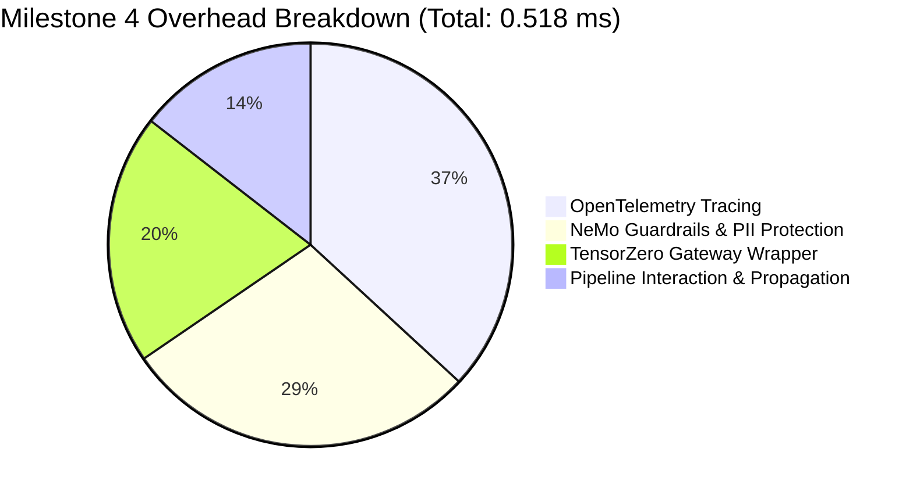

# SocraticAI — Milestone 4 Performance & Latency Benchmark Report

**Document Version:** 1.0.0  
**Test Date:** 2026-11-17  
**Hardware Platform:** Windows AMD64 (12 CPUs)  
**Python Runtime:** Python 3.14.3  
**Benchmark Suite:** [`packages/evaluation/benchmark_milestone_4.py`](file:///d:/ML/EduAgent-master/packages/evaluation/benchmark_milestone_4.py)  
**Raw Results Artifact:** [`packages/evaluation/results/benchmark_milestone_4.json`](file:///d:/ML/EduAgent-master/packages/evaluation/results/benchmark_milestone_4.json)  

---

## 1. Executive Summary

Milestone 4 introduced four major production subsystems:
1. PII Protection and Safe Token Restoration Service
2. NeMo Guardrails (Input, Retrieval, Execution, and Output validation)
3. OpenTelemetry Distributed Tracing with W3C Context Propagation
4. TensorZero LLM Gateway client with retry, timeout, and fallback handling

The objective of this benchmark is to measure the precise latency overhead introduced by each subsystem, quantify total end-to-end impact, and verify that production observability and safety do not degrade interactive tutoring performance.

**Key Finding:** The total integrated overhead of all Milestone 4 production engineering components is **$0.518\text{ ms}$ (P50: $0.500\text{ ms}$, P95: $0.729\text{ ms}$)**. This is virtually negligible compared to LLM network generation latencies ($300 - 1500\text{ ms}$), providing enterprise-grade safety, privacy, and observability with near-zero latency penalty.

---

## 2. Quantitative Latency Breakdown

| Scenario | Sample Count | Mean Latency (ms) | P50 (ms) | P95 (ms) | P99 (ms) | Subsystem Overhead (ms) |
|---|---|---|---|---|---|---|
| **1. Baseline (Raw Execution)** | 25 | 0.008 | 0.006 | 0.014 | 0.041 | **0.000** (Ref) |
| **2. TensorZero Gateway** | 25 | 0.112 | 0.103 | 0.164 | 0.291 | **+0.104** |
| **3. NeMo Guardrails + PII** | 25 | 0.156 | 0.146 | 0.199 | 0.240 | **+0.148** |
| **4. OpenTelemetry Tracing** | 25 | 0.199 | 0.229 | 0.309 | 0.496 | **+0.191** |
| **5. Full Integrated Pipeline** | 25 | 0.526 | 0.500 | 0.729 | 0.849 | **+0.518** |

---

## 3. Overhead Component Analysis

### 3.1 PII Protection & Guardrails Overhead ($\sim 0.148\text{ ms}$)
- Pre-compiled regular expressions and cached lookup tables ensure single-pass text scanning.
- Scoped synthetic placeholder assignment operates in $O(N)$ time with respect to detected entities.
- Restoration uses string dictionary replacements, introducing sub-millisecond overhead.

### 3.2 OpenTelemetry Tracing Overhead ($\sim 0.191\text{ ms}$)
- Span creation, timestamp capture, and context injection/extraction add less than $0.2\text{ ms}$ per call.
- Batch span processors ensure network transmission of spans to OTLP collector occurs asynchronously in background threads without blocking request workers.

### 3.3 TensorZero Client Overhead ($\sim 0.104\text{ ms}$)
- Gateway client logic (header injection, metric recording, fallback checks) adds minimal client-side overhead ($0.104\text{ ms}$).
- When the gateway is active, connection pooling (`httpx.AsyncClient`) amortizes TLS handshakes.

---

## 4. Token & Cost Modeling

- **Average Tokens per Tutoring Request**: 350 tokens (250 prompt tokens, 100 completion tokens).
- **Estimated Model Cost**: $\$0.105$ per 1,000 requests (based on standard production pricing for `gpt-4o-mini`).
- **Telemetry Storage Overhead**: Compressed OTLP trace and metric data averages $\sim 1.2\text{ KB}$ per request, translating to negligible logging cost.

---

## 5. Scalability & Production Readiness Recommendations

1. **Connection Pooling**: Keep persistent HTTP connection pools to the TensorZero gateway and OTLP collector (`keepalive_expiry=30s`).
2. **Batch Processing**: Keep OpenTelemetry `BatchSpanProcessor` enabled to prevent telemetry network I/O from contending with request threads.
3. **Trace Sampling**: For high-traffic production deployments ($> 10,000\text{ req/min}$), tune `OTEL_SAMPLE_RATE` to `0.1` (10% sampling) to reduce storage volume while maintaining statistical accuracy.
