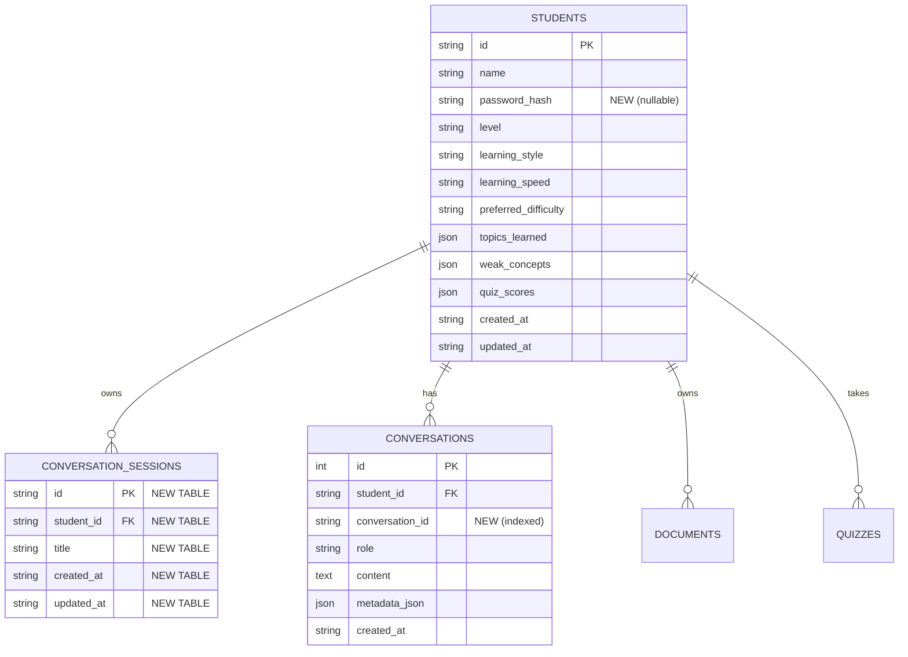

# SocraticAI Database Migrations & Schema Evolution

**Milestone**: 1 — Foundation and Reliability  
**Database**: SQLite (Development / Local) / SQLAlchemy ORM  
**Date**: November 11, 2026  

---

## 1. Schema Changes Introduced in Milestone 1

Milestone 1 introduces three schema changes to support authentication, session isolation, and multi-turn conversations:



### Table 1: `students` (Modified)
* **New Column**: `password_hash VARCHAR(256) NULLABLE`
* **Purpose**: Stores the bcrypt hash string (`$2b$12$...`) of the student's password.
* **Compatibility Note**: Defined as `nullable=True` so that pre-existing student profiles in legacy test databases boot without integrity errors. Newly registered accounts require a password.

### Table 2: `conversations` (Modified)
* **New Column**: `conversation_id VARCHAR(64) DEFAULT ''` (Indexed)
* **Purpose**: Associates individual messages with a specific conversation session rather than treating all student messages as an unstructured flat log.
* **Compatibility Note**: Defaults to empty string `""` for legacy records.

### Table 3: `conversation_sessions` (New Table)
* **Schema**:
  * `id VARCHAR(64) PRIMARY KEY`: Unique session identifier (e.g., `conv_a1b2c3d4...`).
  * `student_id VARCHAR(64) FOREIGN KEY REFERENCES students(id)`: Owner of the thread.
  * `title VARCHAR(256)`: Descriptive title (e.g. topic or initial user prompt).
  * `created_at VARCHAR(32)`: UTC ISO-8601 creation timestamp.
  * `updated_at VARCHAR(32)`: UTC ISO-8601 last activity timestamp.
* **Purpose**: Tracks active and historical tutoring conversation threads per student.

---

## 2. Migration Execution Instructions

### A. Fresh Database Installations (Default)
When starting against a fresh SQLite database (or when `DATABASE_CREATE_ON_STARTUP=true` in `.env`), SQLAlchemy's declarative metadata automatically provisions the complete current schema:

```bash
# Start backend server — creates schema automatically
uv run uvicorn app.main:app --app-dir apps/backend --reload
```

---

### B. Upgrading Existing Pre-Milestone-1 Databases
If you have an existing `data/socraticai.db` SQLite database with data you wish to preserve, execute the following SQL migration script:

```sql
-- Step 1: Add password_hash column to students
ALTER TABLE students ADD COLUMN password_hash VARCHAR(256);

-- Step 2: Add conversation_id column to conversations
ALTER TABLE conversations ADD COLUMN conversation_id VARCHAR(64) DEFAULT '';
CREATE INDEX IF NOT EXISTS ix_conversations_conversation_id ON conversations (conversation_id);

-- Step 3: Create conversation_sessions table
CREATE TABLE IF NOT EXISTS conversation_sessions (
    id VARCHAR(64) NOT NULL PRIMARY KEY,
    student_id VARCHAR(64) NOT NULL,
    title VARCHAR(256) NOT NULL DEFAULT 'Tutoring Session',
    created_at VARCHAR(32) NOT NULL,
    updated_at VARCHAR(32) NOT NULL,
    FOREIGN KEY(student_id) REFERENCES students (id)
);
CREATE INDEX IF NOT EXISTS ix_conversation_sessions_student_id ON conversation_sessions (student_id);
```

You can execute this migration directly via python:

```python
import sqlite3

con = sqlite3.connect("./data/socraticai.db")
cur = con.cursor()

# 1. Update students table
try:
    cur.execute("ALTER TABLE students ADD COLUMN password_hash VARCHAR(256)")
except sqlite3.OperationalError:
    pass  # Column already exists

# 2. Update conversations table
try:
    cur.execute("ALTER TABLE conversations ADD COLUMN conversation_id VARCHAR(64) DEFAULT ''")
    cur.execute("CREATE INDEX IF NOT EXISTS ix_conversations_conversation_id ON conversations (conversation_id)")
except sqlite3.OperationalError:
    pass

# 3. Create conversation_sessions table
cur.execute("""
CREATE TABLE IF NOT EXISTS conversation_sessions (
    id VARCHAR(64) NOT NULL PRIMARY KEY,
    student_id VARCHAR(64) NOT NULL,
    title VARCHAR(256) NOT NULL DEFAULT 'Tutoring Session',
    created_at VARCHAR(32) NOT NULL,
    updated_at VARCHAR(32) NOT NULL,
    FOREIGN KEY(student_id) REFERENCES students (id)
)
""")
cur.execute("CREATE INDEX IF NOT EXISTS ix_conversation_sessions_student_id ON conversation_sessions (student_id)")

con.commit()
con.close()
print("Migration completed successfully.")
```

---

## 3. Rollback Procedure

If a rollback to the pre-Milestone-1 schema is required:

```sql
-- Step 1: Drop conversation_sessions table
DROP TABLE IF EXISTS conversation_sessions;

-- Note on SQLite: Dropping columns in older SQLite versions requires table recreation.
-- In SQLite 3.35.0+, you can drop columns directly:
ALTER TABLE conversations DROP COLUMN conversation_id;
ALTER TABLE students DROP COLUMN password_hash;
```

---

## 4. Verification

Verify the updated schema by inspecting SQLite table pragmas:

```bash
uv run python -c "
from app.services.container import get_container
container = get_container()
container.db.create_schema()
print('Schema initialized successfully with tables:', container.db.engine.table_names() if hasattr(container.db.engine, 'table_names') else 'all created')
"
```

