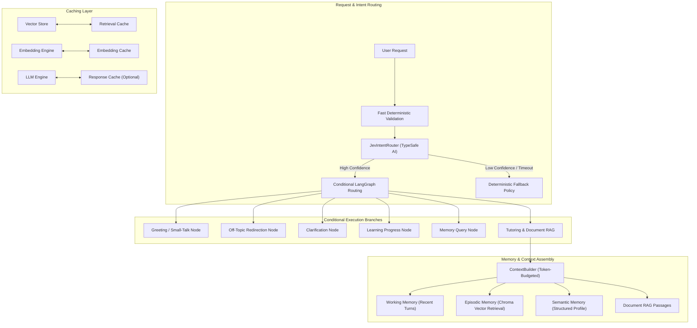

# Milestone 1.5: Verification and Code-Level Audit Assessment

**Project**: SocraticAI  
**Milestone**: 1.5 — Conversational Intelligence, Memory & Intelligent Routing  
**Date**: November 12, 2026  
**Status**: Verification Completed — Implementation Ready  

---

## 1. Executive Summary & Verification Methodology

Before modifying any source code for Milestone 1.5, we conducted a comprehensive inspection of the repository across:
1. Current chat request lifecycle and context construction in [`chat.py`](file:///d:/ML/EduAgent-master/apps/backend/app/api/v1/routes/chat.py).
2. Existing conversation history loading and limits in [`conversation_repository.py`](file:///d:/ML/EduAgent-master/apps/backend/app/repositories/conversation_repository.py).
3. Memory storage, extraction, and prompt injection in [`memory_repository.py`](file:///d:/ML/EduAgent-master/apps/backend/app/repositories/memory_repository.py) and [`memory/agent.py`](file:///d:/ML/EduAgent-master/apps/backend/app/agents/memory/agent.py).
4. LangGraph states, nodes, and routing in [`workflow.py`](file:///d:/ML/EduAgent-master/apps/backend/app/graphs/tutoring/workflow.py) and [`planner/agent.py`](file:///d:/ML/EduAgent-master/apps/backend/app/agents/planner/agent.py).
5. ChromaDB vector storage and retrieval in [`vector_store.py`](file:///d:/ML/EduAgent-master/apps/backend/app/rag/retrieval/vector_store.py) and [`service.py`](file:///d:/ML/EduAgent-master/apps/backend/app/rag/pipelines/service.py).
6. Centralized configuration in [`config.py`](file:///d:/ML/EduAgent-master/apps/backend/app/core/config.py) and `.env.example`.

---

## 2. Verified Limitations & Hardcoded Operational Values

### Limitation 1: Working Memory Truncation & Token Ignorance
* **Location**: [`apps/backend/app/api/v1/routes/chat.py:74-79`](file:///d:/ML/EduAgent-master/apps/backend/app/api/v1/routes/chat.py#L74-L79)
  ```python
  history_records = container.conversation_repo.list_messages(
      student_id=current_student.student_id,
      conversation_id=conversation_id,
      limit=10,  # Hardcoded message limit
  )
  ```
* **Limitation**: Context window management is based entirely on a fixed count of 10 messages without calculating token lengths. Ten short sentences take ~150 tokens, whereas ten long explanations take ~3,500 tokens, risking context overflow or premature truncation of essential dialogue context.

### Limitation 2: Unstructured, Sessionless Fact-Only Memory
* **Location**: [`apps/backend/app/models/orm.py:141-152`](file:///d:/ML/EduAgent-master/apps/backend/app/models/orm.py#L141-L152) and [`apps/backend/app/agents/memory/agent.py:53-64`](file:///d:/ML/EduAgent-master/apps/backend/app/agents/memory/agent.py#L53-L64)
* **Limitation**: `MemoryEntry` only persists flat text facts (`fact_type`, `content`, `importance`). There is:
  * No episodic memory representation (no session ID, topic metadata, event categorization).
  * No semantic vector search over past memories; memories are merely listed chronologically (`limit=6`).
  * No structured misconception tracking with confidence, timestamps, and status (`active`, `resolved`).
  * No memory consolidation to merge redundant or obsolete facts across sessions.

### Limitation 3: Expensive Autoregressive Routing & Missing Intents
* **Location**: [`apps/backend/app/agents/planner/agent.py:54-99`](file:///d:/ML/EduAgent-master/apps/backend/app/agents/planner/agent.py#L54-L99) and [`apps/backend/app/graphs/tutoring/workflow.py:51-78`](file:///d:/ML/EduAgent-master/apps/backend/app/graphs/tutoring/workflow.py#L51-L78)
* **Limitation**:
  * The `PlannerAgent` uses a heavy generative LLM (`generate_json`) to classify intents. If classified as `general`, it calls the LLM a *second time* for a conversational reply.
  * Intents are limited to (`learn`, `answer_question`, `practice`, `upload`, `general`).
  * Greetings, small talk, learning progress queries, and off-topic questions lack dedicated lightweight handlers and get pushed into full tutoring or generic fallback paths.
  * No typed decision model (Jev by TypeSafe AI) is currently used.

### Limitation 4: Complete Absence of Caching
* **Location**: [`apps/backend/app/rag/embeddings/provider.py`](file:///d:/ML/EduAgent-master/apps/backend/app/rag/embeddings/provider.py) and [`apps/backend/app/rag/retrieval/vector_store.py`](file:///d:/ML/EduAgent-master/apps/backend/app/rag/retrieval/vector_store.py)
* **Limitation**:
  * Every embedding computation executes sentence-transformers on CPU, even for repeated phrases or identical queries.
  * Semantic vector similarity searches re-execute against ChromaDB disk indexes every time.
  * There is no cache invalidation mechanism when documents are updated or deleted.

### Limitation 5: Hardcoded Operational Literals
Inspection revealed hardcoded parameters across the backend:
* `limit=10` messages in `chat.py`.
* `limit=6` facts in `memory_prompt_section` in `apps/backend/app/agents/base.py:73`.
* `limit=5` in `weakest_concepts` in `student_repository.py:171`.
* `alpha=0.6` in `upsert_concept_score` in `student_repository.py:146`.
* `assistant_text[:2000]` slice in `memory/agent.py:55`.
* `title = req.message[:40].strip()` in `chat.py:70`.

---

## 3. Existing Reusable Abstractions

The repository provides clean extension points that will be reused:
1. **ChromaDB Client**: [`VectorStore`](file:///d:/ML/EduAgent-master/apps/backend/app/rag/retrieval/vector_store.py) already manages persistence and cosine distance calculations. We can create an episodic memory collection (`socraticai_episodic_memory`) reusing this foundation.
2. **Pydantic Settings**: [`Settings`](file:///d:/ML/EduAgent-master/apps/backend/app/core/config.py) uses Pydantic Settings v2 with nested grouping and environment variable support.
3. **Container & DI**: [`Container`](file:///d:/ML/EduAgent-master/apps/backend/app/services/container.py) wires dependencies cleanly across routes and graph nodes.
4. **FastAPI Lifespan**: Pre-compiles graphs and initializes resources during startup in [`main.py`](file:///d:/ML/EduAgent-master/apps/backend/app/main.py).
5. **TikToken**: Already present in `pyproject.toml` dependencies for exact token counting.

---

## 4. Proposed Architectural Changes



---

## 5. Potential Schema Migrations

To support structured semantic memory and episodic memory tracking:
1. **`episodic_memories` Table**:
   * `id VARCHAR(64) PRIMARY KEY`
   * `student_id VARCHAR(64) NOT NULL (FK, indexed)`
   * `session_id VARCHAR(64) NULLABLE (indexed)`
   * `topic VARCHAR(256) NOT NULL`
   * `summary TEXT NOT NULL`
   * `event_type VARCHAR(32) NOT NULL` (`studied_topic`, `concept_struggle`, `misconception`, `quiz_attempt`, `milestone`)
   * `provenance VARCHAR(32) NOT NULL` (`observed_interaction`, `quiz_evaluation`, `llm_inference`)
   * `created_at VARCHAR(32) NOT NULL`
2. **`student_misconceptions` Table**:
   * `id INTEGER PRIMARY KEY AUTOINCREMENT`
   * `student_id VARCHAR(64) NOT NULL (FK, indexed)`
   * `concept VARCHAR(256) NOT NULL`
   * `description TEXT NOT NULL`
   * `severity FLOAT NOT NULL DEFAULT 0.5`
   * `status VARCHAR(32) NOT NULL DEFAULT 'active'` (`active`, `resolved`)
   * `confidence FLOAT NOT NULL DEFAULT 0.5`
   * `provenance VARCHAR(64) NOT NULL DEFAULT 'tutor_inference'`
   * `created_at VARCHAR(32) NOT NULL`
   * `resolved_at VARCHAR(32) NULLABLE`

Both tables use SQLite-compatible columns and SQLAlchemy's `Base.metadata.create_all()`, preserving existing records with zero destructive changes.

---

## 6. Dependencies Added

* **`typesafe-sdk>=0.7.0,<1.0`**: Added to `pyproject.toml`.
  * *Purpose*: Official client library for Jev (TypeSafe AI) System One decision models, supporting typed `Choice`, `Noul`, and `Score` questions for sub-500ms intent classification.
  * *No other external dependencies required*: In-process caching, token budgeting (`tiktoken`), and vector storage (`chromadb`) utilize existing stack components.

---

## 7. Compatibility and Safety Assessment

* **Security & Auth**: All new endpoints, memories, and cache entries maintain strict student-level isolation via `current_student.student_id`.
* **Privacy**: Data transmitted to Jev contains only the user input string; no tokens, student IDs, document texts, or memory contents are sent.
* **Fallback Guarantee**: If `TYPESAFE_API_KEY` is omitted or Jev encounters network timeouts, the system automatically falls back to deterministic rule routing without degrading availability.
* **Conclusion**: Safe to proceed with implementation.

