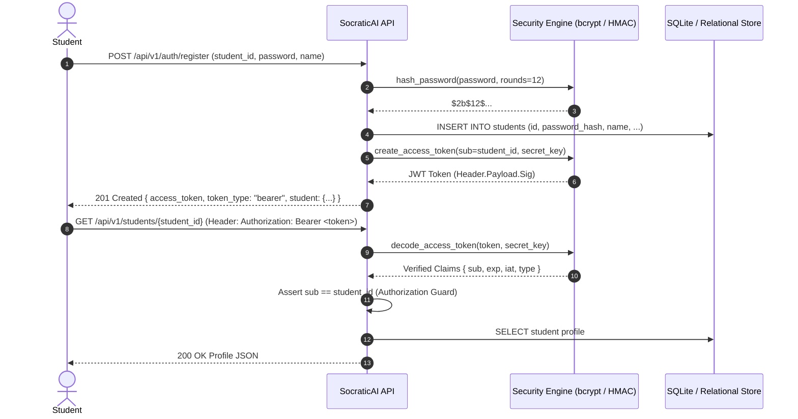

# SocraticAI Security Architecture and Threat Model

**Milestone**: 1 — Foundation and Reliability  
**Target**: Production-grade multi-tenant educational AI assistant  
**Last Updated**: November 11, 2026  

---

## 1. Authentication Architecture

SocraticAI implements a stateless, token-based authentication protocol designed for low latency and zero reliance on external third-party auth providers.



### Password Security
- **Algorithm**: `bcrypt` with cost factor 12 (4096 hashing rounds).
- **Salt**: Cryptographically secure, generated per-password via `os.urandom` (handled by `bcrypt.gensalt(12)`).
- **Storage**: Decoded UTF-8 string containing algorithm identifier, cost factor, salt, and hash. Plaintext passwords are never logged, cached, or persisted.
- **Key Limit**: Inputs are clamped at 72 bytes to align with bcrypt's internal cipher block size.

### Token Specification (HMAC-SHA256 JWT)
Tokens are generated using URL-safe Base64-encoded JSON headers, claims, and signatures:
* **Header**: `{"alg": "HS256", "typ": "JWT"}`
* **Payload Claims**:
  * `sub`: The unique student identifier.
  * `iat`: Unix timestamp when token was issued.
  * `exp`: Unix timestamp when token expires (configurable via `AUTH_ACCESS_TOKEN_EXPIRE_MINUTES`, default 24h).
  * `type`: Fixed value `"access"` to prevent confusion with refresh or CSRF tokens.
* **Signature**: `HMAC-SHA256(signing_input, AUTH_SECRET_KEY)`
* **Validation**:
  * Timing-safe signature comparison using Python's `hmac.compare_digest`.
  * Expiration checking against current server epoch time.
  * Explicit algorithm verification (rejecting `none` or unsupported ciphers).

---

## 2. Authorization Model & Insecure Direct Object Reference (IDOR) Defense

Prior to Milestone 1, all endpoints accepted arbitrary `student_id` or `doc_id` values from URL query parameters, path variables, or request bodies, resulting in severe IDOR vulnerabilities.

### Authorization Enforcement Rules
1. **Never Trust Client Body/Path Identity**: The client's true identity is determined strictly by the cryptographic `sub` claim extracted from the verified JWT in `get_current_student`.
2. **Resource Ownership Assertions**:
   * **Profile & Dashboard**: Path parameter `student_id` must match `current_student.student_id`.
   * **Documents**:
     * Upload: Path parameter `student_id` must match `current_student.student_id`.
     * Listing: Returns only records where `document.student_id == current_student.student_id`.
     * Deletion: Verifies `document_repo.get(doc_id).student_id == current_student.student_id`.
   * **Conversations**:
     * Sessions: Created under `current_student.student_id`.
     * Retrieval & Deletion: Verifies `session.student_id == current_student.student_id`.
   * **Quizzes**:
     * Submission: Verifies `req.student_id == current_student.student_id` AND `quiz.student_id == current_student.student_id`.
3. **HTTP 403 Forbidden Response**: Unauthorized access attempts immediately abort execution and return a standard `AUTHORIZATION_ERROR` JSON envelope without performing any downstream operations.

---

## 3. Multi-Tenant Vector Store Data Isolation

ChromaDB is utilized as a shared vector collection (`socraticai_notes`). Without explicit partitioning, vector embeddings are globally searchable across all tenants.

### Defense-in-Depth Implementation
* **Layer 1: Metadata Tagging on Ingestion**: Every chunk passed to ChromaDB is tagged with `"student_id": student_id`.
* **Layer 2: Hardened Filter on Similarity Queries**: All queries routed through `VectorStore.search` and `RAGService.search` enforce ChromaDB's metadata filter:
  ```python
  query_kwargs["where"] = {"student_id": student_id}
  ```
* **Layer 3: Deletion Synchronization**: When a document is deleted through the API, its database record and corresponding vector records are purged simultaneously:
  ```python
  self._collection.delete(where={"doc_id": doc_id})
  ```

---

## 4. Document Upload Security & Denial-of-Service Defense

Document uploads present a high-risk attack surface (memory exhaustion, remote code execution via malicious file formats, path traversal attacks).

### Security Controls
1. **Memory-Bounded Streaming**: Uploads are read in 64 KB chunks rather than loading entire payloads into memory via `await file.read()`. If the cumulative byte count exceeds `API_MAX_UPLOAD_SIZE_BYTES` (default: 25 MB), reading terminates immediately and raises `PayloadTooLargeError` (HTTP 413).
2. **Magic Byte & Content Verification**:
   * File extension checking against `SUPPORTED_DOCUMENT_EXTENSIONS` (`.pdf`, `.txt`, `.md`).
   * For `.pdf`: Confirms the binary stream begins with the `%PDF-` magic byte sequence.
   * For `.txt` and `.md`: Validates that content can be decoded as valid UTF-8/ASCII text. Non-text binaries disguised with text extensions are rejected with `UnsupportedMediaTypeError` (HTTP 415).
3. **Path Traversal Sanitization**: Filenames provided by client HTTP headers are stripped of directory components (`../`, `..\`, absolute paths) using `Path(raw_filename).name` and regex sanitization (`[^a-zA-Z0-9_\-\. ]`), preventing arbitrary file creation.
4. **Temporary File Isolation**: Extracted files are processed via OS-managed secure temporary files (`tempfile.NamedTemporaryFile`) and guaranteed deletion inside a `finally` block.

---

## 5. Security Environment Variables

| Variable | Description | Default (Dev) | Production Requirement |
|---|---|---|---|
| `AUTH_SECRET_KEY` | HMAC signing key for JWT tokens. | Dev placeholder | Must be a secure random 32+ byte string (e.g., `openssl rand -hex 32`). |
| `AUTH_ALGORITHM` | JWT signing algorithm. | `HS256` | Keep `HS256`. |
| `AUTH_ACCESS_TOKEN_EXPIRE_MINUTES` | Lifetime of access tokens in minutes. | `1440` (24h) | Set according to organization policy (e.g., 60-1440). |
| `API_MAX_UPLOAD_SIZE_BYTES` | Maximum allowed upload size in bytes. | `26214400` (25 MB) | Configure to prevent resource exhaustion based on server capacity. |

---

## 6. Threat Modeling & Mitigation Summary

| Threat / Attack Vector | Risk | Prior State | Milestone 1 Mitigation |
|---|---|---|---|
| **Plaintext Password Theft** | Critical | No passwords or authentication existed. | Bcrypt work factor 12 hashing; passwords never stored or logged in plaintext. |
| **IDOR Profile Tampering** | Critical | Any caller could query or overwrite any student profile via URL parameter. | Identity derived from JWT token; authorization checks enforce ownership (HTTP 403). |
| **Cross-Tenant Vector Data Leakage** | Critical | ChromaDB searched globally without filtering. | Chunks tagged with `student_id`; all queries filtered by `student_id`. |
| **Memory Exhaustion (DoS Upload)** | High | Uploaded files read entirely into worker RAM without size limits. | Chunked 64 KB stream reading with 25 MB ceiling (HTTP 413). |
| **Malicious File Upload / RCE** | High | Only client-supplied file extension checked. | Extension validation, `%PDF-` magic byte check, UTF-8 text validation (HTTP 415). |
| **Path Traversal Attacks** | Medium | Filenames passed directly to OS paths. | Basename extraction and regex sanitization stripping `../` and directory separators. |
| **Session Bleed / Multi-Turn Amnesia** | Medium | Chat turn had no session concept and reset history to `[]`. | `ConversationSession` entity, `conversation_id` tracking, and automatic history loading. |

