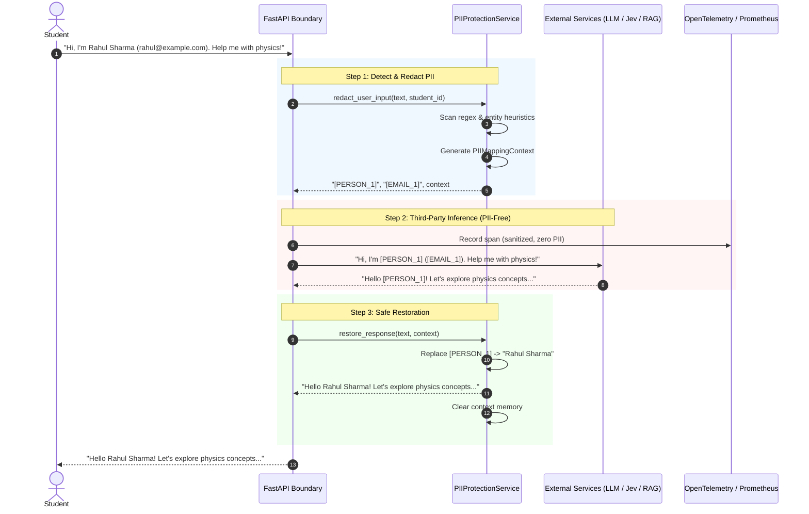

# SocraticAI — PII Protection & Safe Restoration Architecture

**Document Version:** 1.0.0  
**Status:** Implemented (Milestone 4)  
**Related Modules:**  
- [`apps/backend/app/security/pii/service.py`](file:///d:/ML/EduAgent-master/apps/backend/app/security/pii/service.py)  
- [`apps/backend/app/security/pii/detector.py`](file:///d:/ML/EduAgent-master/apps/backend/app/security/pii/detector.py)  
- [`apps/backend/app/security/pii/redactor.py`](file:///d:/ML/EduAgent-master/apps/backend/app/security/pii/redactor.py)  
- [`apps/backend/app/security/pii/restorer.py`](file:///d:/ML/EduAgent-master/apps/backend/app/security/pii/restorer.py)  
- [`apps/backend/app/security/pii/mapping.py`](file:///d:/ML/EduAgent-master/apps/backend/app/security/pii/mapping.py)  
- [`apps/backend/app/security/pii/entities.py`](file:///d:/ML/EduAgent-master/apps/backend/app/security/pii/entities.py)  

---

## 1. Regulatory Context & Security Imperative

Educational tutoring systems inherently handle student data, including homework, communications, and personal notes. Data privacy regulations (FERPA, GDPR, COPPA, and DPDP) mandate that Personally Identifiable Information (PII) must not be transmitted to third-party model providers (OpenAI, Anthropic, Google, Jev) or logged in plaintext within distributed observability platforms.

SocraticAI implements a **Zero-PII-to-External-Services Architecture**:
1. All incoming text is de-identified and replaced with scoped synthetic placeholders *before* being processed by any external model, decision API, embedding provider, or reranker.
2. The mapping between original PII and synthetic tokens is isolated to a transient, in-memory, request-scoped context.
3. The final response generated by the AI system has placeholders safely restored back to the original values so the student experiences natural, personalized tutoring without data leakage.

---

## 2. PII Protection Architecture & Data Flow

---

## 3. Supported Entity Categories & Detection Heuristics

The `PIIDetector` engine evaluates incoming text against rigorous patterns and contextual heuristics:

| Category | Identifier Pattern | Detection Heuristic & Scope |
|---|---|---|
| `PERSON` | `[PERSON_n]` | Common names, honorific titles (Mr./Ms./Dr.), intro patterns ("My name is...", "I am..."). |
| `EMAIL` | `[EMAIL_n]` | Standard RFC 5322 email regex matching domains, subdomains, and TLDs. |
| `PHONE` | `[PHONE_n]` | E.164 international formats, US 10-digit formats with hyphens/parentheses, and extensions. |
| `ADDRESS` | `[ADDRESS_n]` | Street numbers, road types (Street, Avenue, Road, Blvd, Terrace, Court), City, State, ZIP. |
| `GOVERNMENT_ID` | `[GOVERNMENT_ID_n]` | US SSN (`\d{3}-\d{2}-\d{4}`), Indian Aadhaar (`\d{4}\s\d{4}\s\d{4}`), PAN (`[A-Z]{5}\d{4}[A-Z]`). |
| `FINANCIAL` | `[FINANCIAL_n]` | Major Credit Cards (Visa, MasterCard, Amex, Discover via Luhn pattern) and IBANs. |
| `SENSITIVE_ID` | `[SENSITIVE_ID_n]` | Passports, student ID numbers, driver's license numbers. |

---

## 4. Request-Scoped Mapping & Safe Restoration

The `PIIMappingContext` manages placeholder assignments:
1. **Deterministic Indexing**: The first person detected in a request is assigned `[PERSON_1]`, the second `[PERSON_2]`.
2. **Repeated Occurrence Consistency**: If "Rahul Sharma" appears multiple times across the input, all occurrences map to the identical placeholder `[PERSON_1]`.
3. **Collision Avoidance**: Placeholders use reserved brackets and tokens that cannot be confused with valid educational math formulas or code blocks.
4. **Immediate Lifecycle Disposal**: The mapping context is created during route entry and purged immediately (`context.clear()`) after final output restoration. It is never stored in SQLite or ChromaDB.

---

## 5. Security & Verification Guarantees

1. **Zero External Leakage**: Third-party LLM providers, embedding providers, rerankers, and decision engines only ever receive de-identified text.
2. **Zero Plaintext Telemetry**: OpenTelemetry span attributes and Prometheus metrics strip all text fields, tracking only redaction counts (`socraticai_pii_redactions_total{entity_type="..."}`).
3. **Compliance Audit Events**: When `PII_AUDIT_ENABLED=true`, a structured audit record is generated recording the count, entity types, and timestamp without logging the sensitive text values.
